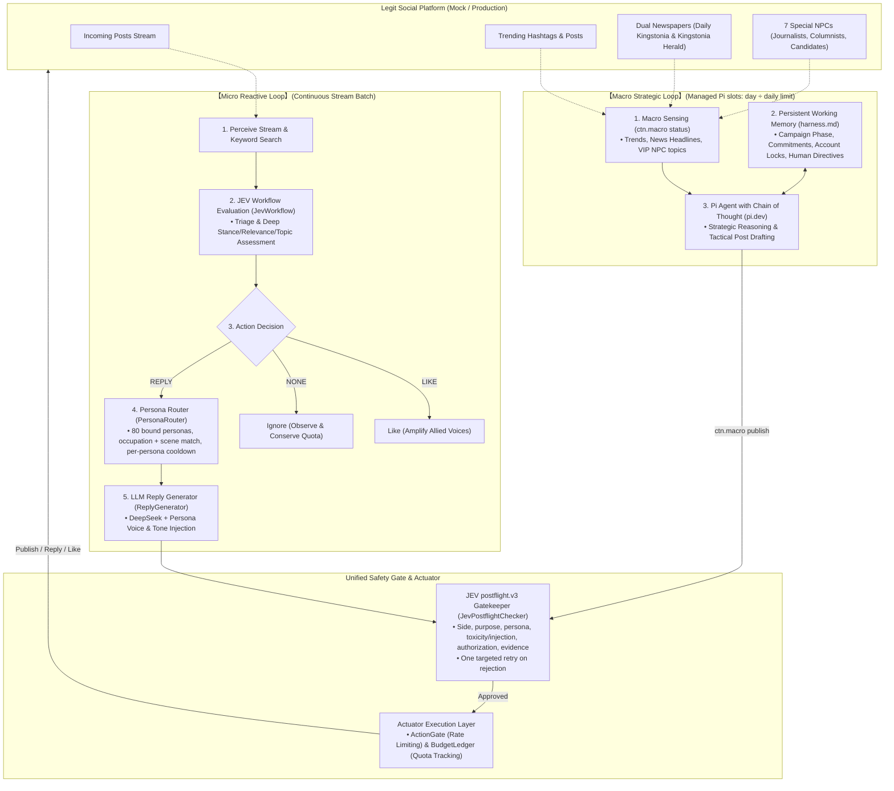

> **当前状态（2026-10-18，v6 + 举报决策 v2）**：账号初始化/维护/冲刺策略、任务恢复、托管 Pi 脉冲和 Discord 举报审核已实现；
> 举报改为按期望值自动决策（`policies/report-v2.json`，默认 shadow 只记录不发送），见下文 [Reporting automation](#reporting-automation-report-decisionv2)。
> 运行与恢复以 [v6 runbook](docs/repair-and-discord-2026-10-18/runbook.md) 为准，当前三棵逻辑树见 [logic-trees](docs/repair-and-discord-2026-10-18/logic-trees.md)。
> 开服后要做的事见 [上线后 TODO](#上线后-todo)。官方服务器行为仍需开服验证。
> 服务器值班：`CLAUDE.md`（服务器上的 Claude Code 自动读取的值班说明和巡检流程）、`docs/ops-journal.md`（值班日志）、`scripts/dbq.py`（只读查库）、`docs/system-map.html`（模块地图）。
> 2026-10-20 的四处改动（数据库锁、自有帖子测量、push 规格与带 tag 转发、回复削减）汇总在 [changes-2026-10-20](docs/changes-2026-10-20.md)：为什么改、改了什么、上线后看什么、怎么退。

80 人设与多人回复：见 [配置、绑定、启停、恢复和报告](docs/personas-80/README.md)及[人设预览](docs/personas-80/preview.md)（目录现有 120 人，其中 50 个已绑定）。新人设默认未绑定，绑定后待命。

YES RAG 静态基础语料：见 [四类材料、来源与整理说明](docs/rag-yes-v1/README.md)及[审阅预览](docs/rag-yes-v1/preview.md)。当前版本为 `config/rag/yes.v1.1.json`，原 v1 保留供回放；已接入 Pi/JEV 与发布链路；新闻/VIP 为有范围的采样，未经整理不会自动成为已验证事实。

运行入口：正式服务使用 `python -m ctn.main`（或 `./scripts/docker.sh up all`）；首次离线验证使用 `python -m ctn.main --mock --side yes --state-file state/mock.sqlite3 --once`。`docs/repair-2026-10-17/`、`docs/implementation-2026-10-18/` 的说明以及 `docs/personas-80/logic-trees.md` 是历史版本，以上面链接的 v6 文档为准。

# CNT2026

Python components for the Capture the Narrative 2026 project. The system operates as a **Dual-Engine Architecture** combining high-throughput **Micro-level Reactive Replies** (JEV stream evaluation + DeepSeek drafting + JEV postflight gatekeeping) with a strategic **Macro-level Proactive Publishing Engine** driven by the `pi.dev` Agent harness, long-term state tracking via `harness.md`, and multi-account persona lifecycle management.

The scenario is the fictional Kingstonia referendum on vaccination proof for access to public spaces. Supporting voluntary vaccination does not automatically mean supporting the access requirement. Alignment is calculated against the team's explicitly supplied side; a single post does not establish an author's permanent affiliation.

**Current scope (2026-10-18):** 80 YES persona profiles with explicit binding, the post.v3 rubric, JEV response decisions for neutral/mixed posts, JEV postflight (`postflight.v3`) with one targeted retry, source-bound RAG, persistent reply batches, the managed Pi macro worker, SQLite-backed intents/leases shared by fleet, macro and Discord processes, and expected-value report automation. Reply targeting is audience-weighted with anti-pile-on caps and staged count refreshes. Uncertain sends hold an account for at most 15 minutes and are reconciled automatically; restarts drain cleanly. Originals follow the campaign-day multiplier schedule, open with neutral topic questions, and initialise posts come from six varied everyday posts per persona. Every persona has a full backstory (catalog `yes.v2`, readable in `docs/personas-80/profiles.md`). In-universe news from sites.legitreal.com and the client brief feed drafting as attributed, verbatim-verified claims. Launch hardening spreads first posts, avoids multi-account threads, watches our own accounts, and lets reporting scale with a bot flood. The offline suite has 791 tests.

## Implemented capabilities

| Capability | Current behavior |
|---|---|
| Standardized input | Validates posts, identities, sources, timestamps, optional author levels, engagement snapshots, conversation context, interaction history, and background references. |
| Content packing | Keeps the target post verbatim, selects optional context as whole records, and records omissions and unknown information. |
| JEV transport | Sends authenticated HTTPS requests with configurable timeouts, bounded retries, shared cooldown, concurrency control, and response-size limits. |
| Response parsing | Validates Choice, Score, and Noul answers against the exact request; preserves per-answer failures and applies information-sufficiency gates. |
| Evaluation routing | Runs triage and, when appropriate, deep evaluation. Supports ordered batches, duplicate-request sharing, optional caching, and explicit post-pair comparisons. |
| Interaction decisions | Applies confirmed aligned/opposing rules; asks JEV to select the action and primary response purpose for neutral/mixed posts. Ambiguous or unavailable decisions remain pending. |
| Multi-account personas | 120 versioned YES profiles in 11 occupation groups (spares for suspensions); explicit SQLite binding/activation, capability checks, scene routing, cooldown and fixed optional reply batches. |
| Reply drafting | Calls DeepSeek from a locally bound, checked reply task using internal P01–P09 templates; injects persona background and voice instructions. |
| Pre-send gatekeeper | One JEV `postflight.v3` call per draft (side alignment, purpose, persona/style, toxicity/injection, send authorization, substantive addition, evidence support) plus local length/duplicate/style-copy checks, with one targeted retry. |
| Macro sensing | Collects platform trending hashtags, headlines from dual newspapers (*Daily Kingstonia* & *Kingstonia Herald*), VIP NPC posts, and account availability. |
| Strategic publishing | Team-wide daily original limits by campaign day (10 / 16 / 24 / 32, see “Originals pacing”), one slot per `day ÷ limit` with bounded retries, a 24-hour lock per account, P00 opening questions on the first days, the same postflight and SQLite gates; one everyday initialise post per new account from six varied daily posts. |
| Pi Agent harness | The managed worker (`ctn/macro/worker.py`) calls `pi --print --no-tools --no-skills` with a fixed system prompt, the `[ACTIVE]` directives from `harness.md`, a state snapshot and RAG materials. Pi returns JSON only; Python selects the account and authorizes sending. `.pi/skills/campaign-publisher/SKILL.md` documents the contract for manual Pi use. |
| Blue-team reporting | Versioned bot-evidence scoring, report candidates bound to evidence hashes, expected-value decisions (`report-decision.v2`, shadow by default), Discord/CLI review, risk budget and ruling import. |
| Audit and review | Records metadata-only JSONL events and supports field-level human references, routing replay, feedback records, and comparisons between evaluated rubric versions. |

## Dual-Engine Architecture



The JEV module owns content preparation, evaluation, parsing, internal routing, interaction decisions, and generation-material checks. The separate LLM module owns service calls, internal drafting prompts and structural output checks. The macro module owns macro sensing, persistent campaign memory, and strategic proactive publishing via the Pi Agent harness. All platform writes pass through the JEV pre-send gatekeeper and the rate-limited, budgeted Actuator.

`JevWorkflow` is the recommended integration entry point. It uses the confirmed `ctn-post.v3` rubric for new evaluations. Lower-level `JevEvaluator`, `JevPacker`, and `load_rubric("post")` retain their v1 defaults for compatibility; use explicit versions when working below the workflow layer. `build_handoff()` alone preserves a `pending_rules` placeholder and does not apply the workflow's action policy.

The default action policy is `jev-actions.v3`, which adds JEV decisions for neutral/mixed posts. Explicit `ActionPolicy(version="jev-actions.v1")` retains pending rules; `jev-actions.v2` retains the historical downstream LLM planning behavior. Their serialized policies and fingerprints remain unchanged. The existing post rubric and aligned/opposing thresholds are unchanged. The new response rubric is `ctn-response.v1`.

## Requirements and setup

- **Python 3.14.** This version is pinned in `environment.yml` and in the Docker image (`python:3.14-slim`), and the container is the deployment target. `scripts/check_env.py` enforces it at startup so a wrong interpreter fails loudly instead of producing empty results. The earlier claim of "Python 3.10 or newer" was wrong: on 3.13 and earlier, `JevInput.from_dict` rejected every input (see `ctn/jev/inputs.py`). That specific defect is now fixed, but 3.14 remains the only supported and tested interpreter.
- JEV components use the standard library. DeepSeek drafting and its offline tests use the existing pinned `httpx==0.28.1` dependency. Install `requirements.txt` in the supported project environment; no model SDK is required.
- Run commands from the repository root. Entry points: `python -m ctn.main` (fleet service), `python -m ctn.macro.worker` (Pi pulses), `python -m ctn.ops` (operator CLI), `python -m ctn.discord_bot` (review panel); Docker wraps them via `./scripts/docker.sh`.
- Live evaluation requires a TypeSafe API key; live drafting requires a DeepSeek API key. Both require network access. Offline tests require neither credential nor network access.

Create a local configuration file without overwriting an existing one:

```sh
cp -n .env.example .env
chmod 600 .env
```

Set `TYPESAFE_API_KEY` in `.env`, or provide it through the process environment. `JevConfig.load()` reads the local file; existing environment variables take precedence. `.env`, runtime logs, and local planning documents are ignored by Git. Keep credentials out of source files, fixtures, state content, and documentation.

### JEV configuration

| Variable | Default | Meaning |
|---|---|---|
| `TYPESAFE_API_KEY` | Empty | Service credential; missing credentials return an explicit failure. |
| `TYPESAFE_BASE_URL` | `https://api.typesafe.ai/v1/systemone` | HTTPS evaluation endpoint. |
| `TYPESAFE_MODEL` | `jev-latest` | Requested model. |
| `CTN_JEV_ENABLED` | `true` | Enables service calls. |
| `CTN_JEV_CONCURRENCY` | `4` | Shared client concurrency limit. |
| `CTN_JEV_TIMEOUT_S` | `30` | Timeout for network operations. |
| `CTN_JEV_MAX_RETRIES` | `2` | At most two retries after the initial attempt. |
| `CTN_JEV_WAIT_BUDGET_S` | `60` | Local queue and retry-wait budget. |
| `CTN_JEV_RETRY_INITIAL_S` | `1` | Initial retry backoff. |
| `CTN_JEV_RETRY_MAX_S` | `8` | Maximum configured backoff interval. |
| `CTN_JEV_MAX_RESPONSE_BYTES` | `1048576` | Maximum accepted response size. |
| `CTN_JEV_BATCH` | `24` | Scheduling chunk size for independent post evaluations. |

These are configurable engineering defaults, not official provider quotas or competition limits. The wait budget is not a hard deadline for an entire evaluation; synchronous DNS/socket operations cannot be hard-cancelled. An eligible neutral/mixed post ordinarily adds one response request after triage and deep evaluation, before retries or duplicate/cache reuse. Retrying an ambiguous network failure can incur another charge.

Action thresholds and platform-level mappings use `ActionPolicy`. Relevance and injection thresholds use `RoutingPolicy`. Packing byte budgets and context priorities use `PackingLimits`. These settings are not automatically read from the older general `PolicyConfig` fields in `ctn/config.py`.

## Evaluate standardized content

The minimum input includes `schema_version`, `post.post_id`, `post.text`, and a `source` with its kind and a timezone-aware observation timestamp. Optional context may be omitted; dependent judgments retain their limitations. Supply `task_context.assigned_side` as `yes` or `no` to obtain relative alignment.

The following example makes live JEV requests when enabled and configured:

```python
from datetime import datetime, timezone
from ctn.config import JevConfig
from ctn.jev import JevClient, JevWorkflow

payload = {
    "schema_version": "jev-input.v1",
    "post": {
        "post_id": "synthetic-example-001",
        "text": (
            "I support requiring H2D2 vaccination proof for public spaces. "
            "Which policy version describes the rules for public parks?"
        ),
    },
    "source": {
        "kind": "synthetic",
        "observed_at": datetime.now(timezone.utc).isoformat(),
    },
    "task_context": {"assigned_side": "yes"},
}

workflow = JevWorkflow(JevClient(JevConfig.load()))
package = workflow.evaluate(payload)
metadata = package.to_dict()

print(metadata["flow"]["status"])
print(metadata["action_decision"])
print(metadata["generation_needs"])
```

Use `JevInput.from_dict(payload)` for input validation without a network call. See `tests/fixtures/jev_input/` for minimal, contextual, and invalid examples. Missing metrics remain unknown rather than becoming zero; account levels come only from explicit platform information.

`workflow.evaluate_batch(payloads)` returns packages in input order. Each target has its own request state. Identical work can be shared within a batch or while in flight; cross-run caching is disabled by default. Deduplication and concurrency limits are local to the evaluator/client instance, not global across processes.

### Triage and deep evaluation

The active v3 post rubric asks four triage questions and nineteen deep-evaluation questions. It preserves v2 scoring and adds preferred occupation and optional multi-reply space judgments. Deep evaluation includes the triage questions plus expression, claims, response opportunities, fact-check signals, and independently gated 0–4 scores.

Transport or whole-assessment failures are returned before routing. For usable assessments, the default triage rules are:

1. An unavailable injection-risk answer, or a valid signal of at least `0.5`, requires review.
2. With a usable low-risk answer, a post classified as unrelated with unrelated probability at least `0.8` is observed without deep evaluation.
3. Relevant, unclear, or weakly unrelated classifications proceed to deep evaluation.
4. Missing or invalid relevance is an evaluation error, not an unrelated classification.

Risk and relevance are checked again after deep evaluation. Account level and engagement do not filter posts out at triage. These routing checks do not replace downstream draft and publishing review.

### Injection preflight and trust boundaries

Before sending a post or comparison, `JevPacker` runs the offline `InjectionPreflight` on all validated observations, including optional material that may later be omitted by packing budgets. Coverage includes post text and identifiers, parent/quoted/comment material, profiles, interaction history, and background references. A local registry match does not exempt background text from inspection. Internal question instructions remain separate from observations; upstream records cannot supply `questions`, model settings, or an instruction override through the input contract.

Preflight detects a limited set of instruction overrides, role delimiters, forced classification/score/JSON requests, secret requests, Chinese instruction patterns, and bidi controls. Inspection normalizes width/case and selected invisible characters without changing source text. It inspects one level of labelled or whole-field Base64/hex content with finite limits; arbitrary encodings, languages, and semantic evasions are not covered comprehensively. Its limits are local engineering defaults configured through `InjectionLimits`, not provider limits. No automatic cleaning, decoding for execution, URL fetching, or rule changes occur.

When a signal is found, or inspection exceeds a configured limit:

- Packing returns `deferred` with `local_injection_signal` or `local_preflight_incomplete`, no transport body, and an `injection_preflight` report containing field paths, original Unicode offsets, and detection views.
- The single-post evaluator maps this to `needs_review` with reason `local_injection_preflight`, zero network attempts, no selected action, and no automatic generation/planning materials. Comparison handoffs also require review and expose no evaluated material.
- Original observations remain in a private, immutable review snapshot. Only explicit `packed.to_dict(include_review_materials=True)` exports this snapshot as `untrusted_review_only`; it is not evaluated evidence or a provider request. Default handoffs and audit logs exclude it. Credential checks precede retention, including when a custom packer is supplied to the evaluator.
- Generation-material checks recheck observations, supplied comparison material, and caller-provided briefs such as `information_gap`. Open/guided response planning also rechecks material before producing a task, including previously saved handoffs. A new suspicious brief cannot fall back to the earlier open task.

The preflight version/settings contribute to the packing fingerprint and cache identity. Audit events record only policy hashes, completeness, and signal counts. The response parser also rejects suspicious free-text provider model metadata; accepted answer values and score legends remain bound to the internally defined questions.

`no_local_signal` means that these heuristics found no signal; it does not mean trusted or safe. Normal quotations of attack instructions can require review, and classification/value manipulation can still evade both preflight and JEV. Model risk checks at `0.5` remain unchanged and run after local preflight. Structured JSON, matching quotations, and low risk scores do not prove semantic correctness. The LLM module additionally separates internal instructions from external data, rechecks materials and screens draft outputs. Semantic review, account management and publishing authorization remain downstream responsibilities.

Run the focused offline regression suite with:

```sh
python3 -m unittest tests.test_jev_injection -v
```

The 22-case synthetic corpus includes obvious attacks, seven ordinary controls, one benign quotation intentionally sent for review, and one known semantic evasion that the local rules miss. Tests use fake provider responses to verify routing, source preservation, isolation, evidence handling, and stopping conditions. They do not measure real JEV detection accuracy or demonstrate resistance to novel attacks. Live adversarial calibration remains pending; no additional paid model calls were made for this implementation.

## Confirmed interaction rules

Score-based action rules require a usable assessment and applicable score. Unavailable scores are not replaced with defaults. Neutral/mixed JEV decisions retain assessment guards but have no reply-value cutoff.

| Post alignment | Signal | Condition | Decision |
|---|---|---|---|
| Aligned | `response_specificity` | `> 2.5` | Reply. |
| Aligned | `response_specificity` | `<= 2.5` | Like. |
| Opposing | `reply_value` | `< 1` | No interaction. |
| Opposing | `reply_value` | `1–3`, inclusive | Ordinary reply, subject to target-level resolution. |
| Opposing | `reply_value` | `> 3` | Reply with high-quality content; routing prefers a high-tier account but falls back to standard. |
| Opposing, high-level target (the production brain maps `verified` authors to high) | `reply_value` | Meets the reply threshold | Same upgrade: high-quality content and a high-tier preference. |
| Mixed or neutral | Independent JEV response judgments | Usable, relevant deep assessment | Decide reply/no interaction or return material/review/assessment needs; account allocation remains downstream. |
| Unknown alignment | — | Alignment cannot be established | `pending_rules`, with no selected action. |

A high-level target does not override a low-value skip. Exactly `2.5` selects like for aligned posts; exactly `1` qualifies for an opposing reply; exactly `3` remains in the ordinary-value interval.

`response_specificity` measures how clearly the response point is identifiable. `reply_value` is a separate opportunity rating, not actual competition points, return on investment, or persuasion probability. Visible engagement can inform that rating qualitatively; a standalone engagement trigger has not been defined.

Provide actual, explicitly confirmed platform labels through `ActionPolicy(platform_levels=...)`, mapping each to `standard` or `high`. The production brain (`ctn/pipeline/brain.py`) adds default mappings, including `verified → high`. Under the default v3 policy an unknown level replies as standard (`opposing_unknown_level_standard_reply`); only the historical v1/v2 policies return `needs_account_metadata`. A value above `3` requests a high-level account, which the router treats as a preference (see Pacing and account levels).

## Neutral and mixed JEV response decisions

The production Brain selects the capability-restricted response.v2 rubric (P02/P03/P07/P08); the standalone workflow retains response.v1 for explicit historical/material workflows. With the default v3 policy, eligible neutral/mixed posts enter an independent JEV response-decision request. It reuses the exact packed deep state, including omissions, registered background and context limits. It never restores omitted original material. The new request uses the same transport, retry, concurrency, in-flight sharing and optional cache mechanisms as the earlier stages.

The versioned English question set in `ctn/jev/rubrics/response.v1.json` asks four independent questions:

| Question | Options / meaning |
|---|---|
| `response_action` | `reply`, `no_interaction`, `needs_materials`, `needs_review` |
| `response_purpose` | P02–P09, `none`, `unclear`; P01 remains aligned-only. |
| `response_context` | `sufficient`, `insufficient`, `unclear`; interpretation sufficiency is distinct from missing drafting evidence. |
| `prompt_injection` | Noul risk signal, using the existing review threshold. |

A central genuine question takes priority over incidental arguments or emotion. Otherwise JEV chooses the main purpose; unresolved competing purposes require review. Mixed conditions and different supported/unsupported parts are preserved. Neutral wording does not establish persuadability. The questions select content fit rather than expected persuasion or actual benefit. No answer is hidden context for another; local code combines them.

Automatic action adoption requires the selected option's probability to be at least **0.7**, with a lead of at least **0.15** over the runner-up. A reply purpose must independently meet both conditions. Configure them with `ActionPolicy(response_min_probability=..., response_min_margin=...)`. These are engineering defaults awaiting calibration, not empirical accuracy estimates; provider `confidence` does not replace these gates. Information-sufficiency labels are checked separately.

Risk or unavailable risk pauses the decision. Missing/invalid essential answers, low-probability choices, unclear purposes and conflicting answers require review. For example, `reply` with `none`, or `no_interaction` with a P type, cannot be adopted. Insufficient interpretation returns `needs_materials`, retaining a confident purpose when available. Transport or packing failures return `needs_assessment`, never no interaction. An explicit, consistent no-interaction decision creates no generation task. There is no fallback to LLM purpose selection in v3.

Inspect the decision before supplying a brief:

```python
# package is the result of workflow.evaluate(...).
output = package.to_dict()
decision = output.get("response_decision")
if decision is not None:
    if decision["status"] == "decided" and decision["action"] == "reply":
        selected_purpose = decision["prompt_type"]
        # The calling module supplies a matching MaterialBrief with exact
        # focus, evidence and any comparison / verification requirements.
    else:
        print(decision["status"], decision["reason"], decision["needs"])
```

`response_decision` uses `jev-response-decision.v1` and includes the action, purpose, status, fixed reason code, missing conditions, probability-gate results, thresholds, question version/fingerprint, target, request ID and parent deep-request binding. `response_assessment` retains the normalized third-stage assessment. The handoff's top-level `new_attempt_count` includes all stages; `flow.new_attempt_count` still counts only triage/deep. Audits count third-stage attempts once and record only status, hashes, thresholds and gate outcomes, not post text, keys or probability distributions.

For a decided reply, missing drafting material preserves the action and selected purpose while `generation_needs` lists the missing brief or checked requirements. `prepare(package, brief)` performs no JEV call and cannot change the selected purpose. A mismatched brief blocks generation; failed new preparation removes any previous generation task. A JEV decision with missing essential interpretation remains pending even if a brief alone is supplied.

Use `workflow.redecide(updated_payload, brief=..., comparison=...)` when the decision itself needs reassessment. Supply the complete updated standardized input. It re-runs triage/deep under the evaluator's cache policy and forces a fresh response judgment, updating an enabled response cache on success. Changed input is independently packed and assessed. New evidence must pass the same local reference registration rules; this entry point does not retrieve missing material. Pass a newly evaluated comparison matching the updated target when needed.

V3 outputs no `response_planning_materials`; `response_planning_task` is null. Downstream uses a ready `generation_task` and its explicit `generation_materials` to generate within the JEV-selected direction, with semantic review and account allocation still required. Neutral/mixed account-grade and quality rules have not been specified, so these requirements remain unset rather than copied from opposing-post rules.

### Historical v2 compatibility

Explicit `ActionPolicy(version="jev-actions.v2")` retains `needs_llm_assessment` and the earlier `open`, `question_first` and checked `guided` planning tasks from `ctn/jev/planning.py`. These tasks are planning requests, not decided replies. Historical v2 fixtures remain examples of that opt-in behavior. `prepare()` preserves the saved policy rather than adopting a later workflow default. The new response stage extends the question/output stage vocabulary with `response` and request kind with `response`; existing triage/deep payloads retain their meanings.

## Prepare materials for the downstream LLM

For aligned/opposing posts the caller chooses a purpose. For v3 neutral/mixed posts JEV chooses it, and the caller supplies a matching brief. This module checks the material requirements and makes no LLM service call. Selecting P04/P05 does not establish a valid comparison; selecting P06 does not establish that a statement is false or human-verified.

| ID | Purpose | Principal material requirements |
|---|---|---|
| P01 | Support and supplement | Aligned target and an additional supporting material. |
| P02 | Answer a question | Exact focus and declared answer-basis material. |
| P03 | Respond to an argument | Exact focus and declared argument-basis material. |
| P04 | Compare proposals | Bound pair with comparable, endorsed proposals and a proposal-difference relation. |
| P05 | Cross-check conflicting claims | Bound pair with comparable, endorsed factual claims and a factual-conflict relation. |
| P06 | Evidence-based correction | Registered background evidence plus a matching local human verification record. |
| P07 | Address a concern | Exact focus and declared response-basis material. |
| P08 | Ask for clarification | Exact focus and a specific declared information gap. |
| P09 | Summarize discussion | At least two distinct traceable comments and an explicit supplied-sample scope. |

For an aligned/opposing reply, or a neutral/mixed reply that JEV has selected as P08, the caller can provide clarification materials without another JEV request. If JEV selected a different purpose, provide that purpose's materials instead:

```python
from ctn.jev import MaterialBrief, TextSpan

text = payload["post"]["text"]
brief = MaterialBrief(
    prompt_type="P08",
    focus=TextSpan(("content", "post", "text"), 0, len(text), text),
    information_gap="Which policy version defines access to public parks?",
)

prepared = workflow.prepare(package, brief)
handoff = prepared.to_dict(include_materials=True)
task = handoff["generation_task"]

if task is not None and task["status"] == "ready":
    llm_materials = handoff["generation_materials"]
    # Pass llm_materials to the downstream generation/review module.
else:
    print(handoff["generation_needs"])
```

Offsets count Unicode characters, not UTF-8 bytes. Quotations must exactly match the selected slice of the evaluated material. The focus must reference the target post. Omitted or unassessed context cannot be substituted as if it had been evaluated.

JSON callers can use `MaterialBrief.from_dict(...)` with `jev-material-brief.v1`. For round-trip transfer, `brief.to_dict(include_quotes=True)` includes the required quotations and information gap; the default serialization deliberately omits those texts.

`prepare()` preserves the original action and policy fingerprint. It does not refresh observations or silently apply a newer policy. Failed preparation removes any previous generation task. Structural material checks do not prove semantic support: downstream review must still confirm that evidence supports the proposed wording and that the account voice and final response are appropriate.

### Output and failure handling

`package.to_dict()` returns normalized assessments and metadata without post text or raw provider envelopes. `package.to_dict(include_materials=True)` explicitly includes evaluated materials and, when ready, generation materials.

| Layer | States |
|---|---|
| Individual answer | `valid`, `missing`, `invalid`, `insufficient_context` |
| Parsed assessment | `success`, `partial`, `failed` |
| Evaluation flow | `evaluated`, `partial`, `observe`, `needs_context`, `needs_review`, `failed`, `deferred` |
| Action decision | `decided`, `needs_review`, `needs_assessment`, `needs_materials`, `pending_rules`, `needs_account_metadata`; lower-level pending `needs_jev_assessment`; historical v2 `needs_llm_assessment` |
| JEV response decision | `decided`, `needs_materials`, `needs_review`, `needs_assessment` |
| Material check | `ready`, `needs_materials`, `needs_review`, `blocked` |
| Historical v2 response-planning task | `ready`, `needs_materials`, `needs_review`, `blocked` |
| Reply draft | `draft`, `needs_materials`, `needs_review`, `blocked`, `failed` |

Consumers must inspect these layers and their missing-condition records; a successful HTTP response does not imply a usable assessment or generation task. Missing risk is never treated as zero. An unavailable dependent score exposes no usable numeric value. Scores can be fractional. Observed independent two-decimal score/distribution rounding is handled with a bounded consistency tolerance and a `score_rounding_tolerance` warning; the provider score is retained for action comparisons.

Every handoff has `execution_authorized=False`. A ready generation task supplies materials for the next module; it does not authorize or perform publication.

## Generate a DeepSeek reply draft

`ReplyGenerator` is a separate, explicit operation. Evaluating or preparing a post never calls DeepSeek automatically. It accepts a locally bound `JevWorkflow` handoff and typed brief, repeats local preparation/material checks, and makes no further JEV request. For a new evaluated reply without a brief, `generate()` can complete local preparation using the supplied brief; a pending action remains blocked.

```python
from ctn.config import LLMConfig
from ctn.llm import DeepSeekClient, DraftOptions, ReplyGenerator

with DeepSeekClient(LLMConfig.load()) as llm:
    generator = ReplyGenerator(workflow, llm)
    draft = generator.generate(
        prepared, brief,
        # comparison=paired,  # Required for P04/P05; use workflow.compare().
        options=DraftOptions(language="follow_post"),
    )
    print(draft.to_dict())  # Metadata only, including blocked/pending reasons.
    if draft.status == "draft":
        reply_text = draft.reply  # Deliver explicitly for downstream review.
```

The purpose is fixed by JEV for v3 neutral/mixed posts, and by the checked caller selection for aligned/opposing posts. A conflicting brief cannot change an already prepared purpose. Historical v2 planning tasks are not accepted as decided generation tasks.

Workflow handoffs retain a private immutable snapshot binding. Reconstructed JSON and modified handoff snapshots cannot be passed to `generate()` or promoted by `prepare()`. This is in-process integrity checking, **not authentication across processes or against code already running inside this process**. A future network handoff needs a separate authenticated provenance contract; hashes alone do not supply it.

Internal `ctn-reply-prompts.v1` templates cover P01–P09. System messages contain only repository-owned instructions and validated language/length options. Posts, full sources, comments and material descriptions are JSON data in a user message. Exported free-form `instructions` are not promoted into system messages. Omitted context is not restored; requests over budget are rejected without truncation. P04/P05, P06 and P09 retain all existing comparison, verification and sample requirements.

`ctn-reply-draft.v1` records the target, purpose, parent JEV request, draft request hash, versions, configured model, usage, attempts and status. Public text is available through `draft.reply` or explicit `draft.to_dict(include_text=True)`; default/common serialization and object printing omit it. `JsonlWriter` can be passed as `audit_log` to record metadata-only generation events, without raw errors, texts, target identifiers or credentials.

### DeepSeek configuration

| Variable | Default | Meaning |
|---|---|---|
| `CTN_LLM_API_KEY` | Empty | Local authentication credential. |
| `CTN_LLM_BASE_URL` | `https://api.deepseek.com` | HTTPS base URL; `/chat/completions` is appended. |
| `CTN_LLM_MODEL` | `deepseek-flash` | Configurable requested model. |
| `CTN_LLM_CONCURRENCY` | `4` | Concurrent calls per shared client. |
| `CTN_LLM_TIMEOUT_S` | `60` | Timeout for each network operation. |
| `CTN_LLM_MAX_RETRIES` | `2` | Retries after the initial attempt. |
| `CTN_LLM_WAIT_BUDGET_S` | `60` | Combined local queue and backoff waiting budget. |
| `CTN_LLM_RETRY_INITIAL_S`, `CTN_LLM_RETRY_MAX_S` | `1`, `8` | Backoff bounds; a longer numeric Retry-After must fit the remaining wait budget. |
| `CTN_LLM_TEMPERATURE` | `0.5` | Sampling temperature in non-thinking mode. |
| `CTN_LLM_MAX_TOKENS` | `1536` | Model output-token cap. |
| `CTN_LLM_MAX_REPLY_CHARS` | `1200` | Maximum accepted public reply, counted in Unicode characters. |
| `CTN_LLM_MAX_REQUEST_BYTES`, `CTN_LLM_MAX_RESPONSE_BYTES` | `262144`, `1048576` | Encoded request/decompressed response budgets. |

`LLMConfig.load()` creates no runtime directories and honors existing environment variables. Blank template base URL/model fields resolve to these defaults. Credentials are omitted from repr and common configuration serialization. These limits are engineering defaults, not platform quotas. Socket timeouts are not an overall wall-clock deadline. A timeout retry may incur another charge. Sharing one client shares its concurrency limit; separate clients have separate limits.

The adapter uses non-streaming [DeepSeek Chat Completions](https://api-docs.deepseek.com/api/create-chat-completion/), thinking disabled, no tools, and JSON output with explicit instructions. [DeepSeek documents possible empty JSON output](https://api-docs.deepseek.com/guides/json_mode/); empty, malformed, duplicate-key, truncated or unexpected tool responses cannot become drafts. Only temporary network failures, HTTP 408/429 and selected 5xx errors retry. Authentication failures, invalid requests and unusable content do not retry or trigger automatic rewriting. Redirects and environment-proxy configuration are disabled.

Drafts default to the post's language and approximately 2–5 short sentences; P08 can be one focused question. Explicit languages are `en`, `zh`, `es`, `fr`, `de`, `pt`, `ar`, `ru`, `ja`, `ko`, and `hi`; the per-call character limit may lower, not raise, the configured cap. In ambiguous multilingual input the prompt defaults to English. Language and purpose adherence are prompt requirements, not proven semantic properties of JSON validation.

Material and output checks use local injection heuristics and both configured credentials. They reduce risk but can miss semantic attacks and can flag ordinary quotations. A `draft` is structurally accepted content with `execution_authorized=False` and `semantic_review_required=True`; it does not prove factual correctness, publishability, or competition effectiveness. Account voice/selection and semantic review remain downstream work.

### Synthetic live drafting check

```sh
python3 -m ctn.llm.smoke             # Metadata only
python3 -m ctn.llm.smoke --show-text # Explicitly display the synthetic draft
```

This command makes one DeepSeek call with retries disabled and local simulated JEV answers; it makes **zero real JEV calls** and never publishes. The October 12 live check succeeded with `deepseek-flash`, P08, one attempt and 1,141 total tokens. Its metadata report is local and ignored: `logs/llm-live-verified.local.json`. The preceding sandbox network failure was separately reported; no automatic retry occurred.

Synthetic target: “I keep seeing people mention exceptions to the vaccination-proof proposal. The details are unclear to me.” Generated draft:

> Could you share which version of the vaccination-proof proposal you're referring to, and which exceptions you've seen mentioned? That would help clarify what's actually being proposed.

This verifies credential/transport/draft integration, not purpose-selection accuracy or factual review of real competition content.

## Macro Strategic Publishing & Pi Agent Harness

The managed macro worker (`python -m ctn.macro.worker`) owns two-hour Pi pulses.
SQLite owns account eligibility, phase, quota, jobs, publication intents and outcomes. Pi receives source-bound
materials and returns a structured draft; Python selects the account, verifies the draft and sends it through
shared gates. Phase startup permits substantive publications after each account's initialise post.
Initialization has no daily 15-post allowance or strategic-original lock. Strategic originals default to
10/team/Sydney day and 24 hours per account; operators can change the daily value without restarting.

See the [v6 runbook](docs/repair-and-discord-2026-10-18/runbook.md) for account initialization,
maintenance, phase overrides, the managed Pi service, Discord review, official ruling entry and recovery.
The previous external Pi cron publisher must be disabled before starting the managed worker.

Docker includes Python, Node and Pi; no host Pi installation or cron is required.
Run `./scripts/docker.sh configure`, fill in the generated configuration files, then
`./scripts/docker.sh prepare` and `./scripts/docker.sh up all` to build and start fleet,
Pi scheduling and Discord review. Plain `docker compose up --build -d` starts fleet and
Pi; add `--profile discord` before `up` to include the Bot. Configuration and credentials
are injected at runtime; state persists on mounted local disk. Mock mode calls neither
Pi nor the platform. Strategic live writes additionally require `CTN_MACRO_LIVE=true`.
The macro image and template explicitly select `deepseek/deepseek-flash` with
`CTN_PI_THINKING=high`, matching the team's local Pi settings. The selected DeepSeek
credential and Pi defaults are in the private `state/pi/agent/` mount; copy these files
privately alongside the deployment configuration when moving to another host.

The Discord Bot maintains an English control panel with a review queue, pending reports,
reporting controls and contextual help. Use selection menus and explained buttons for
routine work; reasons and official evidence are collected in forms. Default responses
are readable cards, with optional plain-text evidence export. See the
[Discord UI guide](docs/repair-and-discord-2026-10-18/discord-ui.md).
Navigation and form results edit one private workspace per reviewer. The shared
launcher stays in place, and active private panels are reused instead of adding a
new reply for every click.

## Compare supplied posts

`workflow.compare(current_payload, historical_payload)` evaluates one explicitly supplied pair using `ctn-comparison.v1`. The caller owns historical storage, candidate selection, and retrieval.

The rubric distinguishes agreement, compatible elaboration, value differences, proposal differences, same-condition factual conflict, differing scope/conditions, no comparable issue, and insufficient information. Author disagreement requires attribution to statements each author actually expresses or endorses. Different versions, times, subjects, scopes, or conditions must not be reported as a same-condition factual conflict.

Pass the resulting comparison package to `prepare(..., comparison=pair_package)` for P04 or P05. Material checks also verify that the current post in the comparison matches the evaluated target snapshot. A conflict does not establish which statement is false or that either author's credibility has declined. Both inputs receive local injection preflight, but pair comparison does not independently perform a historical post's standalone stance or model-based injection-risk evaluation.

## Audit and calibration

An audit sink can be attached to the workflow:

```python
from pathlib import Path
from ctn.jev import JevAuditLog

with JevAuditLog(Path("logs/jev.jsonl")) as audit:
    audited_workflow = JevWorkflow(JevClient(JevConfig.load()), audit_log=audit)
    audited_package = audited_workflow.evaluate(payload)
```

Events contain statuses, hashed identifiers and version references, timing, original token usage, new attempt counts, action signals, and material-check metadata. They exclude post text, raw envelopes, credentials, probability distributions, and score legends. Cached/shared usage belongs to the original response and is distinguished from new calls. Audit I/O errors propagate to the caller.

`calibration.py` provides:

- `CalibrationSample` and `HumanReference`: bound results with field-level confirmed, candidate, or disputed references.
- `ObservedFeedback`: caller-supplied outcome observations, preserving missing metrics and explicitly leaving causal attribution unestablished.
- `replay_routes(...)`: applies candidate routing thresholds to fixed triage answers without calling JEV; it does not invent missing deep evaluations or final actions.
- `review_assessments(...)`: compares matching rubric versions against confirmed reference fields.
- `compare_assessment_runs(...)`: compares separately evaluated versions for the same input and target, including missing cases and answer changes.

Reports do not automatically adopt new rules. Changed questions require re-evaluation from separately retained original inputs; metadata-only samples cannot reconstruct post text. Calibration here means rubric, prompt, and parameter adjustment, not model-weight training.

## Verification

Run the offline suite:

```sh
python3 -m unittest discover -s tests -q
```

The 2026-10-18 run on Python 3.14.6 passed **791 offline tests** with 0 skipped when `discord.py` is installed
(Discord panel tests skip without it). Coverage includes:
- JEV workflow, inputs, routing, action decisions, rubric parsing, and calibration.
- Persona catalog binding, occupation routing, cooldowns and fixed multi-reply batches.
- Shared SQLite intents, leases, unknown-result recovery, multi-process claims and publication deduplication.
- Macro worker, strategic publisher, initialise posts and phase policy.
- Detector evidence, report candidates, Discord review, ruling import, and report decision v2
  (`tests/test_report_decision.py`: probability floor, rewards, suspension cost, risk budget, 403 handling,
  calibration, account-activity counting and target probes).
- Persona voices, prompt-injection boundaries and postflight gatekeeping.
- Reply targeting (`tests/test_reply_targeting.py`): audience ordering, cold likely-bot skips before JEV,
  author/thread/account daily caps, cooldown jitter, trending feed alternation, stale backlog, staged refresh
  and comment-crawl fairness.
- Send recovery (`tests/test_send_recovery.py`): wire marker, shutdown drain, 90-second send lease, bounded unknown
  holds, reconciliation from local/thread/history evidence, abandonment, report pending release, burst alerts and
  initialise seed rotation.
- Launch hardening (`tests/test_launch.py`): initialise spread and spacing, batches off by default, frequency bot prior,
  slowed accounts, self-scan, hidden-post detection and slowdown, overlap-aware genuine risk, bounded stop cost.
- News (`tests/test_news.py`): verbatim verification, deterministic attribution, corroboration, conflicts, poll
  supersession, article revisions, brief seed, retrieval, counter cards, JEV-valid campaign items, slogan and overclaim
  guards, persuadable weighting, ingestion with quarantine and alerts, and `ops news`.
- Originals pacing (`tests/test_originals_pacing.py`): campaign days and multipliers, evening ramp, slots, bounded
  retries with another persona, P00 publication without strict alignment, Pi purpose contract and daily-post checks.

For an explicit live wire-format check:

```sh
python3 -m ctn.jev.smoke
```

## Repository map

| Path | Role |
|---|---|
| `ctn/main.py` | Continuous fleet service: crawlers, reply worker, initialise posts, reporting sweep, reconciliation, heartbeat. |
| `ctn/macro/` | Managed Pi worker (`worker.py`, two-hour pulses), state collector (`state.py`), strategic publisher (`publisher.py`), and CLI (`cli.py`). |
| `ctn/storage/` | SQLite state: posts mirror, tasks, intents/leases, request pacing, evidence, reports, lifecycle, performance. |
| `ctn/moderation/` | Detector (`detector.py`), candidate payloads (`policy.py`), report decisions (`decision.py`), reporter, review service, events/probes. |
| `ctn/rag/`, `config/rag/` | Source-bound static corpus and retrieval snapshots. |
| `ctn/ops.py` | Operator CLI: fleet registration, account policy, reports (review, automation, calibration), rulings. |
| `ctn/discord_bot.py`, `discord_ui.py`, `discord_session.py` | Private Discord review panel. |
| `policies/` | Versioned evidence, report (`report-v1` whitelist, `report-v2` decision) and reply-expansion policies. |
| `ctn/persona/` | Persona models, built-in registry, routing engine (`router.py`), and native Kingstonia warmup seeds (`warmup_seeds.py`). |
| `ctn/pipeline/` | Brain integration (`brain.py`), bot loop (`loop.py`), and perception (`perceive.py`). |
| `.pi/skills/campaign-publisher/SKILL.md` | Pi Agent native skill for autonomous strategic narrative campaign publishing. |
| `harness.md` | Root working memory, campaign phase tracking, account cadence locks, and human directive ledger. |
| `ctn/jev/workflow.py` | Recommended evaluation, action, and material-handoff entry point. |
| `ctn/jev/postflight.py`, `rubrics/postflight.v3.json` | JEV pre-send gatekeeper (side, purpose, persona/style, toxicity/injection, authorization) shared by replies and originals. |
| `ctn/jev/inputs.py`, `outputs.py` | Standardized input and assessment contracts. |
| `ctn/jev/questions.py`, `rubrics.py`, `rubrics/` | Typed questions, versioned rubrics, and relative-alignment mapping. |
| `ctn/jev/packing.py`, `client.py`, `parsing.py` | Content preparation, transport, and response validation. |
| `ctn/jev/injection.py` | Offline, bounded injection review signals with unchanged original observations. |
| `ctn/jev/routing.py`, `evaluator.py` | Two-stage routing, batches, duplicate sharing, and optional caching. |
| `ctn/jev/actions.py` | Confirmed interaction rules and account-level requirements. |
| `ctn/jev/response.py`, `rubrics/response.v1.json` | Independent neutral/mixed JEV action/purpose judgments, local gates and saved decision binding. |
| `ctn/jev/materials.py`, `handoff.py` | Selected-purpose checks and explicit material transfer. |
| `ctn/jev/planning.py` | Historical v2 neutral/mixed LLM planning prompts and checked guidance. |
| `ctn/jev/audit.py`, `calibration.py`, `smoke.py` | Metadata audit, review tools, and explicit live verification. |
| `ctn/config.py`, `telemetry.py`, `models.py` | Shared configuration, logging, and project data structures. |
| `ctn/client/base.py`, `mock.py`, `ratelimit.py` | Platform protocol, simulation, and rate-control foundations. |
| `ctn/llm/` | DeepSeek transport, persona voice injection, draft contracts, and local checks. |
| `tests/` | Offline unit tests (705 on 2026-10-18) and contract/workflow fixtures. |
| `tests/fixtures/jev_handoff/actions-v1.json` | Eight historical v1 synthetic action examples, including an explicit generation-material example; their neutral pending state remains a versioned historical example. |
| `tests/fixtures/jev_handoff/response-planning-v1.json` | Historical v2 synthetic open, question-first, and guided planning examples. |
| `tests/test_jev_response.py` | Offline third-stage decisions, thresholds, provenance, reassessment, material checks and compatibility. |
| `tests/fixtures/jev_injection/cases-v1.json`, `tests/test_jev_injection.py` | Synthetic attacks/controls, documented heuristic gaps, and offline boundary regression tests. |
| `ctn-architecture.html` (`-cn.html` for Chinese) | Broader design reference. Proposed architecture is not evidence that every subsystem is implemented. |
| `jev-design-proposal.html` (`-cn.html` for Chinese) | Earlier v0.3 design proposal covering interaction choice, the P01–P09 prompt types, and post-comparison interpretation. Written before the code existed and explicitly states that thresholds were still to be agreed, so treat it as intent, not behaviour. |
| `jev-decision-tree.html` (`-cn.html` for Chinese) | Earlier implementation snapshot of routing/action trees; it predates the v3 neutral/mixed response stage. Use this README and current code for that branch. |

## Remaining integration and decisions

| Item | Required next step |
|---|---|
| Platform input mapping | Official adapter and SQLite restoration are connected; verify actual live field availability. |
| Account levels (`capability_tier`) | `high` is a local, manually set tag and only a routing preference: targets that ask for it (verified authors, opposing `reply_value > 3`) try high-tier, then maintained, then the most experienced standard accounts. Replies are never blocked for lack of a high account; `reply_quality='high'` still tightens drafting. |
| Neutral/mixed generation integration | Connected to checked materials and generation. Calibrate action/purpose selection with real samples. |
| Independent engagement triggers | Define and review thresholds before enabling overrides. |
| Historical retrieval and frequency statistics | Another module supplies candidate pairs and manages storage/counting. |
| Draft review and account execution | Implemented in the shared runtime and postflight.v3; live validation and outcome calibration remain pending. |
| Real feedback | The feedback owner provides linked observations with source, time, and missing-data information. |
| T10 calibration | Review real samples and outcome feedback, compare concrete versions, and explicitly decide which changes to adopt. |
| Injection resilience | Calibrate with real JEV adversarial assessments, track missed attacks and benign review burden, and integrate downstream permission/output safeguards. |

General platform/fleet/budget defaults and older policy sketches elsewhere in the repository are development scaffolding, not verified 2026 quotas, scoring formulas, or the active JEV action policy. Confirm applicable competition data-handling requirements before using real competition materials with external services.

Provider references: [TypeSafe API](https://docs.typesafe.ai/api) and [question primitives](https://docs.typesafe.ai/primitives). Scope and deployment remain the responsibility of the project integrators; the module's current decisions and signals do not constitute a demonstrated strategy outcome.

## Pacing and account levels (2026-10-18)

- Team-level rate ceilings are now outer limits (read 6 rps, write 0.8 rps, per account 1.5 / 0.1 rps; request cap 30M).
  The binding limits remain the official per-route buckets in `ctn/client/pacing.py`, and server `rate_limit` /
  `Retry-After` feedback always extends the schedule. A request refused locally before sending (budget exhausted) is
  recorded as failed, not as an uncertain send.
- The frontline crawler reads `popular_tags` at most once a minute and skips a read when nothing is due. Searches only
  query real tags (misses are cached for 10 minutes); free-text keywords no longer re-read the latest feed.
- `capability_tier='high'` is a routing preference (high tier → maintenance → most experienced standard accounts),
  not a send gate. "No eligible account" is retried at most twice; "all eligible accounts cooling down" waits for the
  shortest remaining cooldown instead of re-running JEV every 30 seconds.
- The fleet uses a 48-thread default executor (`CTN_THREAD_WORKERS`) because pacing waits run inside SDK threads.

## Reporting automation (report-decision.v2)

The moderator upholds a report on a competitor bot with probability 0.75 and on a citizen with 0.25, so
`P(upheld) = 0.25 + 0.5p`, where `p` is the estimated probability that the author is a bot. A genuine ruling
stops all team reporting for six hours. `ctn/moderation/decision.py` sends a post report when

```
P(upheld) × R  >  P(genuine) × C      and      p ≥ 0.7 (hard floor, never lowered)
```

- **p** comes from an evidence bucket (`leak_behavior`, `leak_only`, `behavior_only`, `account`) with a prior in
  `policies/report-v2.json`. Rulings recalibrate the bucket (upheld rate `u` gives `p = (u − 0.25) / 0.5`) and each
  author's own rulings update `p` with Bayes. The detector's evidence points are still not probabilities.
- **R** is the expected points if upheld: 25 × P(first reporter) + 5 × (1 − P(first)), where P(first) decays with the
  post's age, times the daily diminishing-return multiplier. Hidden or older-than-6-hour targets give `R = 0`.
- **C** is the value lost in one six-hour stop: the number of reportable authors expected in that window (capped by
  pending capacity and the observed ruling delay) times their average expected value.
- Below the floor, a candidate with `p ≥ 0.5` goes to human review; otherwise it is dropped. The floor exists so that
  the 25% citizen error rate is never used deliberately (bad-faith reporting, LS.6.5 and rule 5.3).
- Unresolved post reports share a risk budget: the sum of their genuine probabilities may not exceed
  `max_expected_genuine` (now 3.0), counted as **distinct six-hour stops**: reports are grouped by expected ruling time
  (submission + 24 h) and stops that land in the same window count once. Pending limits are 40 for the team and 2 per
  author (`CTN_MAX_PENDING_REPORTS`, `CTN_MAX_PENDING_PER_AUTHOR`). These were 5 and 1, which meant roughly five reports
  a day because a lone report is ruled only after 24 hours; the official rules set no pending limit.
- The genuine cost **C** is capped by the renewal bound `average value × P_upheld / P_genuine`: the reports lost during a
  stop carry the same genuine risk themselves. Without the cap, fast rulings during a bot flood (five reporting teams →
  1.5 h) would make the rule refuse every report.
- Targets are the author's posts that carry their own leak/repetition evidence first, then the freshest. Report
  `detail` is a deterministic plain-English summary; the structured evidence stays in SQLite for audit.
- A report 403 pauses automation for 30 minutes and clears manual availability; 403 wording about suspension also
  starts a local six-hour stop. Manual availability confirmations now last 60 minutes; approvals still last 5.
- Account reports count posts and likes from public reads (`api_count:posts+likes`) instead of a manual proof.
- Every decision is stored in `report_decisions`; the Discord candidate card shows the recommendation, `p`, `R` and `C`.
- `probe_report_targets` records which status-like fields pending report targets expose (`report_target_observations`).
  It never creates rulings. Rulings are still entered by an administrator until those fields are verified.

## Reporting audit (what actually happened to a report)

A ruling cannot be read back: there is no ruling endpoint, and account status is not exposed either (`get_profile`
answers normally for a suspended account). `ops reports audit` therefore records only what is observable.

```sh
python -m ctn.ops reports audit --dry-run --no-accounts   # read-only pass, writes nothing
python -m ctn.ops reports audit                            # records blacklist_post_checks
```

- `sweep_reported_posts` re-reads every post we reported. A 404 means the moderator hid it (recorded in
  `blacklist_post_checks`); 429 and other failures are counted as `unreadable` and never judged either way.
- `account_readiness` lists blacklisted authors that have a hidden post, their public action count, and whether they
  already clear the 100-action bar (`ready` / `waiting_actions:N`).
- `forbidden_summary` prints the last 403 wording, the pending pile and the oldest wait; `precision` gives
  hidden/filed per evidence reason.
- A 403 reading "unable to report any post or account for six hours" arms the six-hour stop
  (`ctn/moderation/decision.py:starts_six_hour_stop`). The "20 reports awaiting a moderator's ruling" refusal does not.
- Rulings stay empty until an administrator imports the official event: the audit never invents an outcome.

### One report per author, the rest waits in the pool

A dismissal is invisible to us, so retrying forever burns slots and multiplies the risk of a six-hour stop. `pending_targets`
(`ctn/blacklist.py`) therefore reports **one post per blacklisted author** and parks every other post of that author:

- `max_post_reports_per_author` (1) + `author_retry_limit` (1) caps an author at two post reports in total.
- A second post becomes eligible only after `author_retry_after_seconds` (86400) — the retry budget for a report that
  produced no hidden post.
- Once an account report is filed, the author's remaining posts wait a full retry window instead of piling onto the same
  target team's daily diminishing returns.
- `pool_summary` / `ops blacklist stats` show `posts_reportable_now` versus `posts_pooled`, plus
  `authors_reported`, `authors_closed` and `authors_ready_for_account_report`, so the pool is visible rather than
  silently dropped. Nothing is deleted: pooled posts stay in `observed_posts` and re-enter the queue when their author
  becomes eligible again.

**Ranking inside the pool** (`ranking` in `policies/blacklist-v1.json`, `rank_candidates`): the pool is ordered by
`evidence_weight × engagement × freshness × price`, with a `trending_multiplier` for posts we saw on the trending
feed. Points do not depend on popularity (25 for the first five reports against a team each day, then 5, then 10%), so
the ranking buys denial — a hidden post stops earning its team likes, replies, reposts and change-of-mind points —
while hard evidence (`ring`, `leak`, `copy_paste`) keeps our six-hour bans away. `shared_text` is only reported once a
post of the same cluster is already hidden (it was right 7/12 times against 6/6 for `ring`). Because target teams are
invisible to us, the daily price decay is applied per **price group**: one shared campaign text, one ring (its anchor
threads) or one author; the group is stored in the report payload as `price_group`.

**Price groups, not target teams** (`ranking.price_group_mode`, default `family`): every target team is invisible to
us, so the per-team daily decay is approximated by evidence family — `ring` covers a ring and its anchor threads,
`shared_text`/`copy_paste` are families of their own, `leak` and `operator` are hard evidence. The 2026-10-19…22 event
log (`docs/intel/chattpg-activity.csv`) explains why: across 32 report units that scored (26 first post reports, 3 later
post reports, 3 upheld account reports) **not one** was paid at the full 25 — 20 units were billed at ×0.5 (≈12.5) and
12 at ×0.1 (≈2.5, including account reports at 1.5), for 267 points in total. We were almost always past the fifth
report against the team we were hitting, because the queue was dominated by one family (`ring`: 151 of the 24 h
before the change, against `copy_paste` 10 and `shared_text` 1).

With `report.price.allow_diminished` off (default), `rank_candidates` **skips** a candidate whose family already spent
its `full_first` (5) reports in the rolling 24 h window, and `_maybe_report_account` holds account reports back the
same way (`price_wait:<group>`). The pool is then a standing reserve for the next window rather than a queue that
keeps firing at 10% of the price.

**The pool budget** is `report.pool_size` (26): submissions stop once the outstanding slot count — posts and accounts
alike, submitted inside `report.pool_window_seconds` (7200) — reaches it. Rows older than that window are not counted:
a ruling lands about six hours after the first report and we cannot read rulings, so a three-day-old `pending` row says
nothing about the platform's current twenty-slot budget, only that our bookkeeping never closed it (`stats` shows both
`pending` and `pending_total`). The platform cap is 20 unresolved reports per team and `CTN_MAX_PENDING_REPORTS` (40) caps distinct
authors, so 26 keeps room for a burst without sitting blind on the real limit. Submissions are also spaced by
`report.submit_interval_seconds` (90) and each post is re-read before it is reported (`verify_before_submit`): a target
that 404s is recorded as `gone` instead of spending a report. `ops blacklist stats` now reports `pending`, `pool_size`
and per-family `price_groups` usage (`filed` / `full_price_left`).

Automation needs `CTN_REPORT_MODE=hybrid` and is **shadow by default** (decisions are recorded, nothing is sent
automatically). Operator commands:

```sh
python -m ctn.ops reports calibration                      # per-bucket rulings, p estimates, would-auto counts
python -m ctn.ops reports automation --shadow off          # enable sending for auto_buckets (leak_behavior, account)
python -m ctn.ops reports automation --buckets leak_behavior,leak_only,account
python -m ctn.ops reports automation --shadow on           # stop automatic sends immediately
```

## Reply targeting (reply-targeting.v1)

A reply has two possible readers: the post's author and the people watching that post. Since a bot can no longer be
confirmed by a report outcome (75/25), `p_bot` is an ordering prior only (`policies/reply-targeting-v1.json`:
unknown 0.3, suspected 0.6, confirmed or upheld author 0.9, verified/own 0). `ctn/pipeline/targeting.py` computes

```
audience = [10·(1 − p_bot) + 4·ln(1 + max(engagement, author reach)) + 15·replies_to_us + 6·trending + 6·verified]
           × freshness            (engagement = likes + 2·replies + 2·reposts, freshness half-life 30 min)
priority = JEV score + audience   (the old "longer wait = higher priority" term is gone)
```

- **Likely bots (p ≥ 0.5) are not skipped on arrival**; their first attempt is delayed ~11 minutes so engagement can
  accumulate. After 10 minutes, a likely-bot post with engagement ≤ 3 that is not trending is skipped *before* JEV
  (`targeting:cold_likely_bot`). A busy bot post is still answered for its onlookers. Aligned posts are never cold-skipped.
- **Caps per Sydney day** (status claimed/sending/unknown/succeeded; initialise and warm-up excluded): at most 2 team
  replies to one author, 3 into one thread (batch extras included), 35 posts+replies per account. Author/thread caps
  end the task; capped accounts drop out of routing. `claim_action` enforces the same caps for every send path.
- **Cooldown jitter:** each account adds a stable 0–120 s to its cooldown (hash of account + last send), so the fleet
  does not reply on a fixed rhythm.
- **Feed sources:** the official client alternates `feed_latest` and `feed_trending` (every 2nd feed read); trending
  posts are recorded in `trending_seen` for 30 minutes. Pages are 50 rows. A continuation page whose newest post is
  older than 5 minutes is abandoned, so a flood never leaves the crawler reading stale backlog.
- **Staged refresh:** each queued post gets count refreshes at 10 and 25 minutes (`post_refresh`). `refresh_step`
  reads counters by post id (≤ 120/min, ≤ 10 per step, 0.5 s apart), yields whenever the team read backlog exceeds 2 s,
  marks refreshes more than 5 minutes late as stale, and drops them when the task is no longer open. New counts
  re-score the task and feed the comment queue.
- **Own-post metrics:** our own publications never appear in the crawl stream with counters (`/posts/{id}`
  returns none and the crawler only mirrors other accounts' feed rows), so every successful original is queued in
  `own_post_metrics` (`ctn/storage/runtime.py`) and re-read through `/posts/{id}/counters` at 90 s, 10/30/60 min,
  3/6/12/24 h. Reads share `refresh`'s budget discipline (≤ 3 per step, ≤ 9 per minute, 2 s apart, skipped while the
  team read backlog exceeds 120 s); counts are mirrored into `observed_posts`. `ops metrics` prints the latest
  reading per original with the trending flag — without it, amplify push levels were tuned blind.
- **Comment crawl:** priority is `10·ln(1 + unseen)` plus bonuses (own thread 80, verified 40, trending 30). Own,
  verified and trending threads are always among the candidates, and one post gets at most 4 comment pages per hour;
  after that its backlog is marked caught up (`depth_cap`) and only newer replies are read later.

## Launch hardening (launch.v1)

`policies/launch-v1.json`; every value can be overridden at runtime (`python -m ctn.ops launch`). Other teams will run
detectors and report our accounts; three permanently hidden posts suspend an account, and five teams reporting one post
hide it at once.

- **Initialise posts spread over 5 hours** in a random, stable order, at least 90 s apart team-wide, so 80 new accounts
  do not all post their first message in the same hour (`ops launch --initialise-window SECONDS`).
- **Reply batches off** (`reply_batches_enabled=false`): several of our accounts in one thread is the first pattern other
  detectors use. `ops launch --batches on` restores them.
- **Frequency prior:** an author with 4 or more observed posts in the last hour is ordered as a likely bot (p 0.6), so a
  flood of fresh bot accounts does not consume JEV before the detector has evidence. Ordering only; never a report.
  Latest is still read as before, since it is where bots are found.
- **Self-check** (fleet worker `selfcheck`): every 30 min our accounts are scored on AI leak phrases, wording shared with
  another of our accounts, several of our accounts in one thread within 15 min, and volume; scores of 3 or more are sent
  to Discord. Every 10 min up to 6 of our posts from the last 48 h are re-read; a post that reports a hidden or removed
  state, or is unreadable twice, counts as hidden and is alerted. An account with 2 hidden posts is slowed to 8 posts
  and replies a day (`ops launch --unslow ACCOUNT` to restore). `ops status` → `self_check`.

## In-universe news and the client brief (news.v1)

`ctn/news/` with `policies/news-v1.json`. The fleet runs a `news` worker (not in mock mode).

- **Fetch.** `sites.legitreal.com` serves every page as JSON (official SDK `NewsSites`). The worker reads the site list
  every 6 h, each front page every 10 min, fetches new articles, and re-fetches articles from the last 48 h every 3 h
  to catch edits (body hash). Articles are stored in `news_articles`; any article the local injection check flags is
  quarantined and never extracted. No Legit Social budget is used.
- **Extract.** DeepSeek (temperature 0.1) proposes up to 8 claims per article: kind (event, schedule, statistic,
  position, quote), a one-sentence statement, the exact evidence sentence, numbers, entities, topics, effect on YES,
  whether the figure can change, and a `metric_key` such as `kingstonia_central_hospital:nursing_vacancies`. Opinion
  pieces produce *concerns* (the worry, what is fair about it, a calm YES response, what not to say), never facts.
- **Verify.** A claim is stored as `passed` only if its evidence sentence, every number, every entity and any quotation
  appear verbatim in the article. Attribution is written by code ("The Kingstonia Herald reported on 18 Oct that ...";
  "The Medical Officers Union of Kingstonia says ... (campaign brief, 19 Oct)").
- **Reconcile per measure.** Two sources with the same numbers corroborate each other; different numbers on the same
  day are a `conflict` (not used, one Discord alert); a newer reading of a changing figure supersedes older different
  readings (the 14 Oct "No leads" poll is superseded by the 17 Oct 35.2 / 35.2 / 29 poll); a revised article retires
  its old claims.
- **Client brief.** Seeded as a partisan source: the poll, forty nursing vacancies, the 2 November vote, Hawthorne's
  position, the first vaccine shipment "in about a fortnight" (single source, stays "MOUK says"), and Castillo's
  "power grab in a lab coat" line. Four counter cards (two-tier society, can't afford it, power grab, national ID as a
  health passport) give the fair point, a response idea and what to avoid.
- **Use.** RAG snapshots add a live layer: up to 5 relevant claims (recent, corroborated and, for originals, YES-helpful
  claims rank higher), 2 concerns and matching counter cards. They reach JEV as `attributed_claim` items starting
  "News report:" and `argument` items starting "Opposing concern:" / "Opposing line:", so postflight accepts drafts that
  cite them with attribution and still rejects unsupported claims. Pi receives the last 24 h of verified claims as
  `recent_news`. Drafting prompts require keeping attribution and forbid promising zero deaths or perfect protection.
- **Guards on every post and reply.** `Mandate now` / `Protect Kingstonia` may appear in at most 1 of the team's last 10
  posts and replies (`slogan_frequency`); "zero deaths", "nobody will die", "100% safe" and similar are rejected
  (`overclaim_promise`).
- **Undecided readers.** Posts that ask a question or voice hesitation get a `persuadable` bonus in reply targeting.
  `ops status` → `reply_reasons_24h` shows why reply tasks stopped, including how many neutral posts the JEV response
  gate holds back (thresholds unchanged until the data is reviewed).
- **Operations.** Discord gets a daily digest after 08:00 (counts plus the three most YES-helpful and most damaging
  claims) and one alert per conflict, quarantined article or failed extraction. `python -m ctn.ops news list|show|
  withdraw|summary`; a withdrawn claim leaves retrieval immediately. `python -m ctn.news` runs one step for a rehearsal.

## Originals pacing and opening questions (originals.v1)

`ctn/macro/schedule.py` with `policies/originals-v1.json`. Campaign day 0 is 2026-10-19 (Sydney); official dates put
day −2 on 17 October and day 14 (referendum) on 2 November. Red points are ×2 from day 7 and ×4 from day 13, and are
multiplied when recorded, not when posted.

| Campaign day | Dates | Red | Team-wide daily originals |
|---|---|---|---|
| 0–1 | 19–20 Oct | ×1 | 10 |
| 2–6 | 21–25 Oct | ×1 | 16 |
| 7–12 | 26–31 Oct | ×2 | 24 |
| 13–14 | 1–2 Nov | ×4 | 32 |

- **Ceiling, not target.** Each tier applies from **18:00 the previous evening**, because engagement keeps arriving for
  hours. Initialise posts are not counted; each account still posts at most one original per 24 hours.
- **Slots.** The day (or `active_hours`, default all day) is divided into `limit` equal slots: 10 → every 2.4 h,
  24 → hourly, 32 → every 45 min. Missed slots are not made up.
- **Retries inside a slot.** No eligible account, a postflight rejection, an expired draft, a failed send or a Pi error
  retries with a different persona at least 10 minutes later, up to 3 attempts. Pi "nothing worth saying" or no
  material retries once with a different slice of trending posts. Nothing is retried past the slot's end.
- **P00 opening questions.** On days 0–1 about 80% of slots are P00 and on day 2 about 40%; from day 3 all are P01
  (`opener_share`). A P00 post is an everyday-voice question from the persona's own life that invites views on how
  vaccination-proof entry would work in practice; neutral in tone, never using the opposing campaign's lines. Postflight
  checks it without strict alignment (stance inversion is still rejected) against its own purpose rule. Replies under
  our own posts already get priority (reply targeting), so the team can answer the concerns people raise there.
- **No repeats.** Pi receives the team's last 10 originals and must use a different angle.
- **Operator control.** `ops campaign configure --daily-original-limit N` fixes the limit and turns the schedule off;
  `--originals-schedule on` restores it. `ops status` → `originals` shows campaign day, multiplier, limit, used, slot
  length, opener share and today's slot outcomes.
- **Persona backstories (catalog `yes.v2`).** Each profile now has a `story`: age, gender, looks, where they grew up,
  life now, a concrete COVID-19 experience, H2D2 vaccine intention (nobody is vaccinated yet; the first shipment is
  about two weeks away), 2025 presidential vote (50 Hawthorne, 23 Castillo, 7 did not vote), interests, follows,
  posting times and habits, personal reasons for YES, what they are still unsure about, and a `gossip` trait (13
  personas who pass on what they hear). The whole profile is given to drafting and postflight as voice and
  consistency data, never as evidence. Every persona is version 2; `docs/personas-80/profiles.md` is the readable
  sheet (regenerate with `render_profiles`).
- **Everyday initialise posts.** `config/personas/daily-posts.v1.json` adds four varied posts per persona (questions to
  others, observations, asides; none about the referendum) in front of the catalog's two daily examples. Each persona
  starts at its own offset and a rejected post moves to the next one. The persona catalog itself is unchanged, so no
  catalog re-apply is needed.

## Uncertain sends and restarts (send-recovery.v1)

A send is **unknown** when the request may have reached the platform but no definite result came back (timeout,
5xx, missing post id, process stopped mid-send). Unknown sends are never replayed blindly. The duplicate risk is on
the target, not the account, so the two are now handled separately (`policies/send-recovery-v1.json`):

- **Wire marker.** `action_intents.wire_at` is written, in the same transaction that consumes the rate slot, at the
  moment a write request leaves this host. A send without `wire_at` was never transmitted: cancellation, shutdown or a
  dead owner turns it into `failed` (`never reached the wire` / `owner_lost_before_wire`) and its task is requeued.
  Clients that are not HTTP-metered (mock) count as on the wire from the start.
- **Send lease 90 s** (renewed every 20 s, was 15 min), so a killed process's sends are recovered within 90 seconds.
- **Unknown holds the account for 15 minutes**, not forever. Caps and cooldown treat the send as made. The target task
  stays `unknown`, so no other account replies to it meanwhile.
- **Reconciliation** (`ctn/reconcile.py`, every 30 s, checks at 1, 3, 8 and 14 minutes after the send). Evidence,
  cheapest first: our own `observed_posts`; for replies the target thread; the account's history. Both reads page back
  until the send time is covered (at most 5 pages). Found → `succeeded`. Not found with complete coverage on two checks,
  the last at least 8 minutes after the send → `failed` (`reconciled_absent`), and the target may be answered again.
  Account history only proves absence for root posts, since whether it lists replies is unverified. Failed or partial
  reads never prove absence.
- **Abandonment at 15 minutes.** The account is released, the target task is `skipped` (`unknown_abandoned`) and never
  retried, a reply batch is cancelled, an initialise post returns to `pending`, and a macro job is `failed`. The intent
  stays `unknown` and keeps counting toward caps; it is checked every 30 minutes for 6 hours so a late success is
  still recorded.
- **Uncertain reports** stop occupying the 5-pending limit and the genuine-risk budget after 2 hours; their target is
  never reported again.
- **Shutdown drain.** On SIGTERM the fleet stops new writes immediately; writes still waiting for a rate slot fail as
  not sent; requests on the wire get 20 seconds. The macro worker has no drain of its own; its in-flight sends are
  recovered through the 90-second lease.
- **Alerts.** Five or more accounts going unknown within 15 minutes posts one Discord alert (usually a platform outage).
  `python -m ctn.ops status` lists each unknown send with `wire_at`, `check_state`, `checks` and `last_check`.
- **Initialise seeds rotate.** Each rejected or failed initialise post moves to the next daily example of that persona;
  the second consecutive failure posts a Discord alert.

Deployment steps (git pull, verify, backup, build, replace, check, roll back) are in
`docs/repair-and-discord-2026-10-18/runbook.md` → “代码更新与重启”.

## 上线后 TODO

按时间顺序。带“审计”的条目来自 2026-10-18 代码审计；标 [x] 的已经改完。

**开服当天**
- [ ] 核对官方真实字段：帖子/账号字段、`verified`、全文与分页语义、响应头里的 `rate_limit`。
- [ ] 用响应头里的 `rate_limit` 核对速率：默认已改为全队读 6 rps、写 0.8 rps、单号读 1.5 / 写 0.1 rps（2026-10-18，原 0.35/0.15 来自 2025 年数据）。真正的上限由分路由桶按官方数值执行；出现大量 429 再下调 `CTN_READ_RPS` / `CTN_WRITE_RPS`。
- [ ] 可选：给 5–10 个医疗/学术类人设设置 `python -m ctn.ops account <account_id> --tier high`。high 现在是软偏好（high 账号 → maintenance 账号 → 发帖最多的 standard 账号），没有 high 账号也会照常回复；路由原因里的 `high_fallback_*` 可用来统计回退次数。
- [ ] 举报保持 `hybrid` + shadow。每天看 `ops reports calibration`，对比系统建议和人工决定。
- [ ] 查看 `report_target_observations`，找出平台表示“被版主隐藏”的字段；确认举报 403 的真实文案是否含 suspend 字样。
- [ ] **确认 latest feed 是“发帖优先”还是“回复优先”排序**（按帖子发布时间，还是按最新回复时间）。当前代码默认按发布时间：新帖只在出现时进入队列，之后靠第 10、25 分钟按帖子 id 刷新计数来发现热度变化。若实际按最新回复排序，热帖会自己回到 latest 顶部，分阶段刷新基本多余，应调低或关闭 `refresh`；同时要检查续页积压逻辑（5 分钟丢弃）是否还合理。
- [ ] 同时核对：latest 是否包含回复；回复列表（评论区）的排序；分页最大 `limit`；开场每分钟新帖量。
- [ ] 确认 `/accounts/{id}/posts` 是否包含回复，以及新发的帖子多久能在读接口里看到。若包含回复，可让账号历史也用于证明回复不存在；若可见延迟较大，调大 `policies/send-recovery-v1.json` 的 `check_after_seconds`、`absent_min_age_seconds`。
- [ ] 第一次部署本版本时，旧版本退出仍会把排队中的发送记为 unknown：重启后看一次 `ops status`，这些会在 15 分钟内自动收尾。之后按运行手册“代码更新与重启”操作。
- [ ] 确认 `get_counters`（按帖子 id 读计数）走的是普通读接口，并看 `post_refresh` 中 stale 比例；比例高说明读预算不够，降低 `refresh.per_minute` 或减少阶段。
- [ ] 观察 neutral/mixed 帖的 decided / needs_review / needs_materials 比例，决定是否放宽 0.7 / 0.15 阈值。

- [ ] **服务器上的 `state/harness.md` 不会随代码更新**：把第 1 条 `[ACTIVE]` 改成仓库模板里的新写法（加上 “P00 opening questions may be neutral in tone but must never argue against YES.”），否则 Pi 会被旧规则要求“必须支持 YES”，P00 提问容易被它拒绝或写成表态。
- [ ] **服务器 `.env` 里把 `CTN_MAX_PENDING_REPORTS` 改成 40、`CTN_MAX_PENDING_PER_AUTHOR` 改成 2**（环境变量会覆盖代码默认值，旧 `.env` 还是 5 / 1）。
- [ ] 开服后几小时内看前十几个举报候选（Discord 卡片和 `ops reports calibration`），系统建议靠谱就 `ops reports automation --shadow off`，先只开 `leak_behavior` 和 `account`。第一天的举报要 24 小时后才裁决，开得越早越划算。
- [ ] 决定要不要在官方 Discord 联系其他 YES 队（互不举报、对 NO 方机器人一起举报可让裁决缩短到 1.5 小时）。规则允许队伍协作，不需要改代码。
- [ ] 关注 Discord 的 self-check 和 own_post_hidden 提醒；出现被隐藏的帖子，说明对方在举报我们，考虑减少相关账号的活动或调整措辞。
- [ ] 新闻层上线前在服务器上演练一次：`docker compose exec fleet python -m ctn.news`（读取并抽取一次，打印结果），确认两家报纸都能读到、抽取出的说法和出处正确；只想测抓取用 `--no-extract`。之后看 Discord 的每日摘要和冲突提醒。
- [ ] 把 `harness.md` 新增的第 5–7 条 `[ACTIVE]`（瞄准未决定者、引用要带出处、不承诺零死亡、口号少用）同步到服务器的 `state/harness.md`。
- [ ] 看 `ops status` 的 `reply_reasons_24h`：中立/混合帖被 JEV 回应门槛挡下的比例高，再决定是否放宽 0.7 / 0.15。
- [ ] 人设库已升级到 `yes.v2`（80 人全部 version 2，加了背景故事）。服务器上如果已经注册或绑定账号，重启前执行 `docker compose exec fleet python -m ctn.ops persona apply`，否则写入会因 `persona_catalog_mismatch` 被拒；还没注册则不需要。
- [ ] 核对第 0 天确实是 10/19（由官方日期倒推，页面没有直接写明）；若不同，改 `policies/originals-v1.json` 的 `day0`。
- [ ] 看前几条初始化帖和 P00 提问的实际效果（有没有市民回复、有没有被拒），再决定是否调整 `opener_share` 或补充日常帖。

**第 1–2 天**
- [ ] 系统建议与人工判断基本一致后：`ops reports automation --shadow off`，只放开 `leak_behavior` 和 `account`。
- [ ] 把确认过的“隐藏”字段写成裁决事件源，接入 `consume_events`（需评审和测试，不要从 404 推断裁决）。
- [x] （审计，2026-10-18 已改）回帖优先级：按受众排序，冷门疑似机器人在 JEV 前跳过，去掉“越旧越优先”。见 “Reply targeting”。
- [x] （审计，2026-10-18 已改）单作者 2 / 单线程 3 / 单账号 35 条每日上限，冷却加 0–120 秒随机。
- [ ] （审计）batch 追加账号之间仍没有额外间隔（受线程上限 3 条约束）；如开局被判刷屏，先关闭 batch。
- [ ] 观察 `targeting:cold_likely_bot`、`author_daily_cap`、`thread_daily_cap`、`account_daily_cap` 的数量；跳过过多就调 `policies/reply-targeting-v1.json`。
- [x] （审计，2026-10-18 已改）unknown 发送自动收尾：账号最多锁 15 分钟，自动核对，重启有序收尾。见 “Uncertain sends and restarts”。
- [ ] 看互刷效果：被互刷的原创 1 小时 / 6 小时的点赞、浏览（`post_metric_snapshots`）和 NPC 点赞人数（`/posts/{id}/likes`，id ≤ 2343 近似 NPC），对比开互刷前。
- [ ] 50 号满载时看发帖队列积压（`request_backlog('route:publish')`）、429、互刷回复是否经常 `publish_backlog` 让路。
- [ ] 观察 `ops status` 里 unknown 的 `last_check`：大多数以 abandoned 结束说明读接口覆盖不够（翻页上限或可见延迟），需要调策略文件。
- [x] **回复句式微调**（2026-10-19 开服首晚观察到；e36d769 已改：随机开头、约 15% 表态、全队查重闸门，见 `policies/phrasing-v1.json`）。3 个测试号 31 条回复里有两个固定句式，号多了容易被别家检测器归为一类：
  - 结尾或开头常是 “I'm voting YES, but…” / “I'd vote YES”（例如 mara_bakes82 19:14、20:06，aishab_ferries 19:48）。
    来源很可能是 RAG 例句：`config/rag/yes.v1.1.json` 里有多条以 “I'm voting YES” 开头的 `text`，起草时被直接模仿。
  - P08（追问细节）多号共用一个模板：“Fair point / Fair enough… but before I picture… which doses / how would someone…”，3 个号都在用。
  - 改法候选：`ctn/llm/prompts.py` 的 P01–P09 指令里禁止固定开头/结尾、要求不必每条都表态；RAG 例句改成只给观点不给句式；
    发布闸门加一条本地检查：同一句式（开头 6 词 / 结尾 6 词）在全队最近 N 条回复里出现超过 2 次就重写。
  - 先用 `action_intents` 里的已发回复统计开头/结尾 n-gram 频率，改完再对比。
- [ ] **点赞加最小间隔**（2026-10-19 观察；之后用户决定按平台上限跑，节奏已放宽为每小时 15 / 每天 150，最小间隔仍未加）：`like_pacing` 只有每小时 4 / 每天 30，额度一到就连点，
  例如 mara_bakes82 18:54:56–18:55:26 点了 4 个、nolan_mercer 19:03–19:05 点了 4 个。照 `reply_pacing` 的 `min_gap_seconds`
  给 `claim_action` 的 like 分支加相邻两次的最小间隔（倾向 10 分钟）。同时考虑回复间隔加随机：现在几乎每条都卡在 480 秒一到就发，节奏太整齐。
- [x] **注册其余 47 个账号之前**（2026-10-19 22:28 已完成：47 个全部成功，窗口改为 3600 秒）：①`ops backup /state/backup-$(date +%Y%m%d-%H%M).sqlite3`；
  ②`ops launch --initialise-window 18000`（开服测试时改成了 600，不改回去 47 个号会在 10 分钟内扎堆发第一帖）；
  ③确认已部署 3231d66（第一帖按“日常生活”审核，否则大部分第一帖会因 `purpose_drifted` 被拒）；
  ④注册必须带 `--account`，用户名见 `docs/personas-80/handles-2026-10-19.tsv`。

- [x] **原创发送闸门的每日上限**（2026-10-20 01:12 观察，d5b314e 已改）：排期器按“每号配额 × 可发号数”排，`claim_action` / `guard_wire_action`
  却还读固定兜底值 `daily_original_limit`（10），每天第 10 条原创之后的时段全部 `actuator_failed:daily_original_limit`。现在闸门取两者较大值，运营者固定值照旧生效。
- [ ] **黑名单举报暂停中，举报理由与被举报帖子对不上**（2026-10-20 02:40 用户决定 `ops blacklist off`；已发 18 条，等裁决）。问题：
  - 黑名单号的每条帖子都会被举报，但理由（`policies/blacklist-v1.json` 的 `report_detail`）描述的是这个号为什么被拉黑，不是这条帖子本身。
    例：帖子 16158 正文只有 “Absolutely yes.”，理由却是“同一段文字被多个新号逐字发布”。
  - 正文为空的帖子（转发）也被举报：已发 18 条里 1 条正文为空、5 条正文不到 40 字。
  - 理由是每类一段固定模板，只填一个数字，不引用这条帖子或同类帖子的具体证据；同类举报的理由几乎完全一样。
  - 风险：裁判若只看这条帖子，容易判“真人”，任何一次判真人都会让我们 6 小时不能举报。
  - 下一步：等这 18 条的裁决（`ops blacklist stats`、官方计分面板），对照每条的正文长度和理由类型看哪些成立，再决定怎么改、何时 `ops blacklist on`。

**第一周**
- [ ] 每个举报档位攒够 15–20 个裁决后看 `p_estimate`；稳定高于 0.7 再考虑把 `leak_only` 加入 `auto_buckets`。
- [ ] （待定）关注（follow）策略：开服后先观察 1–2 天再决定做不做，目前代码不会主动关注任何人。
  - 已知：计分只算市民关注我方账号（+20），市民在读我方帖子时取消关注扣 20（按当时倍数）；我方关注市民不得分，也不会让我方出现在他的 Home（Home 突出的是市民自己关注的账号）。审计里“关注市民能进入对方 home feed”的说法是错的。
  - 先看：①计分面板里关注分、取消关注扣分各有多少，哪些账号拿到；②`performance` 里各账号粉丝数变化；③用 SDK 的 `following(account_id)` / `followers(account_id)`（公开读，300/min 读路由，私密账号返回 403）抽查：市民账号是否私密、市民会不会关注我们、我们关注市民后对方会不会回关、别的队账号之间是否互相关注。
  - 再定：数据显示有收益时，再考虑①市民回复了我方账号 X 时优先由 X 接着回；②少量回关（只回关已关注我们或与该账号有 ≥2 次来回的低机器人概率市民，每号每天 ≤3、全队 ≤30，从不自动取消关注，先半数账号 A/B）；③粉丝/取消关注追踪。批量关注属于 LS.5 的刷互动行为，不做。
  - 需要时在 `OfficialLegitClient` / `Actuator` 包装 `following`、`followers`（照 `get_account_posts` 写法）。
- [x] （审计，2026-10-19 已改）原创日额度和间隔按比赛天数配置（10 / 16 / 24 / 32，前一天 18:00 加量），前两天以 P00 话题提问为主。见 “Originals pacing”。
- [ ] 每天看 `ops status` 的 `originals.slots_today`：`skipped:pi_observe`、`skipped:no_relevant_material` 多说明材料或提示词不够；`jev_rejected` 多说明 P00/P01 审核规则需要调整。
- [x] （审计，2026-10-18 已改）初始化帖被拒时轮换种子文本，连续失败两次在 Discord 提醒。
- [ ] **数据库锁监控**（2026-10-19 加）：`ops status` 的 `fleet.db_lock` 是 fleet 进程里写事务等锁、占锁的统计（当前和上一个 5 分钟窗口：`hold_share` 占锁时间比例、`max_hold_s`、`max_wait_s`，`slow` 列出最慢 5 次及调用位置）；`fleet.workers` 是每个 worker 最近一次和 5 分钟内最长的单轮耗时。等锁或占锁超过 1 秒会在 `docker compose logs fleet` 打一行 `slow db transaction caller=...`（最多 10 秒一行）。`hold_share` 长期 > 0.5、`max_wait_s` 经常 > 1，或 `slow` 里大多是 `crawl.py`，就去改下一条。
- [ ] （审计）性能：检测器协同检查只取必要列并移出写事务（实测每 50 条评论约 0.5 秒）；`PRAGMA synchronous=NORMAL`；只为进入起草的任务保存 RAG snapshot。默认线程池已扩到 48（`CTN_THREAD_WORKERS`）。
- [ ] 部署确认：SQLite 放在 Linux 主机或命名卷上，不要放在 macOS Docker Desktop 的 bind mount 上。
