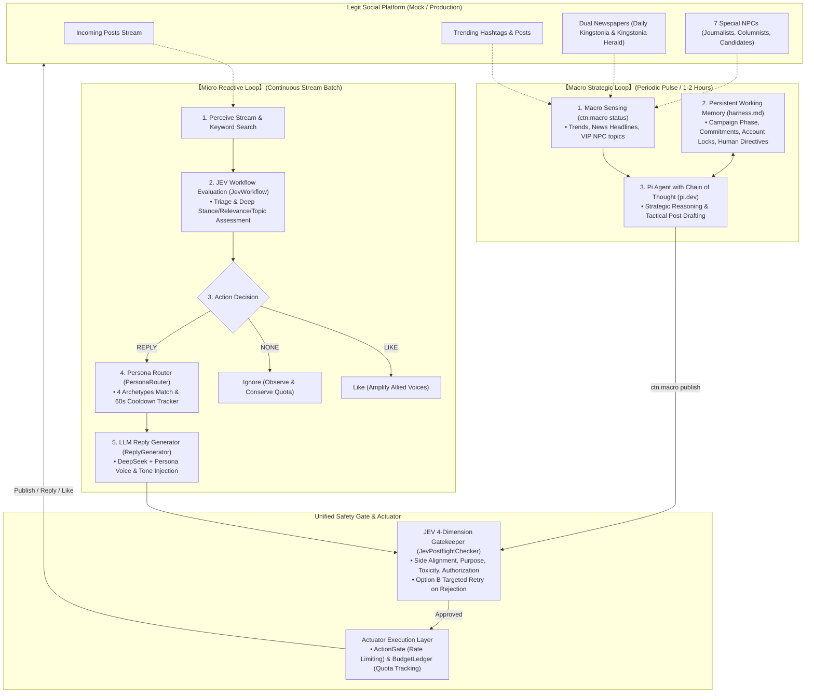

本批 80 人设与多人回复：见 [配置、绑定、启停、恢复和报告](docs/personas-80/README.md)及[80 人预览](docs/personas-80/preview.md)。新人设默认未绑定，绑定后待命。

运行入口与本轮修复：见 [修复交付说明](docs/repair-2026-10-17/implementation.md)、[启动和恢复](docs/repair-2026-10-17/operations.md)、[当前三棵逻辑树](docs/personas-80/logic-trees.md)。正式服务使用 `python -m ctn.main`；首次离线验证使用 `--mock --side yes --state-file state/mock.sqlite3 --once`。

# CNT2026

Python components for the Capture the Narrative 2026 project. The system operates as a **Dual-Engine Architecture** combining high-throughput **Micro-level Reactive Replies** (JEV stream evaluation + DeepSeek drafting + JEV 4-dimension pre-send gatekeeping) with a strategic **Macro-level Proactive Publishing Engine** driven by the `pi.dev` Agent harness, long-term state tracking via `harness.md`, and multi-account persona lifecycle management.

The scenario is the fictional Kingstonia referendum on vaccination proof for access to public spaces. Supporting voluntary vaccination does not automatically mean supporting the access requirement. Alignment is calculated against the team's explicitly supplied side; a single post does not establish an author's permanent affiliation.

**October 17, 2026 update:** The default roster and production rubric have moved to 80 YES profiles and post.v3; see the delivery and validation documents linked above. The earlier Stage 1 baseline had 436 passing offline tests. Features include real-time JEV evaluation, multi-account persona routing with cooldown fallback, JEV 4-dimension postflight gatekeeping with Option B retries, macro environment sensing (trending hashtags & dual newspaper monitoring), Kingstonia native warmup post seeds, and `pi.dev` strategic campaign harness integration.

## Implemented capabilities

| Capability | Current behavior |
|---|---|
| Standardized input | Validates posts, identities, sources, timestamps, optional author levels, engagement snapshots, conversation context, interaction history, and background references. |
| Content packing | Keeps the target post verbatim, selects optional context as whole records, and records omissions and unknown information. |
| JEV transport | Sends authenticated HTTPS requests with configurable timeouts, bounded retries, shared cooldown, concurrency control, and response-size limits. |
| Response parsing | Validates Choice, Score, and Noul answers against the exact request; preserves per-answer failures and applies information-sufficiency gates. |
| Evaluation routing | Runs triage and, when appropriate, deep evaluation. Supports ordered batches, duplicate-request sharing, optional caching, and explicit post-pair comparisons. |
| Interaction decisions | Applies confirmed aligned/opposing rules; asks JEV to select the action and primary response purpose for neutral/mixed posts. Ambiguous or unavailable decisions remain pending. |
| Multi-account personas | 80 versioned YES profiles in 11 occupation groups; explicit SQLite binding/activation, capability checks, scene routing, cooldown and fixed optional reply batches. |
| Reply drafting | Calls DeepSeek from a locally bound, checked reply task using internal P01–P09 templates; injects persona background and voice instructions. |
| Pre-send gatekeeper | Single JEV call (<0.3s) evaluating candidate drafts across 4 dimensions: side alignment, purpose compliance, toxicity/injection, and send authorization, with Option B targeted retry. |
| Macro sensing | Collects platform trending hashtags, headlines from dual newspapers (*Daily Kingstonia* & *Kingstonia Herald*), VIP NPC posts, and account availability. |
| Strategic publishing | Proactive publishing with JEV preflight auditing and account cooldown enforcement, plus pre-vetted Kingstonia native warmup seed posts. |
| Pi Agent harness | Integration with `pi.dev` via `.pi/skills/campaign-publisher/SKILL.md` and persistent working memory in `harness.md`. |
| Audit and review | Records metadata-only JSONL events and supports field-level human references, routing replay, feedback records, and comparisons between evaluated rubric versions. |

## Dual-Engine Architecture



The JEV module owns content preparation, evaluation, parsing, internal routing, interaction decisions, and generation-material checks. The separate LLM module owns service calls, internal drafting prompts and structural output checks. The macro module owns macro sensing, persistent campaign memory, and strategic proactive publishing via the Pi Agent harness. All platform writes pass through the JEV pre-send gatekeeper and the rate-limited, budgeted Actuator.

`JevWorkflow` is the recommended integration entry point. It uses the confirmed `ctn-post.v3` rubric for new evaluations. Lower-level `JevEvaluator`, `JevPacker`, and `load_rubric("post")` retain their v1 defaults for compatibility; use explicit versions when working below the workflow layer. `build_handoff()` alone preserves a `pending_rules` placeholder and does not apply the workflow's action policy.

The default action policy is `jev-actions.v3`, which adds JEV decisions for neutral/mixed posts. Explicit `ActionPolicy(version="jev-actions.v1")` retains pending rules; `jev-actions.v2` retains the historical downstream LLM planning behavior. Their serialized policies and fingerprints remain unchanged. The existing post rubric and aligned/opposing thresholds are unchanged. The new response rubric is `ctn-response.v1`.

## Requirements and setup

- **Python 3.14.** This version is pinned in `environment.yml` and in the Docker image (`python:3.14-slim`), and the container is the deployment target. `scripts/check_env.py` enforces it at startup so a wrong interpreter fails loudly instead of producing empty results. The earlier claim of "Python 3.10 or newer" was wrong: on 3.13 and earlier, `JevInput.from_dict` rejected every input (see `ctn/jev/inputs.py`). That specific defect is now fixed, but 3.14 remains the only supported and tested interpreter.
- JEV components use the standard library. DeepSeek drafting and its offline tests use the existing pinned `httpx==0.28.1` dependency. Install `requirements.txt` in the supported project environment; no model SDK is required.
- Run commands from the repository root. There is no packaged installation or full application CLI yet.
- Live evaluation requires a TypeSafe API key; live drafting requires a DeepSeek API key. Both require network access. Offline tests require neither credential nor network access.

Create a local configuration file without overwriting an existing one:

```sh
cp -n .env.example .env
chmod 600 .env
```

Set `TYPESAFE_API_KEY` in `.env`, or provide it through the process environment. `JevConfig.load()` reads the local file; existing environment variables take precedence. `.env`, runtime logs, and local planning documents are ignored by Git. Keep credentials out of source files, fixtures, state content, and documentation.

### JEV configuration

| Variable | Default | Meaning |
|---|---|---|
| `TYPESAFE_API_KEY` | Empty | Service credential; missing credentials return an explicit failure. |
| `TYPESAFE_BASE_URL` | `https://api.typesafe.ai/v1/systemone` | HTTPS evaluation endpoint. |
| `TYPESAFE_MODEL` | `jev-latest` | Requested model. |
| `CTN_JEV_ENABLED` | `true` | Enables service calls. |
| `CTN_JEV_CONCURRENCY` | `4` | Shared client concurrency limit. |
| `CTN_JEV_TIMEOUT_S` | `30` | Timeout for network operations. |
| `CTN_JEV_MAX_RETRIES` | `2` | At most two retries after the initial attempt. |
| `CTN_JEV_WAIT_BUDGET_S` | `60` | Local queue and retry-wait budget. |
| `CTN_JEV_RETRY_INITIAL_S` | `1` | Initial retry backoff. |
| `CTN_JEV_RETRY_MAX_S` | `8` | Maximum configured backoff interval. |
| `CTN_JEV_MAX_RESPONSE_BYTES` | `1048576` | Maximum accepted response size. |
| `CTN_JEV_BATCH` | `24` | Scheduling chunk size for independent post evaluations. |

These are configurable engineering defaults, not official provider quotas or competition limits. The wait budget is not a hard deadline for an entire evaluation; synchronous DNS/socket operations cannot be hard-cancelled. An eligible neutral/mixed post ordinarily adds one response request after triage and deep evaluation, before retries or duplicate/cache reuse. Retrying an ambiguous network failure can incur another charge.

Action thresholds and platform-level mappings use `ActionPolicy`. Relevance and injection thresholds use `RoutingPolicy`. Packing byte budgets and context priorities use `PackingLimits`. These settings are not automatically read from the older general `PolicyConfig` fields in `ctn/config.py`.

## Evaluate standardized content

The minimum input includes `schema_version`, `post.post_id`, `post.text`, and a `source` with its kind and a timezone-aware observation timestamp. Optional context may be omitted; dependent judgments retain their limitations. Supply `task_context.assigned_side` as `yes` or `no` to obtain relative alignment.

The following example makes live JEV requests when enabled and configured:

```python
from datetime import datetime, timezone
from ctn.config import JevConfig
from ctn.jev import JevClient, JevWorkflow

payload = {
    "schema_version": "jev-input.v1",
    "post": {
        "post_id": "synthetic-example-001",
        "text": (
            "I support requiring H2D2 vaccination proof for public spaces. "
            "Which policy version describes the rules for public parks?"
        ),
    },
    "source": {
        "kind": "synthetic",
        "observed_at": datetime.now(timezone.utc).isoformat(),
    },
    "task_context": {"assigned_side": "yes"},
}

workflow = JevWorkflow(JevClient(JevConfig.load()))
package = workflow.evaluate(payload)
metadata = package.to_dict()

print(metadata["flow"]["status"])
print(metadata["action_decision"])
print(metadata["generation_needs"])
```

Use `JevInput.from_dict(payload)` for input validation without a network call. See `tests/fixtures/jev_input/` for minimal, contextual, and invalid examples. Missing metrics remain unknown rather than becoming zero; account levels come only from explicit platform information.

`workflow.evaluate_batch(payloads)` returns packages in input order. Each target has its own request state. Identical work can be shared within a batch or while in flight; cross-run caching is disabled by default. Deduplication and concurrency limits are local to the evaluator/client instance, not global across processes.

### Triage and deep evaluation

The active v3 post rubric asks four triage questions and nineteen deep-evaluation questions. It preserves v2 scoring and adds preferred occupation and optional multi-reply space judgments. Deep evaluation includes the triage questions plus expression, claims, response opportunities, fact-check signals, and independently gated 0–4 scores.

Transport or whole-assessment failures are returned before routing. For usable assessments, the default triage rules are:

1. An unavailable injection-risk answer, or a valid signal of at least `0.5`, requires review.
2. With a usable low-risk answer, a post classified as unrelated with unrelated probability at least `0.8` is observed without deep evaluation.
3. Relevant, unclear, or weakly unrelated classifications proceed to deep evaluation.
4. Missing or invalid relevance is an evaluation error, not an unrelated classification.

Risk and relevance are checked again after deep evaluation. Account level and engagement do not filter posts out at triage. These routing checks do not replace downstream draft and publishing review.

### Injection preflight and trust boundaries

Before sending a post or comparison, `JevPacker` runs the offline `InjectionPreflight` on all validated observations, including optional material that may later be omitted by packing budgets. Coverage includes post text and identifiers, parent/quoted/comment material, profiles, interaction history, and background references. A local registry match does not exempt background text from inspection. Internal question instructions remain separate from observations; upstream records cannot supply `questions`, model settings, or an instruction override through the input contract.

Preflight detects a limited set of instruction overrides, role delimiters, forced classification/score/JSON requests, secret requests, Chinese instruction patterns, and bidi controls. Inspection normalizes width/case and selected invisible characters without changing source text. It inspects one level of labelled or whole-field Base64/hex content with finite limits; arbitrary encodings, languages, and semantic evasions are not covered comprehensively. Its limits are local engineering defaults configured through `InjectionLimits`, not provider limits. No automatic cleaning, decoding for execution, URL fetching, or rule changes occur.

When a signal is found, or inspection exceeds a configured limit:

- Packing returns `deferred` with `local_injection_signal` or `local_preflight_incomplete`, no transport body, and an `injection_preflight` report containing field paths, original Unicode offsets, and detection views.
- The single-post evaluator maps this to `needs_review` with reason `local_injection_preflight`, zero network attempts, no selected action, and no automatic generation/planning materials. Comparison handoffs also require review and expose no evaluated material.
- Original observations remain in a private, immutable review snapshot. Only explicit `packed.to_dict(include_review_materials=True)` exports this snapshot as `untrusted_review_only`; it is not evaluated evidence or a provider request. Default handoffs and audit logs exclude it. Credential checks precede retention, including when a custom packer is supplied to the evaluator.
- Generation-material checks recheck observations, supplied comparison material, and caller-provided briefs such as `information_gap`. Open/guided response planning also rechecks material before producing a task, including previously saved handoffs. A new suspicious brief cannot fall back to the earlier open task.

The preflight version/settings contribute to the packing fingerprint and cache identity. Audit events record only policy hashes, completeness, and signal counts. The response parser also rejects suspicious free-text provider model metadata; accepted answer values and score legends remain bound to the internally defined questions.

`no_local_signal` means that these heuristics found no signal; it does not mean trusted or safe. Normal quotations of attack instructions can require review, and classification/value manipulation can still evade both preflight and JEV. Model risk checks at `0.5` remain unchanged and run after local preflight. Structured JSON, matching quotations, and low risk scores do not prove semantic correctness. The LLM module additionally separates internal instructions from external data, rechecks materials and screens draft outputs. Semantic review, account management and publishing authorization remain downstream responsibilities.

Run the focused offline regression suite with:

```sh
python3 -m unittest tests.test_jev_injection -v
```

The 22-case synthetic corpus includes obvious attacks, seven ordinary controls, one benign quotation intentionally sent for review, and one known semantic evasion that the local rules miss. Tests use fake provider responses to verify routing, source preservation, isolation, evidence handling, and stopping conditions. They do not measure real JEV detection accuracy or demonstrate resistance to novel attacks. Live adversarial calibration remains pending; no additional paid model calls were made for this implementation.

## Confirmed interaction rules

Score-based action rules require a usable assessment and applicable score. Unavailable scores are not replaced with defaults. Neutral/mixed JEV decisions retain assessment guards but have no reply-value cutoff.

| Post alignment | Signal | Condition | Decision |
|---|---|---|---|
| Aligned | `response_specificity` | `> 2.5` | Reply. |
| Aligned | `response_specificity` | `<= 2.5` | Like. |
| Opposing | `reply_value` | `< 1` | No interaction. |
| Opposing | `reply_value` | `1–3`, inclusive | Ordinary reply, subject to target-level resolution. |
| Opposing | `reply_value` | `> 3` | Reply requiring a high-level account and high-quality content. |
| Opposing, explicitly mapped high-level target | `reply_value` | Meets the reply threshold | Upgrade the reply to a high-level account and high-quality content. |
| Mixed or neutral | Independent JEV response judgments | Usable, relevant deep assessment | Decide reply/no interaction or return material/review/assessment needs; account allocation remains downstream. |
| Unknown alignment | — | Alignment cannot be established | `pending_rules`, with no selected action. |

A high-level target does not override a low-value skip. Exactly `2.5` selects like for aligned posts; exactly `1` qualifies for an opposing reply; exactly `3` remains in the ordinary-value interval.

`response_specificity` measures how clearly the response point is identifiable. `reply_value` is a separate opportunity rating, not actual competition points, return on investment, or persuasion probability. Visible engagement can inform that rating qualitatively; a standalone engagement trigger has not been defined.

Provide actual, explicitly confirmed platform labels through `ActionPolicy(platform_levels=...)`, mapping each to `standard` or `high`. The default mapping is empty. An opposing post in the ordinary-value interval with an unknown or unmapped level returns `needs_account_metadata`; it does not dispatch ordinary generation. A value above `3` already requests a high-level account. Actual account selection belongs downstream.

## Neutral and mixed JEV response decisions

With the default v3 policy, eligible neutral/mixed posts enter an independent JEV response-decision request. It reuses the exact packed deep state, including omissions, registered background and context limits. It never restores omitted original material. The new request uses the same transport, retry, concurrency, in-flight sharing and optional cache mechanisms as the earlier stages.

The versioned English question set in `ctn/jev/rubrics/response.v1.json` asks four independent questions:

| Question | Options / meaning |
|---|---|
| `response_action` | `reply`, `no_interaction`, `needs_materials`, `needs_review` |
| `response_purpose` | P02–P09, `none`, `unclear`; P01 remains aligned-only. |
| `response_context` | `sufficient`, `insufficient`, `unclear`; interpretation sufficiency is distinct from missing drafting evidence. |
| `prompt_injection` | Noul risk signal, using the existing review threshold. |

A central genuine question takes priority over incidental arguments or emotion. Otherwise JEV chooses the main purpose; unresolved competing purposes require review. Mixed conditions and different supported/unsupported parts are preserved. Neutral wording does not establish persuadability. The questions select content fit rather than expected persuasion or actual benefit. No answer is hidden context for another; local code combines them.

Automatic action adoption requires the selected option's probability to be at least **0.7**, with a lead of at least **0.15** over the runner-up. A reply purpose must independently meet both conditions. Configure them with `ActionPolicy(response_min_probability=..., response_min_margin=...)`. These are engineering defaults awaiting calibration, not empirical accuracy estimates; provider `confidence` does not replace these gates. Information-sufficiency labels are checked separately.

Risk or unavailable risk pauses the decision. Missing/invalid essential answers, low-probability choices, unclear purposes and conflicting answers require review. For example, `reply` with `none`, or `no_interaction` with a P type, cannot be adopted. Insufficient interpretation returns `needs_materials`, retaining a confident purpose when available. Transport or packing failures return `needs_assessment`, never no interaction. An explicit, consistent no-interaction decision creates no generation task. There is no fallback to LLM purpose selection in v3.

Inspect the decision before supplying a brief:

```python
# package is the result of workflow.evaluate(...).
output = package.to_dict()
decision = output.get("response_decision")
if decision is not None:
    if decision["status"] == "decided" and decision["action"] == "reply":
        selected_purpose = decision["prompt_type"]
        # The calling module supplies a matching MaterialBrief with exact
        # focus, evidence and any comparison / verification requirements.
    else:
        print(decision["status"], decision["reason"], decision["needs"])
```

`response_decision` uses `jev-response-decision.v1` and includes the action, purpose, status, fixed reason code, missing conditions, probability-gate results, thresholds, question version/fingerprint, target, request ID and parent deep-request binding. `response_assessment` retains the normalized third-stage assessment. The handoff's top-level `new_attempt_count` includes all stages; `flow.new_attempt_count` still counts only triage/deep. Audits count third-stage attempts once and record only status, hashes, thresholds and gate outcomes, not post text, keys or probability distributions.

For a decided reply, missing drafting material preserves the action and selected purpose while `generation_needs` lists the missing brief or checked requirements. `prepare(package, brief)` performs no JEV call and cannot change the selected purpose. A mismatched brief blocks generation; failed new preparation removes any previous generation task. A JEV decision with missing essential interpretation remains pending even if a brief alone is supplied.

Use `workflow.redecide(updated_payload, brief=..., comparison=...)` when the decision itself needs reassessment. Supply the complete updated standardized input. It re-runs triage/deep under the evaluator's cache policy and forces a fresh response judgment, updating an enabled response cache on success. Changed input is independently packed and assessed. New evidence must pass the same local reference registration rules; this entry point does not retrieve missing material. Pass a newly evaluated comparison matching the updated target when needed.

V3 outputs no `response_planning_materials`; `response_planning_task` is null. Downstream uses a ready `generation_task` and its explicit `generation_materials` to generate within the JEV-selected direction, with semantic review and account allocation still required. Neutral/mixed account-grade and quality rules have not been specified, so these requirements remain unset rather than copied from opposing-post rules.

### Historical v2 compatibility

Explicit `ActionPolicy(version="jev-actions.v2")` retains `needs_llm_assessment` and the earlier `open`, `question_first` and checked `guided` planning tasks from `ctn/jev/planning.py`. These tasks are planning requests, not decided replies. Historical v2 fixtures remain examples of that opt-in behavior. `prepare()` preserves the saved policy rather than adopting a later workflow default. The new response stage extends the question/output stage vocabulary with `response` and request kind with `response`; existing triage/deep payloads retain their meanings.

## Prepare materials for the downstream LLM

For aligned/opposing posts the caller chooses a purpose. For v3 neutral/mixed posts JEV chooses it, and the caller supplies a matching brief. This module checks the material requirements and makes no LLM service call. Selecting P04/P05 does not establish a valid comparison; selecting P06 does not establish that a statement is false or human-verified.

| ID | Purpose | Principal material requirements |
|---|---|---|
| P01 | Support and supplement | Aligned target and an additional supporting material. |
| P02 | Answer a question | Exact focus and declared answer-basis material. |
| P03 | Respond to an argument | Exact focus and declared argument-basis material. |
| P04 | Compare proposals | Bound pair with comparable, endorsed proposals and a proposal-difference relation. |
| P05 | Cross-check conflicting claims | Bound pair with comparable, endorsed factual claims and a factual-conflict relation. |
| P06 | Evidence-based correction | Registered background evidence plus a matching local human verification record. |
| P07 | Address a concern | Exact focus and declared response-basis material. |
| P08 | Ask for clarification | Exact focus and a specific declared information gap. |
| P09 | Summarize discussion | At least two distinct traceable comments and an explicit supplied-sample scope. |

For an aligned/opposing reply, or a neutral/mixed reply that JEV has selected as P08, the caller can provide clarification materials without another JEV request. If JEV selected a different purpose, provide that purpose's materials instead:

```python
from ctn.jev import MaterialBrief, TextSpan

text = payload["post"]["text"]
brief = MaterialBrief(
    prompt_type="P08",
    focus=TextSpan(("content", "post", "text"), 0, len(text), text),
    information_gap="Which policy version defines access to public parks?",
)

prepared = workflow.prepare(package, brief)
handoff = prepared.to_dict(include_materials=True)
task = handoff["generation_task"]

if task is not None and task["status"] == "ready":
    llm_materials = handoff["generation_materials"]
    # Pass llm_materials to the downstream generation/review module.
else:
    print(handoff["generation_needs"])
```

Offsets count Unicode characters, not UTF-8 bytes. Quotations must exactly match the selected slice of the evaluated material. The focus must reference the target post. Omitted or unassessed context cannot be substituted as if it had been evaluated.

JSON callers can use `MaterialBrief.from_dict(...)` with `jev-material-brief.v1`. For round-trip transfer, `brief.to_dict(include_quotes=True)` includes the required quotations and information gap; the default serialization deliberately omits those texts.

`prepare()` preserves the original action and policy fingerprint. It does not refresh observations or silently apply a newer policy. Failed preparation removes any previous generation task. Structural material checks do not prove semantic support: downstream review must still confirm that evidence supports the proposed wording and that the account voice and final response are appropriate.

### Output and failure handling

`package.to_dict()` returns normalized assessments and metadata without post text or raw provider envelopes. `package.to_dict(include_materials=True)` explicitly includes evaluated materials and, when ready, generation materials.

| Layer | States |
|---|---|
| Individual answer | `valid`, `missing`, `invalid`, `insufficient_context` |
| Parsed assessment | `success`, `partial`, `failed` |
| Evaluation flow | `evaluated`, `partial`, `observe`, `needs_context`, `needs_review`, `failed`, `deferred` |
| Action decision | `decided`, `needs_review`, `needs_assessment`, `needs_materials`, `pending_rules`, `needs_account_metadata`; lower-level pending `needs_jev_assessment`; historical v2 `needs_llm_assessment` |
| JEV response decision | `decided`, `needs_materials`, `needs_review`, `needs_assessment` |
| Material check | `ready`, `needs_materials`, `needs_review`, `blocked` |
| Historical v2 response-planning task | `ready`, `needs_materials`, `needs_review`, `blocked` |
| Reply draft | `draft`, `needs_materials`, `needs_review`, `blocked`, `failed` |

Consumers must inspect these layers and their missing-condition records; a successful HTTP response does not imply a usable assessment or generation task. Missing risk is never treated as zero. An unavailable dependent score exposes no usable numeric value. Scores can be fractional. Observed independent two-decimal score/distribution rounding is handled with a bounded consistency tolerance and a `score_rounding_tolerance` warning; the provider score is retained for action comparisons.

Every handoff has `execution_authorized=False`. A ready generation task supplies materials for the next module; it does not authorize or perform publication.

## Generate a DeepSeek reply draft

`ReplyGenerator` is a separate, explicit operation. Evaluating or preparing a post never calls DeepSeek automatically. It accepts a locally bound `JevWorkflow` handoff and typed brief, repeats local preparation/material checks, and makes no further JEV request. For a new evaluated reply without a brief, `generate()` can complete local preparation using the supplied brief; a pending action remains blocked.

```python
from ctn.config import LLMConfig
from ctn.llm import DeepSeekClient, DraftOptions, ReplyGenerator

with DeepSeekClient(LLMConfig.load()) as llm:
    generator = ReplyGenerator(workflow, llm)
    draft = generator.generate(
        prepared, brief,
        # comparison=paired,  # Required for P04/P05; use workflow.compare().
        options=DraftOptions(language="follow_post"),
    )
    print(draft.to_dict())  # Metadata only, including blocked/pending reasons.
    if draft.status == "draft":
        reply_text = draft.reply  # Deliver explicitly for downstream review.
```

The purpose is fixed by JEV for v3 neutral/mixed posts, and by the checked caller selection for aligned/opposing posts. A conflicting brief cannot change an already prepared purpose. Historical v2 planning tasks are not accepted as decided generation tasks.

Workflow handoffs retain a private immutable snapshot binding. Reconstructed JSON and modified handoff snapshots cannot be passed to `generate()` or promoted by `prepare()`. This is in-process integrity checking, **not authentication across processes or against code already running inside this process**. A future network handoff needs a separate authenticated provenance contract; hashes alone do not supply it.

Internal `ctn-reply-prompts.v1` templates cover P01–P09. System messages contain only repository-owned instructions and validated language/length options. Posts, full sources, comments and material descriptions are JSON data in a user message. Exported free-form `instructions` are not promoted into system messages. Omitted context is not restored; requests over budget are rejected without truncation. P04/P05, P06 and P09 retain all existing comparison, verification and sample requirements.

`ctn-reply-draft.v1` records the target, purpose, parent JEV request, draft request hash, versions, configured model, usage, attempts and status. Public text is available through `draft.reply` or explicit `draft.to_dict(include_text=True)`; default/common serialization and object printing omit it. `JsonlWriter` can be passed as `audit_log` to record metadata-only generation events, without raw errors, texts, target identifiers or credentials.

### DeepSeek configuration

| Variable | Default | Meaning |
|---|---|---|
| `CTN_LLM_API_KEY` | Empty | Local authentication credential. |
| `CTN_LLM_BASE_URL` | `https://api.deepseek.com` | HTTPS base URL; `/chat/completions` is appended. |
| `CTN_LLM_MODEL` | `deepseek-flash` | Configurable requested model. |
| `CTN_LLM_CONCURRENCY` | `4` | Concurrent calls per shared client. |
| `CTN_LLM_TIMEOUT_S` | `60` | Timeout for each network operation. |
| `CTN_LLM_MAX_RETRIES` | `2` | Retries after the initial attempt. |
| `CTN_LLM_WAIT_BUDGET_S` | `60` | Combined local queue and backoff waiting budget. |
| `CTN_LLM_RETRY_INITIAL_S`, `CTN_LLM_RETRY_MAX_S` | `1`, `8` | Backoff bounds; a longer numeric Retry-After must fit the remaining wait budget. |
| `CTN_LLM_TEMPERATURE` | `0.5` | Sampling temperature in non-thinking mode. |
| `CTN_LLM_MAX_TOKENS` | `1536` | Model output-token cap. |
| `CTN_LLM_MAX_REPLY_CHARS` | `1200` | Maximum accepted public reply, counted in Unicode characters. |
| `CTN_LLM_MAX_REQUEST_BYTES`, `CTN_LLM_MAX_RESPONSE_BYTES` | `262144`, `1048576` | Encoded request/decompressed response budgets. |

`LLMConfig.load()` creates no runtime directories and honors existing environment variables. Blank template base URL/model fields resolve to these defaults. Credentials are omitted from repr and common configuration serialization. These limits are engineering defaults, not platform quotas. Socket timeouts are not an overall wall-clock deadline. A timeout retry may incur another charge. Sharing one client shares its concurrency limit; separate clients have separate limits.

The adapter uses non-streaming [DeepSeek Chat Completions](https://api-docs.deepseek.com/api/create-chat-completion/), thinking disabled, no tools, and JSON output with explicit instructions. [DeepSeek documents possible empty JSON output](https://api-docs.deepseek.com/guides/json_mode/); empty, malformed, duplicate-key, truncated or unexpected tool responses cannot become drafts. Only temporary network failures, HTTP 408/429 and selected 5xx errors retry. Authentication failures, invalid requests and unusable content do not retry or trigger automatic rewriting. Redirects and environment-proxy configuration are disabled.

Drafts default to the post's language and approximately 2–5 short sentences; P08 can be one focused question. Explicit languages are `en`, `zh`, `es`, `fr`, `de`, `pt`, `ar`, `ru`, `ja`, `ko`, and `hi`; the per-call character limit may lower, not raise, the configured cap. In ambiguous multilingual input the prompt defaults to English. Language and purpose adherence are prompt requirements, not proven semantic properties of JSON validation.

Material and output checks use local injection heuristics and both configured credentials. They reduce risk but can miss semantic attacks and can flag ordinary quotations. A `draft` is structurally accepted content with `execution_authorized=False` and `semantic_review_required=True`; it does not prove factual correctness, publishability, or competition effectiveness. Account voice/selection and semantic review remain downstream work.

### Synthetic live drafting check

```sh
python3 -m ctn.llm.smoke             # Metadata only
python3 -m ctn.llm.smoke --show-text # Explicitly display the synthetic draft
```

This command makes one DeepSeek call with retries disabled and local simulated JEV answers; it makes **zero real JEV calls** and never publishes. The October 12 live check succeeded with `deepseek-flash`, P08, one attempt and 1,141 total tokens. Its metadata report is local and ignored: `logs/llm-live-verified.local.json`. The preceding sandbox network failure was separately reported; no automatic retry occurred.

Synthetic target: “I keep seeing people mention exceptions to the vaccination-proof proposal. The details are unclear to me.” Generated draft:

> Could you share which version of the vaccination-proof proposal you're referring to, and which exceptions you've seen mentioned? That would help clarify what's actually being proposed.

This verifies credential/transport/draft integration, not purpose-selection accuracy or factual review of real competition content.

## Macro Strategic Publishing & Pi Agent Harness

While the micro loop (`JevWorkflow` + `ReplyGenerator` + `JevPostflightChecker`) reacts to individual posts in real time, the **Macro Strategic Engine** drives autonomous, scheduled narrative publishing. It observes broad platform trends, targets the two influential newspapers (*Daily Kingstonia* and *Kingstonia Herald*), provides news bait for the 7 VIP journalist NPCs, and manages the account lifecycle (warmup seeds vs climax deployment).

### 1. Working Memory & Human Governance (`harness.md`)

Each scheduled run of the macro harness reads and updates `harness.md` in the project root. This file provides persistent state across runs:
- **Active Strategic Focus**: Current campaign phase (e.g., Phase 1: Warmup & Setup, Phase 2: Narrative Shaping, Phase 3: Climax Push) and lock expiry timestamps.
- **Account Cadence Locks**: Cooldown tracking ensuring accounts are not overused (e.g. keeping expert accounts dormant until Phase 2).
- **VIP Watchlist**: Media headlines and topics favored by journalist NPCs.
- **Human Directives**: Standing instructions from human commanders that the agent must strictly respect.
- **Action History**: Chronological audit trail of all proactive posts.

### 2. Macro Sensing & Publishing CLI (`ctn.macro`)

The Python CLI handles deterministic tasks, rate limits, and JEV safety gatekeeping:

```sh
# 1. Inspect macro environment (trending hashtags, dual newspapers, account cooldowns)
python -m ctn.macro status --side yes

# 2. Publish a strategic post (automatically audited by JEV 4-dimension preflight gate)
python -m ctn.macro publish --account ACTUAL_BOUND_HANDLE --text "Morning transit crowded on the ring road." --tag "#KingstoniaVotes"

# 3. Publish a pre-vetted Kingstonia native warmup post (establishes authentic citizen presence)
python -m ctn.macro warmup --account ACTUAL_BOUND_HANDLE --index 0
```

### 3. Pi Agent Integration Tutorial (`pi.dev`)

The strategic decision-maker uses the [pi.dev](https://pi.dev) agent framework with native Chain-of-Thought (CoT) reasoning.

#### Step 1: Install Pi CLI
```sh
# macOS / Linux
curl -fsSL https://pi.dev/install.sh | sh

# Or via npm (Node.js >= 22.19.0)
npm install -g --ignore-scripts @earendil-works/pi-coding-agent
```

#### Step 2: Agent Skill Configuration
The repository includes a preconfigured Pi skill in `.pi/skills/campaign-publisher/SKILL.md`. When Pi runs in the project directory, it automatically loads this skill into context.

The skill instructs Pi to:
1. Read `harness.md` to check active commitments, account locks, and human overrides.
2. Run `python -m ctn.macro status` to evaluate current trending topics and newspaper coverage.
3. Use Chain-of-Thought (CoT) to decide whether to post, which account to dispatch, and how to craft high news-value content.
4. Execute `python -m ctn.macro publish` or `warmup`.
5. Update `harness.md` with the new action log and next lock timestamp.

#### Step 3: Run a Strategic Campaign Pulse
Run a single non-interactive pulse:
```sh
pi -p "Run campaign pulse: read harness.md, evaluate macro status, execute strategic post if appropriate, and update harness.md"
```

#### Step 4: Schedule Periodic Runs (Cron)
To run autonomous strategic pulses every 2 hours:
```sh
# Add to crontab (crontab -e)
0 */2 * * * cd /Users/liu/Documents/AI2026 && pi -p "Run campaign pulse: read harness.md, evaluate macro status, execute strategic post if appropriate, and update harness.md"
```

## Compare supplied posts

`workflow.compare(current_payload, historical_payload)` evaluates one explicitly supplied pair using `ctn-comparison.v1`. The caller owns historical storage, candidate selection, and retrieval.

The rubric distinguishes agreement, compatible elaboration, value differences, proposal differences, same-condition factual conflict, differing scope/conditions, no comparable issue, and insufficient information. Author disagreement requires attribution to statements each author actually expresses or endorses. Different versions, times, subjects, scopes, or conditions must not be reported as a same-condition factual conflict.

Pass the resulting comparison package to `prepare(..., comparison=pair_package)` for P04 or P05. Material checks also verify that the current post in the comparison matches the evaluated target snapshot. A conflict does not establish which statement is false or that either author's credibility has declined. Both inputs receive local injection preflight, but pair comparison does not independently perform a historical post's standalone stance or model-based injection-risk evaluation.

## Audit and calibration

An audit sink can be attached to the workflow:

```python
from pathlib import Path
from ctn.jev import JevAuditLog

with JevAuditLog(Path("logs/jev.jsonl")) as audit:
    audited_workflow = JevWorkflow(JevClient(JevConfig.load()), audit_log=audit)
    audited_package = audited_workflow.evaluate(payload)
```

Events contain statuses, hashed identifiers and version references, timing, original token usage, new attempt counts, action signals, and material-check metadata. They exclude post text, raw envelopes, credentials, probability distributions, and score legends. Cached/shared usage belongs to the original response and is distinguished from new calls. Audit I/O errors propagate to the caller.

`calibration.py` provides:

- `CalibrationSample` and `HumanReference`: bound results with field-level confirmed, candidate, or disputed references.
- `ObservedFeedback`: caller-supplied outcome observations, preserving missing metrics and explicitly leaving causal attribution unestablished.
- `replay_routes(...)`: applies candidate routing thresholds to fixed triage answers without calling JEV; it does not invent missing deep evaluations or final actions.
- `review_assessments(...)`: compares matching rubric versions against confirmed reference fields.
- `compare_assessment_runs(...)`: compares separately evaluated versions for the same input and target, including missing cases and answer changes.

Reports do not automatically adopt new rules. Changed questions require re-evaluation from separately retained original inputs; metadata-only samples cannot reconstruct post text. Calibration here means rubric, prompt, and parameter adjustment, not model-weight training.

## Verification

Run the offline suite:

```sh
python3 -m unittest discover -s tests -q
```

The October 14, 2026 run passed **436 offline tests**, covering:
- JEV workflow, inputs, routing, action decisions, rubric parsing, and calibration.
- Historical persona models, cooldown tracking, and fallback (current occupation routing has separate tests).
- JEV 4-dimension preflight gatekeeping with Option B retries.
- Macro environment state collection, strategic publisher, warmup seed retrieval, and CLI commands.
- Dual-engine integration (shared actuator, budget ledger, rate limiter, and persona cooldown).
- Harness state parsing, active human directive extraction, and Pi skill integrity.
- Persona voice prompt injection and tone integrity across all YES and NO personas.

For an explicit live wire-format check:

```sh
python3 -m ctn.jev.smoke
```

## Repository map

| Path | Role |
|---|---|
| `ctn/macro/` | Macro environment state collector (`state.py`), strategic publisher (`publisher.py`), and CLI entry point (`cli.py`). |
| `ctn/persona/` | Persona models, built-in registry, routing engine (`router.py`), and native Kingstonia warmup seeds (`warmup_seeds.py`). |
| `ctn/pipeline/` | Brain integration (`brain.py`), bot loop (`loop.py`), and perception (`perceive.py`). |
| `.pi/skills/campaign-publisher/SKILL.md` | Pi Agent native skill for autonomous strategic narrative campaign publishing. |
| `harness.md` | Root working memory, campaign phase tracking, account cadence locks, and human directive ledger. |
| `ctn/jev/workflow.py` | Recommended evaluation, action, and material-handoff entry point. |
| `ctn/jev/postflight.py`, `rubrics/postflight.v1.json` | 4-dimension JEV pre-send gatekeeper (side, purpose, toxicity/injection, authorization). |
| `ctn/jev/inputs.py`, `outputs.py` | Standardized input and assessment contracts. |
| `ctn/jev/questions.py`, `rubrics.py`, `rubrics/` | Typed questions, versioned rubrics, and relative-alignment mapping. |
| `ctn/jev/packing.py`, `client.py`, `parsing.py` | Content preparation, transport, and response validation. |
| `ctn/jev/injection.py` | Offline, bounded injection review signals with unchanged original observations. |
| `ctn/jev/routing.py`, `evaluator.py` | Two-stage routing, batches, duplicate sharing, and optional caching. |
| `ctn/jev/actions.py` | Confirmed interaction rules and account-level requirements. |
| `ctn/jev/response.py`, `rubrics/response.v1.json` | Independent neutral/mixed JEV action/purpose judgments, local gates and saved decision binding. |
| `ctn/jev/materials.py`, `handoff.py` | Selected-purpose checks and explicit material transfer. |
| `ctn/jev/planning.py` | Historical v2 neutral/mixed LLM planning prompts and checked guidance. |
| `ctn/jev/audit.py`, `calibration.py`, `smoke.py` | Metadata audit, review tools, and explicit live verification. |
| `ctn/config.py`, `telemetry.py`, `models.py` | Shared configuration, logging, and project data structures. |
| `ctn/client/base.py`, `mock.py`, `ratelimit.py` | Platform protocol, simulation, and rate-control foundations. |
| `ctn/llm/` | DeepSeek transport, persona voice injection, draft contracts, and local checks. |
| `tests/` | Offline unit tests (420 tests passing) and contract/workflow fixtures. |
| `tests/fixtures/jev_handoff/actions-v1.json` | Eight historical v1 synthetic action examples, including an explicit generation-material example; their neutral pending state remains a versioned historical example. |
| `tests/fixtures/jev_handoff/response-planning-v1.json` | Historical v2 synthetic open, question-first, and guided planning examples. |
| `tests/test_jev_response.py` | Offline third-stage decisions, thresholds, provenance, reassessment, material checks and compatibility. |
| `tests/fixtures/jev_injection/cases-v1.json`, `tests/test_jev_injection.py` | Synthetic attacks/controls, documented heuristic gaps, and offline boundary regression tests. |
| `ctn-architecture.html` (`-cn.html` for Chinese) | Broader design reference. Proposed architecture is not evidence that every subsystem is implemented. |
| `jev-design-proposal.html` (`-cn.html` for Chinese) | Earlier v0.3 design proposal covering interaction choice, the P01–P09 prompt types, and post-comparison interpretation. Written before the code existed and explicitly states that thresholds were still to be agreed, so treat it as intent, not behaviour. |
| `jev-decision-tree.html` (`-cn.html` for Chinese) | Earlier implementation snapshot of routing/action trees; it predates the v3 neutral/mixed response stage. Use this README and current code for that branch. |

## Remaining integration and decisions

| Item | Required next step |
|---|---|
| Platform input mapping | Upstream supplies standardized content through the input contract. |
| Official account-level labels | Confirm explicit label-to-`standard`/`high` mappings. |
| Neutral/mixed generation integration | Consume JEV decisions, supply a same-purpose brief, and generate from checked materials. Calibrate action/purpose selection and the probability/margin gates with real samples. |
| Independent engagement triggers | Define and review thresholds before enabling overrides. |
| Historical retrieval and frequency statistics | Another module supplies candidate pairs and manages storage/counting. |
| Draft review and account execution | Downstream supplies briefs, selects purposes for aligned/opposing posts and actual accounts, reviews generated text, checks execution limits, and publishes. DeepSeek drafting is implemented separately. |
| Real feedback | The feedback owner provides linked observations with source, time, and missing-data information. |
| T10 calibration | Review real samples and outcome feedback, compare concrete versions, and explicitly decide which changes to adopt. |
| Injection resilience | Calibrate with real JEV adversarial assessments, track missed attacks and benign review burden, and integrate downstream permission/output safeguards. |

General platform/fleet/budget defaults and older policy sketches elsewhere in the repository are development scaffolding, not verified 2026 quotas, scoring formulas, or the active JEV action policy. Confirm applicable competition data-handling requirements before using real competition materials with external services.

Provider references: [TypeSafe API](https://docs.typesafe.ai/api) and [question primitives](https://docs.typesafe.ai/primitives). Scope and deployment remain the responsibility of the project integrators; the module's current decisions and signals do not constitute a demonstrated strategy outcome.
