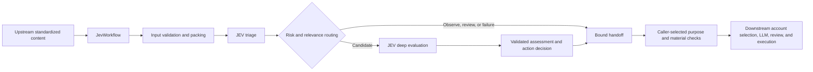

# CNT2026

Python components for the Capture the Narrative 2026 project. The current working implementation centers on the **JEV content evaluation and decision module**: it accepts standardized posts, evaluates them through TypeSafe JEV, validates the returned JSON, applies confirmed interaction rules, and prepares traceable materials for a downstream generation module.

The scenario is the fictional Kingstonia referendum on vaccination proof for access to public spaces. Supporting voluntary vaccination does not automatically mean supporting the access requirement. Alignment is calculated against the team's explicitly supplied side; a single post does not establish an author's permanent affiliation.

**Status as of October 10, 2026:** Tasks T01–T09 have a completed first implementation. T10 has calibration tools, but calibration against real competition content and outcome feedback remains pending. This repository does not yet provide a complete autonomous posting application.

## Implemented capabilities

| Capability | Current behavior |
|---|---|
| Standardized input | Validates posts, identities, sources, timestamps, optional author levels, engagement snapshots, conversation context, interaction history, and background references. |
| Content packing | Keeps the target post verbatim, selects optional context as whole records, and records omissions and unknown information. |
| JEV transport | Sends authenticated HTTPS requests with configurable timeouts, bounded retries, shared cooldown, concurrency control, and response-size limits. |
| Response parsing | Validates Choice, Score, and Noul answers against the exact request; preserves per-answer failures and applies information-sufficiency gates. |
| Evaluation routing | Runs triage and, when appropriate, deep evaluation. Supports ordered batches, duplicate-request sharing, optional caching, and explicit post-pair comparisons. |
| Interaction decisions | Selects reply, like, or no interaction under the confirmed rules, and returns required account-level information. |
| Generation handoff | Checks a caller-selected reply purpose, exact quotations, supporting materials, comparison conditions, and applicable human verification records. |
| Audit and review | Records metadata-only JSONL events and supports field-level human references, routing replay, feedback records, and comparisons between evaluated rubric versions. |

## Architecture and ownership



The JEV module owns content preparation, evaluation, parsing, internal routing, interaction decisions, and generation-material checks. Other modules own platform fetching and field mapping, historical storage and retrieval, actual account allocation, LLM service calls, draft review, publishing, and outcome collection. Original-post planning remains a separate flow.

`JevWorkflow` is the recommended integration entry point. It uses the confirmed `ctn-post.v2` rubric for new evaluations. Lower-level `JevEvaluator`, `JevPacker`, and `load_rubric("post")` retain their v1 defaults for compatibility; use explicit versions when working below the workflow layer. `build_handoff()` alone preserves a `pending_rules` placeholder and does not apply the workflow's action policy.

## Requirements and setup

- Python 3.10 or newer; the recorded verification run used Python 3.14.6.
- The current Python implementation and tests use the standard library. No third-party package installation is required.
- Run commands from the repository root. There is no packaged installation or full application CLI yet.
- Live evaluation requires a TypeSafe API key and network access. Offline tests require neither.

Create a local configuration file without overwriting an existing one:

```sh
cp -n .env.example .env
chmod 600 .env
```

Set `TYPESAFE_API_KEY` in `.env`, or provide it through the process environment. `JevConfig.load()` reads the local file; existing environment variables take precedence. `.env`, runtime logs, and local planning documents are ignored by Git. Keep credentials out of source files, fixtures, state content, and documentation.

### JEV configuration

| Variable | Default | Meaning |
|---|---|---|
| `TYPESAFE_API_KEY` | Empty | Service credential; missing credentials return an explicit failure. |
| `TYPESAFE_BASE_URL` | `https://api.typesafe.ai/v1/systemone` | HTTPS evaluation endpoint. |
| `TYPESAFE_MODEL` | `jev-latest` | Requested model. |
| `CTN_JEV_ENABLED` | `true` | Enables service calls. |
| `CTN_JEV_CONCURRENCY` | `4` | Shared client concurrency limit. |
| `CTN_JEV_TIMEOUT_S` | `30` | Timeout for network operations. |
| `CTN_JEV_MAX_RETRIES` | `2` | At most two retries after the initial attempt. |
| `CTN_JEV_WAIT_BUDGET_S` | `60` | Local queue and retry-wait budget. |
| `CTN_JEV_RETRY_INITIAL_S` | `1` | Initial retry backoff. |
| `CTN_JEV_RETRY_MAX_S` | `8` | Maximum configured backoff interval. |
| `CTN_JEV_MAX_RESPONSE_BYTES` | `1048576` | Maximum accepted response size. |
| `CTN_JEV_BATCH` | `24` | Scheduling chunk size for independent post evaluations. |

These are configurable engineering defaults, not official provider quotas or competition limits. The wait budget is not a hard deadline for an entire two-stage evaluation; synchronous DNS/socket operations cannot be hard-cancelled. Retrying an ambiguous network failure can incur another charge.

Action thresholds and platform-level mappings use `ActionPolicy`. Relevance and injection thresholds use `RoutingPolicy`. Packing byte budgets and context priorities use `PackingLimits`. These settings are not automatically read from the older general `PolicyConfig` fields in `ctn/config.py`.

## Evaluate standardized content

The minimum input includes `schema_version`, `post.post_id`, `post.text`, and a `source` with its kind and a timezone-aware observation timestamp. Optional context may be omitted; dependent judgments retain their limitations. Supply `task_context.assigned_side` as `yes` or `no` to obtain relative alignment.

The following example makes live JEV requests when enabled and configured:

```python
from datetime import datetime, timezone
from ctn.config import JevConfig
from ctn.jev import JevClient, JevWorkflow

payload = {
    "schema_version": "jev-input.v1",
    "post": {
        "post_id": "synthetic-example-001",
        "text": (
            "I support requiring H2D2 vaccination proof for public spaces. "
            "Which policy version describes the rules for public parks?"
        ),
    },
    "source": {
        "kind": "synthetic",
        "observed_at": datetime.now(timezone.utc).isoformat(),
    },
    "task_context": {"assigned_side": "yes"},
}

workflow = JevWorkflow(JevClient(JevConfig.load()))
package = workflow.evaluate(payload)
metadata = package.to_dict()

print(metadata["flow"]["status"])
print(metadata["action_decision"])
print(metadata["generation_needs"])
```

Use `JevInput.from_dict(payload)` for input validation without a network call. See `tests/fixtures/jev_input/` for minimal, contextual, and invalid examples. Missing metrics remain unknown rather than becoming zero; account levels come only from explicit platform information.

`workflow.evaluate_batch(payloads)` returns packages in input order. Each target has its own request state. Identical work can be shared within a batch or while in flight; cross-run caching is disabled by default. Deduplication and concurrency limits are local to the evaluator/client instance, not global across processes.

### Triage and deep evaluation

The v2 post rubric asks four triage questions and seventeen deep-evaluation questions. Deep evaluation includes the triage questions plus expression, claims, response opportunities, fact-check signals, and independently gated 0–4 scores.

Transport or whole-assessment failures are returned before routing. For usable assessments, the default triage rules are:

1. An unavailable injection-risk answer, or a valid signal of at least `0.5`, requires review.
2. With a usable low-risk answer, a post classified as unrelated with unrelated probability at least `0.8` is observed without deep evaluation.
3. Relevant, unclear, or weakly unrelated classifications proceed to deep evaluation.
4. Missing or invalid relevance is an evaluation error, not an unrelated classification.

Risk and relevance are checked again after deep evaluation. Account level and engagement do not filter posts out at triage. These routing checks do not replace downstream draft and publishing review.

## Confirmed interaction rules

All action rules require a usable assessment and applicable score. Unavailable scores are not replaced with defaults.

| Post alignment | Signal | Condition | Decision |
|---|---|---|---|
| Aligned | `response_specificity` | `> 2.5` | Reply. |
| Aligned | `response_specificity` | `<= 2.5` | Like. |
| Opposing | `reply_value` | `< 1` | No interaction. |
| Opposing | `reply_value` | `1–3`, inclusive | Ordinary reply, subject to target-level resolution. |
| Opposing | `reply_value` | `> 3` | Reply requiring a high-level account and high-quality content. |
| Opposing, explicitly mapped high-level target | `reply_value` | Meets the reply threshold | Upgrade the reply to a high-level account and high-quality content. |
| Mixed, neutral, or unknown alignment | — | Rules not confirmed | `pending_rules`, with no selected action. |

A high-level target does not override a low-value skip. Exactly `2.5` selects like for aligned posts; exactly `1` qualifies for an opposing reply; exactly `3` remains in the ordinary-value interval.

`response_specificity` measures how clearly the response point is identifiable. `reply_value` is a separate opportunity rating, not actual competition points, return on investment, or persuasion probability. Visible engagement can inform that rating qualitatively; a standalone engagement trigger has not been defined.

Provide actual, explicitly confirmed platform labels through `ActionPolicy(platform_levels=...)`, mapping each to `standard` or `high`. The default mapping is empty. An opposing post in the ordinary-value interval with an unknown or unmapped level returns `needs_account_metadata`; it does not dispatch ordinary generation. A value above `3` already requests a high-level account. Actual account selection belongs downstream.

## Prepare materials for the downstream LLM

The downstream caller chooses a purpose; this module checks its requirements. There is no automatic purpose-priority selection or LLM service call.

| ID | Purpose | Principal material requirements |
|---|---|---|
| P01 | Support and supplement | Aligned target and an additional supporting material. |
| P02 | Answer a question | Exact focus and declared answer-basis material. |
| P03 | Respond to an argument | Exact focus and declared argument-basis material. |
| P04 | Compare proposals | Bound pair with comparable, endorsed proposals and a proposal-difference relation. |
| P05 | Cross-check conflicting claims | Bound pair with comparable, endorsed factual claims and a factual-conflict relation. |
| P06 | Evidence-based correction | Registered background evidence plus a matching local human verification record. |
| P07 | Address a concern | Exact focus and declared response-basis material. |
| P08 | Ask for clarification | Exact focus and a specific declared information gap. |
| P09 | Summarize discussion | At least two distinct traceable comments and an explicit supplied-sample scope. |

After evaluating the example above, the caller can select P08 without another JEV request:

```python
from ctn.jev import MaterialBrief, TextSpan

text = payload["post"]["text"]
brief = MaterialBrief(
    prompt_type="P08",
    focus=TextSpan(("content", "post", "text"), 0, len(text), text),
    information_gap="Which policy version defines access to public parks?",
)

prepared = workflow.prepare(package, brief)
handoff = prepared.to_dict(include_materials=True)
task = handoff["generation_task"]

if task is not None and task["status"] == "ready":
    llm_materials = handoff["generation_materials"]
    # Pass llm_materials to the downstream generation/review module.
else:
    print(handoff["generation_needs"])
```

Offsets count Unicode characters, not UTF-8 bytes. Quotations must exactly match the selected slice of the evaluated material. The focus must reference the target post. Omitted or unassessed context cannot be substituted as if it had been evaluated.

JSON callers can use `MaterialBrief.from_dict(...)` with `jev-material-brief.v1`. For round-trip transfer, `brief.to_dict(include_quotes=True)` includes the required quotations and information gap; the default serialization deliberately omits those texts.

`prepare()` preserves the original action and policy fingerprint. It does not refresh observations or silently apply a newer policy. Failed preparation removes any previous generation task. Structural material checks do not prove semantic support: downstream review must still confirm that evidence supports the proposed wording and that the account voice and final response are appropriate.

### Output and failure handling

`package.to_dict()` returns normalized assessments and metadata without post text or raw provider envelopes. `package.to_dict(include_materials=True)` explicitly includes evaluated materials and, when ready, generation materials.

| Layer | States |
|---|---|
| Individual answer | `valid`, `missing`, `invalid`, `insufficient_context` |
| Parsed assessment | `success`, `partial`, `failed` |
| Evaluation flow | `evaluated`, `partial`, `observe`, `needs_context`, `needs_review`, `failed`, `deferred` |
| Action decision | `decided`, `needs_review`, `needs_assessment`, `pending_rules`, `needs_account_metadata` |
| Material check | `ready`, `needs_materials`, `needs_review`, `blocked` |

Consumers must inspect these layers and their missing-condition records; a successful HTTP response does not imply a usable assessment or generation task. Missing risk is never treated as zero. An unavailable dependent score exposes no usable numeric value. Scores can be fractional. Observed independent two-decimal score/distribution rounding is handled with a bounded consistency tolerance and a `score_rounding_tolerance` warning; the provider score is retained for action comparisons.

Every handoff has `execution_authorized=False`. A ready generation task supplies materials for the next module; it does not authorize or perform publication.

## Compare supplied posts

`workflow.compare(current_payload, historical_payload)` evaluates one explicitly supplied pair using `ctn-comparison.v1`. The caller owns historical storage, candidate selection, and retrieval.

The rubric distinguishes agreement, compatible elaboration, value differences, proposal differences, same-condition factual conflict, differing scope/conditions, no comparable issue, and insufficient information. Author disagreement requires attribution to statements each author actually expresses or endorses. Different versions, times, subjects, scopes, or conditions must not be reported as a same-condition factual conflict.

Pass the resulting comparison package to `prepare(..., comparison=pair_package)` for P04 or P05. Material checks also verify that the current post in the comparison matches the evaluated target snapshot. A conflict does not establish which statement is false or that either author's credibility has declined. Pair comparison does not independently perform a historical post's standalone stance or injection-risk evaluation.

## Audit and calibration

An audit sink can be attached to the workflow:

```python
from pathlib import Path
from ctn.jev import JevAuditLog

with JevAuditLog(Path("logs/jev.jsonl")) as audit:
    audited_workflow = JevWorkflow(JevClient(JevConfig.load()), audit_log=audit)
    audited_package = audited_workflow.evaluate(payload)
```

Events contain statuses, hashed identifiers and version references, timing, original token usage, new attempt counts, action signals, and material-check metadata. They exclude post text, raw envelopes, credentials, probability distributions, and score legends. Cached/shared usage belongs to the original response and is distinguished from new calls. Audit I/O errors propagate to the caller.

`calibration.py` provides:

- `CalibrationSample` and `HumanReference`: bound results with field-level confirmed, candidate, or disputed references.
- `ObservedFeedback`: caller-supplied outcome observations, preserving missing metrics and explicitly leaving causal attribution unestablished.
- `replay_routes(...)`: applies candidate routing thresholds to fixed triage answers without calling JEV; it does not invent missing deep evaluations or final actions.
- `review_assessments(...)`: compares matching rubric versions against confirmed reference fields.
- `compare_assessment_runs(...)`: compares separately evaluated versions for the same input and target, including missing cases and answer changes.

Reports do not automatically adopt new rules. Changed questions require re-evaluation from separately retained original inputs; metadata-only samples cannot reconstruct post text. Calibration here means rubric, prompt, and parameter adjustment, not model-weight training.

## Verification

Run the offline suite:

```sh
python3 -m unittest discover -s tests -q
```

The recorded October 10, 2026 run passed **285 tests**. Coverage includes input contracts, context omission, request binding, transport failures and retry limits, per-answer parsing, sufficiency gates, routing boundaries, batching and caching, action thresholds, material binding, audit handling, and calibration tools.

For an explicit live wire-format check:

```sh
python3 -m ctn.jev.smoke
```

This sends one synthetic v2 deep-evaluation request with retries disabled, parses its response, prints metadata and diagnostic counts only, and exits successfully only when all answers are valid. It uses the configured service and may incur a provider charge. The recorded final live check returned **HTTP 200 with all 17 answers valid**. It did not invoke an LLM or publish a platform action.

Neither offline tests nor that synthetic live check establish real-content classification accuracy, measured reply benefit, or competition performance. The reference fixture uses six accepted boundary meanings with confirmations recorded per field; other annotations remain candidates. Correction priority is risk misses, alignment mistakes, unendorsed quotation attribution, and false conflicts between different conditions, followed by value-score and purpose-selection deviations.

## Repository map

| Path | Role |
|---|---|
| `ctn/jev/workflow.py` | Recommended evaluation, action, and material-handoff entry point. |
| `ctn/jev/inputs.py`, `outputs.py` | Standardized input and assessment contracts. |
| `ctn/jev/questions.py`, `rubrics.py`, `rubrics/` | Typed questions, versioned rubrics, and relative-alignment mapping. |
| `ctn/jev/packing.py`, `client.py`, `parsing.py` | Content preparation, transport, and response validation. |
| `ctn/jev/routing.py`, `evaluator.py` | Two-stage routing, batches, duplicate sharing, and optional caching. |
| `ctn/jev/actions.py` | Confirmed interaction rules and account-level requirements. |
| `ctn/jev/materials.py`, `handoff.py` | Selected-purpose checks and explicit material transfer. |
| `ctn/jev/audit.py`, `calibration.py`, `smoke.py` | Metadata audit, review tools, and explicit live verification. |
| `ctn/config.py`, `telemetry.py`, `models.py` | Shared configuration, logging, and project data structures. |
| `ctn/client/base.py`, `mock.py`, `ratelimit.py` | Existing platform protocol, simulation, and rate-control foundations; not a connected production platform adapter. |
| `ctn/llm/`, `ctn/rag/`, `ctn/pipeline/` | Placeholders for future integration; their current package initializers are empty. |
| `tests/` | Offline unit tests and contract/workflow fixtures. |
| `tests/fixtures/jev_handoff/actions-v1.json` | Eight synthetic action examples, including an explicit generation-material example. |
| `ctn-architecture-en.html`, `ctn-architecture.html` | Broader design references; proposed architecture is not evidence that every subsystem is implemented. |
| `jev-decision-tree-en.html` | Earlier English v0.3 design; confirmed rules above and current Python code describe implemented behavior. |

## Remaining integration and decisions

| Item | Required next step |
|---|---|
| Platform input mapping | Upstream supplies standardized content through the input contract. |
| Official account-level labels | Confirm explicit label-to-`standard`/`high` mappings. |
| Mixed and neutral interaction rules | Confirm business rules; current decisions remain pending. |
| Independent engagement triggers | Define and review thresholds before enabling overrides. |
| Historical retrieval and frequency statistics | Another module supplies candidate pairs and manages storage/counting. |
| LLM and account execution | Downstream selects the purpose and actual account, generates and reviews text, checks execution limits, and publishes. |
| Real feedback | The feedback owner provides linked observations with source, time, and missing-data information. |
| T10 calibration | Review real samples and outcome feedback, compare concrete versions, and explicitly decide which changes to adopt. |

General platform/fleet/budget defaults and older policy sketches elsewhere in the repository are development scaffolding, not verified 2026 quotas, scoring formulas, or the active JEV action policy. Confirm applicable competition data-handling requirements before using real competition materials with external services.

Provider references: [TypeSafe API](https://docs.typesafe.ai/api) and [question primitives](https://docs.typesafe.ai/primitives). Scope and deployment remain the responsibility of the project integrators; the module's current decisions and signals do not constitute a demonstrated strategy outcome.
