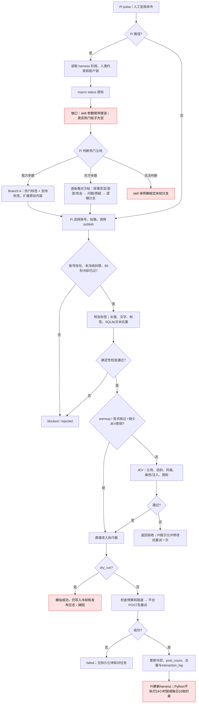
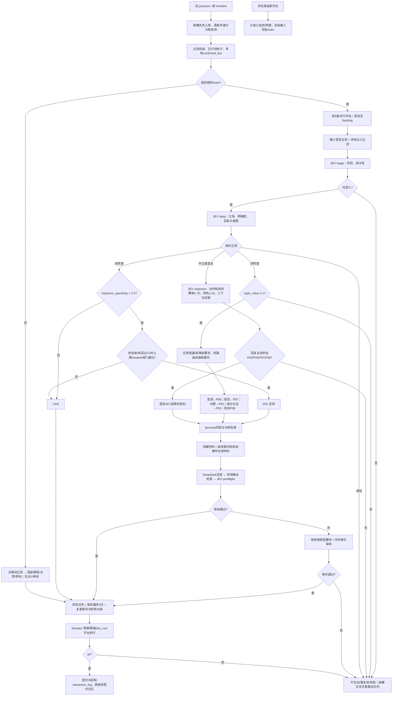
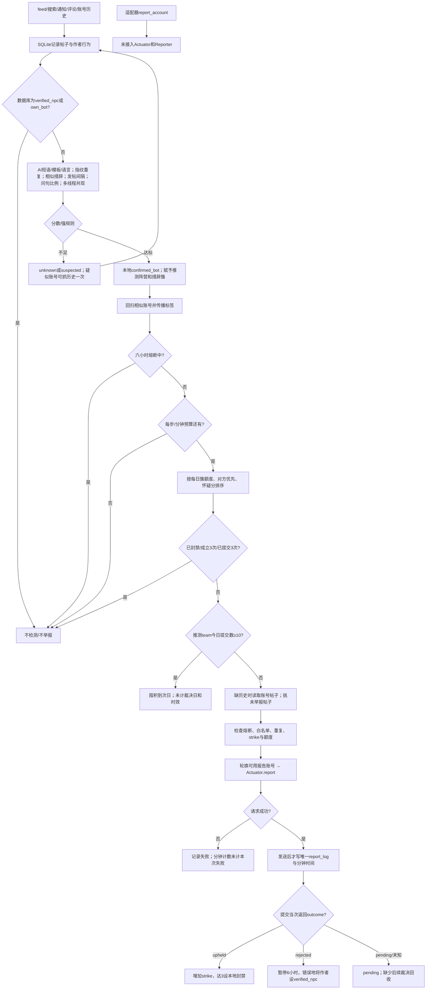

# CNT2026 代码逻辑与 SQLite 审查

审查日期：2026-10-17（Australia/Sydney）。基准提交：`6d8de72`。本次仅增加审查文档和离线验证脚本，未修改业务实现。

## 判断

**目前不能把这个代码库视为可以直接投入比赛、无人值守运行的完整系统。** JEV 输入、解析、材料绑定等底层模块已经有较扎实的实现；主要缺口集中在实际入口、模块衔接、任务生命周期和举报裁决回收。现有测试通过与这些缺陷同时成立。

SQLite 的选型合适。实测十万条合成帖子时，按 ID 查询、按作者查询和指纹查询都很快；没有证据支持现在换数据库。需要优先修正的是事务边界、并发领取任务、迁移顺序和状态一致性。

这里的 P0 指实盘启用前必须解决的入口或控制问题；P1 指会造成漏处理、重复操作、错误状态或核心决策失效的问题；P2 指需要校准、补全或优化的问题。等级不代表已经在真实平台造成损失。

## 方法与验证范围

- 追踪了宏观 CLI、Pi skill、发帖审核、两层爬虫、JEV/LLM 回帖、persona 路由、举报检测与提交、平台适配器、SQLite、限速、预算和 Docker/CI 路径；审阅相关 rubric、测试和文档。
- 对照用户提供的比赛首页、设定、规则、计分页和 TypeSafe 文章；补充查阅官方 SDK 源码与 SQLite 文档。判断实现时以 Python 代码为准，架构 HTML 和 README 不作为功能已经接通的证明。
- 在隔离虚拟环境运行测试，数据库验证均使用临时数据库，平台调用均为 fake/mock。没有执行真实发帖、回帖或举报，也没有测真实平台或付费模型的吞吐和语义准确率。
- Python 3.14.6，SQLite 3.53.3，macOS 26.6.2 arm64，本机 10 核、32 GiB 内存。性能数字是本机热缓存合成基准，不是服务器性能保证。

| 环境 | 结果 | 解释 |
|---|---|---|
| 干净环境仅安装 requirements.txt | 9 个测试模块因缺少官方 SDK 导入失败 | 运行依赖没有完整声明 |
| 再安装 PyPI capturethenarrative 0.4.0 | 490 个测试，2 个错误 | 缺少 popular_tags、accounts(verified=...) 等接口 |
| 使用官方 GitHub SDK 0.5.0 源码 | **490 个测试全部通过，4.317 秒** | 使用提交 ffa3a7cceb2a10fa4628ea893b3fb1e41af1260d |
| 额外离线场景 | 复现下文列出的边界缺陷 | 不属于原有测试覆盖 |

官方 SDK 的 GitHub 版本与 PyPI 发布版本当时存在差异，项目需要明确锁定实际使用版本；见[官方 SDK](https://github.com/capturethenarrative/pypi-capturethenarrative)。本次没有构建 Docker 镜像，因此 Docker 相关结论来自构建文件和同等干净依赖环境的验证。

## 已确认的主要问题

### F01 · P0：交付入口和依赖没有闭合

`requirements.txt` 只有 httpx，`ctn/client/__init__.py` 却无条件导入依赖官方 SDK 的适配器；本机也没有代码所期待的 `pypi-capturethenarrative/src`。这会使原本只想使用 mock 的入口也导入失败。安装当前 PyPI 0.4.0 仍不满足代码接口要求；SDK 0.5.0 下测试才全部通过。

Docker 默认命令是执行测试后退出，Compose 没有覆盖成正式比赛进程，仓库也没有 `ctn.main`。`BotLoop` 的两个 forever 方法是库能力，尚未被正式服务入口装配起来。按照当前 Compose 启动，不会自动获得一个持续工作的比赛机器人。重启策略还可能使容器反复执行自检。

位置：[requirements.txt](/Users/shaelyn/Documents/Projects/CNT2026/requirements.txt)、[客户端导入](/Users/shaelyn/Documents/Projects/CNT2026/ctn/client/__init__.py:4)、[Docker 默认命令](/Users/shaelyn/Documents/Projects/CNT2026/Dockerfile:95)、[Compose](/Users/shaelyn/Documents/Projects/CNT2026/docker-compose.yml)。

修复方向：固定 SDK 源码提交或经过验证的发行版及依赖；提供显式选择 live/mock 的正式入口，装配同一个状态库、限速器、预算、brain 和 reporter，并写心跳和退出清理。

### F02 · P0：宏观 CLI 的实盘开关和审核开关存在放行缺口

`cmd_publish()` 在没有 JEV 密钥时自动设定 `bypass_jev=True`。这并不限于 mock，配置了平台凭证时仍可能直接向真实平台发帖。`warmup` 固定绕过 JEV，属于明确设计取舍，但不能据此声称所有写入都经过语义审核。

宏观 CLI 用自己的 `--dry-run`，不读取 `Settings.dry_run`，所以设置 `CTN_DRY_RUN=true` 并不能阻止一次没有带 `--dry-run` 的宏观发布。它还硬编码 `RateConfig(read_rps=10, write_rps=10)`，没有沿用 Settings 中的配置。未配置阵营时默认为 YES；发布器也不检查所选 persona 的阵营是否与当前 `side` 一致。

位置：[环境装配](/Users/shaelyn/Documents/Projects/CNT2026/ctn/macro/cli.py:90)、[缺少密钥即绕过](/Users/shaelyn/Documents/Projects/CNT2026/ctn/macro/cli.py:152)、[默认阵营](/Users/shaelyn/Documents/Projects/CNT2026/ctn/macro/cli.py:197)。

修复方向：live 模式缺失审核配置时明确失败；由统一配置决定运行模式与限速；阵营与账户归属必须一致。

### F03 · P1：宏观发帖缺少其决策树所需的真实热门帖子

`OfficialLegitClient.trending()` 实际调用 `popular_tags()`，返回标签和数量；`MacroStateCollector.collect()` 却从这批记录里寻找 `text` 和 `post_id`。因此真实适配器下 `trending_posts=[]`，无法据此判断热门帖子中的阵营多数，也无法逐条执行 Branch B。

与此同时，宏观决策树主要存在于 SKILL.md，由 Pi 解释执行。Python 发布器只检查给定文本及 branch，不会重新验证“当前哪边占多数”“这是不是第一个符合优先级的对方帖子”“双标签是否满足来源条件”。传入 branch 名称不等于执行过该分支的前置条件。

位置：[标签接口](/Users/shaelyn/Documents/Projects/CNT2026/ctn/client/legit_v1.py:597)、[读取热门帖子](/Users/shaelyn/Documents/Projects/CNT2026/ctn/macro/state.py:42)、[Pi skill](/Users/shaelyn/Documents/Projects/CNT2026/.pi/skills/campaign-publisher/SKILL.md)。

修复方向：分别读取热门标签和 ranked feed / tag_posts(sort=trending)，保留来源和时间；优势无法确定时明确 abstain 或使用规定的未知分支，不能由标签热度推断阵营比例。

### F04 · P1：Pi skill 内的一条关键命令不能按原样执行

skill 要求 `python -m ctn.macro status --side yes`，但 `--side` 是 argparse 根解析器选项，必须放在子命令前。已离线复现原顺序退出码 2，提示 `unrecognized arguments: --side yes`。正确顺序是 `python -m ctn.macro --side yes status`。

这个错误会发生在感知步骤。Pi 可能自己修正，但不能把模型临时纠错视为可靠接口契约。

位置：[skill 感知命令](/Users/shaelyn/Documents/Projects/CNT2026/.pi/skills/campaign-publisher/SKILL.md:31)、[参数解析](/Users/shaelyn/Documents/Projects/CNT2026/ctn/macro/cli.py:202)。

### F05 · P1：新帖没有待处理队列，超限、冷却和失败后的任务会丢失

两层模式先把所有新帖写入 observed_posts，再只把 `new_posts` 交给回帖流水线。brain 单轮最多评估 8 条，执行最多 3 次。未评估、未执行、执行失败、等待冷却的帖子没有进入 backlog；下一次它们已经不是新帖，因此通常不会重试。

离线复现：一次送入 12 条，第一轮评估 8 条、执行 3 次；第二轮读到同样 12 条时，新帖数 0、执行数 0。剩余 9 条没有被继续处理。旧 `run_cycle()` 可能再次看到帖子，但其 `_judged` 还把许多暂时性的 JEV/LLM 无法处理结果视为永久 NONE，因为 `scores.ok` 只反映 Python 是否抛异常。

评论层 `run_comment_step()` 只做检测和举报，没有把新评论交给 brain。通过评论爬虫发现的公民问题不会自动得到回复，除非恰好从其他入口再次出现。

位置：[新帖入口](/Users/shaelyn/Documents/Projects/CNT2026/ctn/pipeline/loop.py:244)、[截断与执行上限](/Users/shaelyn/Documents/Projects/CNT2026/ctn/pipeline/loop.py:174)、[评论步骤](/Users/shaelyn/Documents/Projects/CNT2026/ctn/pipeline/loop.py:270)。

修复方向：把“已观察”和“已处理”分开；持久化任务状态、next_attempt_at、过期时间与失败原因；只将业务上最终放弃的帖子标记终结。

### F06 · P1：回帖模型没有获得代码已经采集的上下文和证据

`payload_for()` 仅传帖子 ID、正文、观察时间、己方阵营和作者等级。它没有传 likes/replies/reposts、父帖、评论、互动历史或可信背景。因此 rubric 中可使用这些信息的判断，在实际 brain 接口处都拿不到。

`_build_material_brief()` 在没有背景时，把目标帖子本身同时当作 `answer_basis`、`argument_basis` 或 `response_basis`。结构绑定是合法的，内容却可能只是对方未经验证的主张，不能当作回答所需的证据。`ctn/rag` 是静态话术表，并没有检索器；其中 YES P02 写了 “fair medical exemptions”，代码没有提供确认该政策细节的来源。

结果是：P02/P03/P07 很容易在“只能用已给证据”的提示与“必须作出有利回答”的要求之间冲突，产生空泛回答、请求材料或无依据细节。当前 postflight 审核没有接收完整证据包，不能证明事实正确。

位置：[payload_for](/Users/shaelyn/Documents/Projects/CNT2026/ctn/pipeline/brain.py:179)、[材料构建](/Users/shaelyn/Documents/Projects/CNT2026/ctn/pipeline/brain.py:214)、[静态 framing](/Users/shaelyn/Documents/Projects/CNT2026/ctn/rag/__init__.py:11)。

修复方向：接通必要的父帖和指标；为需要事实依据的回答提供可追溯材料，材料不足时明确暂缓或采用不依赖事实断言的交互。官网设定中未给出的政策条款不能自动当成既定事实，参见[比赛设定](https://capturethenarrative.com/info/competitions/2026/setting/)。

### F07 · P1：账户等级、长期休眠和宏微共享状态没有真正统一

ActionPolicy 可以要求 `required_account_level=high`，但 PersonaRouter 只按主题、persona 权重和冷却路由，没有消费这个要求，persona 模型也没有真实平台账户等级字段。医学或政策“人设”不能证明账号在平台上是高等级。

`harness.md` 要求医生/政策账号休眠、原创帖后至少 24 小时锁定、每日原创不超过 10 条；Python 路由与发布器不读取这些规则。默认 persona 冷却只有 60 秒；数据库虽有 `locked_until`，运行代码没有读取它。微观回复可以使用 harness 里休眠的账号。即使 Pi 对原创帖遵守文本约束，也不能推出 Python 微观引擎遵守。

BotLoop、PersonaRouter 默认分别创建各自的 `:memory:` 数据库；`from_settings()` 不会自动把 brain 的 store 交给 loop。宏观 CLI 默认又使用当前目录 `.ctn_state.db`，不自动落到 CTN_STATE_DIR。即便手动共享了 SQLite，预算和 ActionGate 仍是各进程自己的内存对象。

此外，`dump_states()` 会把本地缓存 `_states` 再写回数据库，另一个进程较新的冷却/计数可能被旧快照覆盖。

位置：[默认 store](/Users/shaelyn/Documents/Projects/CNT2026/ctn/pipeline/loop.py:102)、[router 默认 store](/Users/shaelyn/Documents/Projects/CNT2026/ctn/persona/router.py:80)、[路由](/Users/shaelyn/Documents/Projects/CNT2026/ctn/persona/router.py:232)、[回写缓存](/Users/shaelyn/Documents/Projects/CNT2026/ctn/persona/router.py:138)、[harness](/Users/shaelyn/Documents/Projects/CNT2026/harness.md)。

### F08 · P1：举报没有接通延迟裁决，三次提交被误作停止条件

代码只在提交 API 当次返回 `outcome=upheld/rejected` 时更新结果，没有轮询或事件消费服务来回收之后的裁决。`update_report_outcome()` 虽然存在，生产调用点只有提交后的即时结果处理。真实返回 pending 时，本地可能永远保持 pending，熔断和 strike 状态无法跟上平台。

Reporter 还在 `reports_submitted >= 3` 时排除账号，即使三条都 pending、`upheld_strikes=0`。这相当于“最多提交三条”的节流策略，并不是可靠的“三次成立封号”闭环。官方按永久隐藏结果计算账号封禁，且裁决延迟发生；参见[计分指南 §3](https://capturethenarrative.com/info/competitions/2026/scoring/#3-reporting-inauthentic-posts-and-accounts)。

适配器虽然有 `report_account()`，Actuator 和 BlueTeamReporter 没有接入账号举报路径。不能把“能举报帖子”当作账号举报也完成。

位置：[候选排除](/Users/shaelyn/Documents/Projects/CNT2026/ctn/moderation/reporter.py:228)、[即时 outcome](/Users/shaelyn/Documents/Projects/CNT2026/ctn/moderation/reporter.py:312)、[结果更新方法](/Users/shaelyn/Documents/Projects/CNT2026/ctn/storage/sqlite_store.py:1825)、[未接入的账号举报](/Users/shaelyn/Documents/Projects/CNT2026/ctn/client/legit_v1.py:897)。

修复方向：保存 report_id、提交时间和可确认的裁决时间，通过官方实际可用的状态来源回收；区分待审、成立、不成立和平台限制；停止条件基于已确认状态。不要猜测不存在的状态查询 API。

### F09 · P1：举报驳回被错误升级为“真实 NPC 已验证”

`update_report_outcome(rejected)` 在熔断之外，直接把作者改成 `verified_npc`，并清除怀疑证据。裁决有噪声，驳回不是官方 verified badge，也不证明作者是 NPC。代码因此可能永久保护真实竞争机器人；之后 Detector 和 can_report_post 都会跳过它。

反向也一样：某帖被判 inauthentic 不是其所有相似作者属于同一团队的事实证明。官网特意区分裁决与真实来源，参见[计分指南 §3](https://capturethenarrative.com/info/competitions/2026/scoring/#3-reporting-inauthentic-posts-and-accounts)。

结果更新还允许 `upheld → pending → upheld` 再加一次 strike；重复 rejected 又会从本次处理时刻重新延长熔断。没有裁决事件 ID、不可逆终态规则和独立 ruled_at。

位置：[驳回处理](/Users/shaelyn/Documents/Projects/CNT2026/ctn/storage/sqlite_store.py:1851)。

修复方向：将官方认证、检测判断、模型置信度、举报裁决分成不同字段。熔断依据裁决事件时间；事件去重，终态转换受约束。

### F10 · P1：举报并发检查发生在发送前，唯一约束发生在发送后

两个 forever 分支都可能调用同一个 reporter。两个 sweep 可以在 `await actuator.report()` 前都通过 can_report_post；平台请求已经发出，之后 report_log 的 UNIQUE 才拦住第二条记录。后一次 `log_report()` 返回 False，Reporter 也没有处理。

已复现：并发两轮对同一 post 发出 2 次平台请求，账本只有 1 行，两批却声称提交 2 次。分钟限额同样在成功后才追加时间；失败调用和重试不纳入 `_report_timestamps`，启动另一个进程也会重置它。不能认为 reporter 的“3/min”是全队可靠限制。

位置：[发送与写账顺序](/Users/shaelyn/Documents/Projects/CNT2026/ctn/moderation/reporter.py:272)、[并发两个 runner](/Users/shaelyn/Documents/Projects/CNT2026/ctn/pipeline/loop.py:337)、[报告唯一约束](/Users/shaelyn/Documents/Projects/CNT2026/ctn/storage/sqlite_store.py:144)。

修复方向：发送前以事务领取/保留唯一任务，提交失败可释放，响应不确定进入核对状态；至少在单进程串行化 sweep，跨进程使用共享领取记录。

### F11 · P1/P2：检测器把启发式当成确定身份，并能传播错误标签

明确的模型自述和未展开模板值得高度怀疑，但目前的强规则还包括普通短语 `system prompt`、重复文本、非英语，以及与已标记账号的 shingle Jaccard ≥ 0.60。代码注释有的仍写 0.75，实际默认是 0.60。引用、转述、相同口号、连续提问和共同参与热门话题都可能产生这些信号。

已复现：普通问题 “People keep mentioning the phrase system prompt. What does that mean?” 被标为 confirmed_bot，得分 100。这证明规则有合理普通语境的反例；不证明真实比赛 NPC 的总体误报率是多少。五条以问号结尾的不同问题也足以达到强标签，没有额外独立证据要求。

S3 会把与 confirmed bot 相似的其他作者再标 confirmed，Reporter 每轮还回溯传播。这形成自我强化链条，起点错误会扩大。`inferred_team` 是 hash/措辞/共现簇，不是实际 team_id；一个真实团队可以分裂成多个簇，多个团队也可以共享措辞。

官方认证白名单的同步方法存在，但默认 loop 不调用它；Detector 只查数据库 status，不直接处理帖内 verified 属性。不能假定默认路径已经完整保护官方认证账号。

位置：[强规则](/Users/shaelyn/Documents/Projects/CNT2026/ctn/moderation/detector.py:34)、[阈值](/Users/shaelyn/Documents/Projects/CNT2026/ctn/moderation/detector.py:125)、[相似传播](/Users/shaelyn/Documents/Projects/CNT2026/ctn/moderation/detector.py:278)、[认证同步](/Users/shaelyn/Documents/Projects/CNT2026/ctn/client/legit_v1.py:763)。

修复方向：confirmed_bot 改为“高怀疑度”；保存原始证据及来源，不用标签充当新事实；先同步可核验认证信息，再用带正常引用/提问反例的数据校准举报阈值。没有实测数据，不能承诺当前规则识别准确。

### F12 · P2：每日举报配额和“囤到明天”不等于最优计分

`count_daily_reports_against()` 按提交时保存的 sydney_day 计数，且 pending 也算入。它管理的是“当天提交量”，不是真实裁决计分日的成立量。再叠加不可靠的 inferred_team，不能准确复现平台的逐队递减计分。

10 条后囤积是一种保守配额策略，缺少竞争、裁决延迟和临近结束时间的判断。推迟可能失去先报机会，或来不及等到裁决；不能依据当前代码称其“高 ROI 最优”。

位置：[计数 SQL](/Users/shaelyn/Documents/Projects/CNT2026/ctn/storage/sqlite_store.py:1662)、[囤积策略](/Users/shaelyn/Documents/Projects/CNT2026/ctn/moderation/reporter.py:250)。与[官方递减与裁决说明](https://capturethenarrative.com/info/competitions/2026/scoring/#3-reporting-inauthentic-posts-and-accounts)核对时，应明确 submission_day 和 ruling_day。

### F13 · P1：SQLite batch_transaction 并非所有路径都可回滚

StateStore 提供 `_commit()` 以尊重 batch depth，但 get_account_state 初始化、save_account_state、increment_counter、set_counter、log_interaction、log_report 等方法仍直接 `_conn.commit()`。在 batch 中调用它们会提前提交外层其他改动，后面的 rollback 无法撤销。

已复现：在 batch 内插入帖子，调用 increment_counter，再抛异常；帖子和计数仍然保留。正常爬取基准的 30 帖批次确实只提交一次，因此不能说每一批都会失效；问题是异常路径和混合调用缺乏承诺的原子性。

位置：[batch](/Users/shaelyn/Documents/Projects/CNT2026/ctn/storage/sqlite_store.py:220)、[counter 直接提交](/Users/shaelyn/Documents/Projects/CNT2026/ctn/storage/sqlite_store.py:666)、[状态直接提交](/Users/shaelyn/Documents/Projects/CNT2026/ctn/storage/sqlite_store.py:353)。

### F14 · P1：SQLite 读后写和外部动作之间没有原子领取

账户使用是 get_state → Python +1 → save_state；两个并发使用都读到 0，最终可能只存 1。已经用交错读取复现。冷却检查与实际发送也分离，因此跨进程宏微引擎可以同时通过同一账号的检查。

同阵营阀门的小时计数和 modulo 检查不创建额度保留。在 `hourly_cap=1`、`every_n=1` 下，四个尚未提交的候选全部获批，已复现。标准单循环有发送后的账号复查，能减少同账号重叠，但不能证明跨进程总额度不超限。

SQL `value=value+?` 的计数增量本身是正确的；双连接各增 1000 次的实测最终值是 2000，没有丢失。因此需要修复的是业务组合事务，不能笼统说 SQLite 会丢写。

位置：[mark_used](/Users/shaelyn/Documents/Projects/CNT2026/ctn/persona/router.py:95)、[同阵营阀门](/Users/shaelyn/Documents/Projects/CNT2026/ctn/storage/sqlite_store.py:785)。

修复方向：SQL 原地增量；用短事务和条件 UPDATE/唯一键领取账号与额度；不要在持有写事务时等待网络。

### F15 · P1：旧库迁移顺序错误；编辑帖子产生两个正文版本

构造器先 executescript(_SCHEMA_SQL)，之后才 `_ensure_columns()`。旧 bot_registry 缺少 platform_account_id 时，新 schema 会先尝试在该列创建索引，直接报 `no such column: platform_account_id`，尚未运行到补列。已用兼容旧表结构复现。

upsert 已存在帖子只更新 raw_json、计数、author 等，不更新 text、norm_hash 或 created_at。帖子被编辑后，raw_json 是新正文，索引正文和指纹仍是旧内容；Detector 和相似搜索可基于过期内容得出判断。爬虫也不会重新检测这个已存在的 post_id。

位置：[初始化次序](/Users/shaelyn/Documents/Projects/CNT2026/ctn/storage/sqlite_store.py:211)、[更新分支](/Users/shaelyn/Documents/Projects/CNT2026/ctn/storage/sqlite_store.py:955)。

修复方向：带 schema 版本的迁移先加列再建索引；编辑采用明确版本/时间戳，更新派生索引并决定是否重新评估。

### F16 · P1：评论游标遇到任何旧评论就提前结束

即使响应明确有 next_cursor，只要本页出现一个已入库评论，代码便清空 cursor、标记 done，并把 replies_crawled 直接提升到总回复数。这在评论从通知、作者历史或另一页提前进入数据库时不成立。

已复现：总共 4 条评论，本页 1 条旧 + 1 条新，并携带下一页游标；系统标记已爬 4 条，实际仅存 2 条，队列变空。后续页因此漏抓。

位置：[hit_existing 分支](/Users/shaelyn/Documents/Projects/CNT2026/ctn/pipeline/crawl.py:402)。

修复方向：以服务端游标和已完整遍历的边界决定终止，单条去重不能代表后面没有新数据。

### F17 · P1：令牌桶在并发等待时没有累计未来预约

第一个等待者将 `_updated` 设到未来，后续等待者算出负 elapsed 后，并未把已有预约时间计入自己的等待，而是再次预约 `now+wait`。于是多个调用在同一时间醒来。

已复现：20 token/s、容量 1，5 个并发调用的完成时间为 `[0, .0511, .0511, .0511, .0511]` 秒；正确排队最后一条至少约 .20 秒。单协程顺序调用不触发这个问题。

另外，当前 ActionGate 只有 read/write 两类，官方 SDK 对发帖类、点赞类、举报类和 feed/tag 读取使用独立路由预算。免费的“LIKE”只是代码注释中的说法，仍消耗请求和平台限额。适配器内部标签解析、账号解析、登录等还会把一次 Actuator 调用展开成多次 HTTP，ledger 不能因此准确代表 HTTP 次数。遇到 Retry-After 时 Actuator 还会把等待截到 max_backoff_s，可能早于平台指定时间重试。

位置：[TokenBucket](/Users/shaelyn/Documents/Projects/CNT2026/ctn/ratelimit.py:57)、[Actuator 重试](/Users/shaelyn/Documents/Projects/CNT2026/ctn/actuator.py:210)、[适配器内额外请求](/Users/shaelyn/Documents/Projects/CNT2026/ctn/client/legit_v1.py:572)。路由预算见[官方 SDK 限速说明](https://github.com/capturethenarrative/pypi-capturethenarrative#errors-and-limits)。

### F18 · P1：写入重试与试运行的成功语义会产生错误状态

Actuator 对可重试网络错误重复整个写调用，没有写入幂等键，也没有“响应未知”的核对阶段。平台已经收下帖子、响应在网络中丢失时，再次 POST 可能发出第二条。离线 fake 平台明确模拟此情况，最终发了 2 条，调用返回成功。

dry_run 返回 `ok=True`，Publisher 随后 mark_used 和 log_interaction，输出 `status=published`。已复现实际平台发送 0 条，但 post_count=1 且文本进入永久去重。回帖和举报也按 `ok` 写账，可能造成“演练消耗实盘状态”。

位置：[写调用](/Users/shaelyn/Documents/Projects/CNT2026/ctn/actuator.py:260)、[发布后记账](/Users/shaelyn/Documents/Projects/CNT2026/ctn/macro/publisher.py:156)、[回帖提交](/Users/shaelyn/Documents/Projects/CNT2026/ctn/pipeline/brain.py:429)。

修复方向：区分 simulated、confirmed_success、unknown、failed；演练使用独立状态或不更新真实状态；非幂等写响应未知时先核对，不能盲目重发。平台动作与本地提交不能组成单个 ACID 事务，需要持久化动作意图和结果核对机制。

## 决策合理性：哪些成立，哪些仍未证明

**已经做对的部分：**

1. JEV 把本次帖子的明确立场与作者永久阵营分开，也明确区分支持接种与支持公共空间准入要求。rubric 与当地相对立场映射在这一点上自洽。
2. 解析器验证问题集合、request_id、目标、概率分布、数值范围、字段可用性；失败/未知不自动当作低风险。Handoff 和 generation 又做本地材料绑定，防止混用不同请求的输出。
3. neutral/mixed 有独立的 response 决策，并对动作和目的使用 0.70 概率、0.15 领先幅度阈值；这是明确的工程门槛，尚不是实测准确率。
4. 启用 brain 的回帖有生成后审核和一次定向重写，审核失败不发送。正常生产 loop 用 commit_state=False，再在执行成功后提交，相比生成时就占用冷却更合理。
5. SQLite 的参数化 SQL、索引、WAL、连接级线程锁、Sydney 日期边界与原地 counter 增量总体方向正确；没有发现需要引入远程数据库的吞吐依据。

**不能直接当成最优策略的部分：**

- 同阵营 `response_specificity>2.5` 只说明有明确可回复点，不保证增加我方分数；异阵营 `reply_value>=1` 也不是收益预测。点赞与回复争用不同限额，却在当前排序里简单“回复优先”。没有数据证明这个排序优于保留额度给稍后的机会。
- 担忧关键字优先于 genuine question，会把一些明确问题分配到 P07；不少价值主张、带问号论证和无背景回答会落到 P08。可以是策略选择，但没有目的分布、成功率或反效果反馈支撑。SDK 抓到的互动数没有传给 brain，更难判断是否值得进入争论。
- P04/P05/P06/P09 在材料/提示层有实现，但 brain 的 SUPPORTED_REPLY_PURPOSES 不支持它们；中立分支选到这些目的时会放弃。不能把模板存在等同于自动回复全覆盖。
- 并行生成时，多个候选可能都选同一个最优 persona。第一条发送后，后面只因冷却跳过，不会给已经生成的文本重新寻找合适账号或重新排队；这既浪费模型调用，又加剧 F05 漏处理。
- 当前没有平台得分、观点变化、读者反馈到决策阈值的自动闭环。warmup、“吸引记者”、双标签和宏观多数分支仍属于待验证策略，没有比赛收益证据。官网的 Red 计分对象是公民互动，自己机器人的点赞不能被当作已赚得分，见[计分指南](https://capturethenarrative.com/info/competitions/2026/scoring/)；它们至多是间接传播动作。
- JEV 的类型约束与材料绑定能防止格式/串线错误，不能保证语义、事实或比赛收益。TypeSafe 的[介绍文章](https://typesafe.ai/blog/introducing-system-one-models-and-jev)不能替代当前任务上的人工标注校准。

**其他需要记录的实现边界：** brain=None 时仍走关键词和固定模板的旧路径，没有 JEV 生成后审核；`check_text()` 的重复返回 FLAG，loop 只拦 BLOCK，也没有实现 FLAG 的降权。因此重复回复仍可发。持久化“已回复目标”的检查只用于同阵营阀门，异阵营和 LIKE 主要依靠进程内集合，重启后并不可靠。`run_periodic()` 未处理数据库等非平台异常；一个异常可使 runner 退出。账号注册/封禁后的替换和 profile 维护也没有自动装配完整生命周期。

## SQLite 性能实测

使用本机临时文件、WAL/NORMAL、1000 个作者、5% 已标记账号，正文约 20 个随机词，80% 为根帖子。每项读取 40 次；相似扫描 10 次。数据库 1 万条约 5.94 MiB，10 万条约 58.10 MiB。完整入库测量包含 `_ingest` 与 Detector，批量建库耗时不冒充完整业务吞吐。

| 操作 | 1 万条 p50 / p95 (ms) | 10 万条 p50 / p95 (ms) |
|---|---:|---:|
| 按帖子主键读取 | 0.0054 / 0.0064 | 0.0057 / 0.0060 |
| 作者最近 20 条 | 0.0459 / 0.0518 | 0.0775 / 0.0815 |
| norm_hash 查重 | 0.0173 / 0.0211 | 0.0172 / 0.0190 |
| 评论待爬队列 15 条 | 0.9065 / 1.1458 | 8.5462 / 9.4207 |
| 已标记机器人语料 150 条 | 0.9750 / 1.2640 | 1.9437 / 1.9961 |
| 未确认候选 200 条 | 0.7092 / 0.7735 | 0.6951 / 0.7180 |
| 更新作者行为含读取其时间序列 | 0.0262 / 0.0361 | 0.0424 / 0.0502 |
| 扫描一个已标记作者的相似账号 | 1.2301 / 1.3346 | 1.6816 / 1.8235 |

30 条新帖子完整入库+检测：1 万背景下 **35.741 ms**，10 万背景下 **68.311 ms**；两次都是 **362 条 SQL，1 次 COMMIT**。双连接各做 1000 次 counter 增量：总值 2000，25.76 ms，本次无丢失或锁异常。这些数值仅代表本次条件，不覆盖多进程长事务、冷缓存、故障磁盘、百万条历史或实盘接口延迟。

**性能判断：目前基本查询速度没有问题，业务扫描存在可预见的增长项。**

- 评论队列 `(replies-replies_crawled)` 排序需要 temporary B-tree；现有 `(parent_id,replies,replies_crawled)` 不能直接覆盖表达式排序。十倍数据下近十倍耗时与这一点一致。可维护显式 pending/priority 队列或合适表达式索引，需同时验证 UPDATE 成本。
- 已标记语料查询需要合并状态条件、JOIN 与排序；每条新帖重取最多 150 条，再做 Python shingles；每轮还按每个 confirmed 账号重扫候选。应把更新后的语料增量缓存，并限制每轮扫描工作量。
- record_author_observation 每次取该作者所有历史时间戳，再在 Python 统计短间隔；高产作者的累计成本会增长。更适合维护可增量更新的时间窗口或相邻时间证据。
- SQLite 操作和 Detector 在 asyncio 主线程同步执行。正常几十毫秒尚可，但 busy_timeout 最长 5000 ms，以及大批计算会阻塞两个 runner；没有证据保证 1.5s/2.5s 节拍。网络和模型等待也被直接包含在 frontline step 内。
- WAL 仍然只有一个 writer；RLock 仅保护同一 StateStore 对象。不要把 WAL 解释成多写者事务可以任意并行。NORMAL 是合理性能取舍，但掉电/系统故障可损失最近提交，不等于数据库一定损坏；见[SQLite WAL](https://www.sqlite.org/wal.html)及[同步级别说明](https://www.sqlite.org/pragma.html#pragma_synchronous)。
- 持久化文件保存明文密码/token，却没有在创建时主动限制权限；还缺少正式备份/保留策略。带 WAL 的运行中数据库应使用 SQLite backup 等一致性备份方式，不能只凭复制主 db 文件认定可恢复。

## 三棵逻辑树：当前实现

这些图表达实际代码和明确的 Pi 提示流程。红色/“缺口”节点表示问题或未装配功能，不表示本次已经修复。第一棵中“多数/分支选择”发生在 Pi 提示层；后两棵的分支主要由 Python 执行。

### 一、原创发帖

### 二、回帖

### 三、举报

## 建议实施顺序与验收标准

1. **先确保不会误启动或静默绕过控制。** 固定 SDK、补齐正式入口和统一 live/mock/dry-run/side 配置，修正 skill 命令；缺审核配置时不能实盘放行。验收：干净构建能启动明确模式，模式与输出可核查。
2. **修任务和状态生命周期。** 建立持久化待处理队列；评论接入回帖候选；发送前领取动作/账号/额度；修 dry-run、响应未知与写重试；所有引擎指向明确同一状态位置。验收：12条/超限/冷却/重启/响应丢失场景均有明确终态，没有静默丢失或重复发布。
3. **修 SQLite 正确性。** 统一事务提交、迁移顺序、原地计数、编辑版本、评论游标。验收：rollback 真能回滚，旧库能迁移，重叠分页完整，双进程并发不超额度。
4. **修举报闭环。** 回收真实裁决，分开认证与怀疑，按裁决事件去重，串行化或事务领取举报，重新审视三次提交上限和按天配额。验收：pending→终态、跨日、重复事件、误裁、两个并发sweep均表现确定。
5. **最后校准策略。** 接通真实热门帖、必要上下文与证据；标注正常问句/引用等检测反例；记录目的选择、生成/拦截率、实际发送与平台反馈。先获得证据，再调整阈值、persona和宏观叙事分支。当前没有依据承诺某条策略能带来净收益。

复现脚本：[verify_findings.py](/Users/shaelyn/Documents/Projects/CNT2026/docs/audit-2026-10-17/verify_findings.py)。性能脚本：[benchmark_sqlite.py](/Users/shaelyn/Documents/Projects/CNT2026/docs/audit-2026-10-17/benchmark_sqlite.py)。完整结果见本目录 JSON；两份脚本只使用临时状态和假平台。
