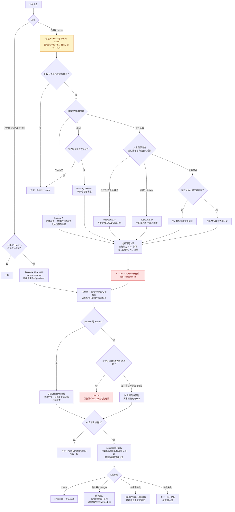
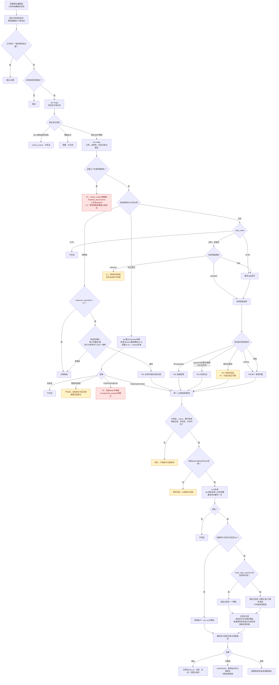
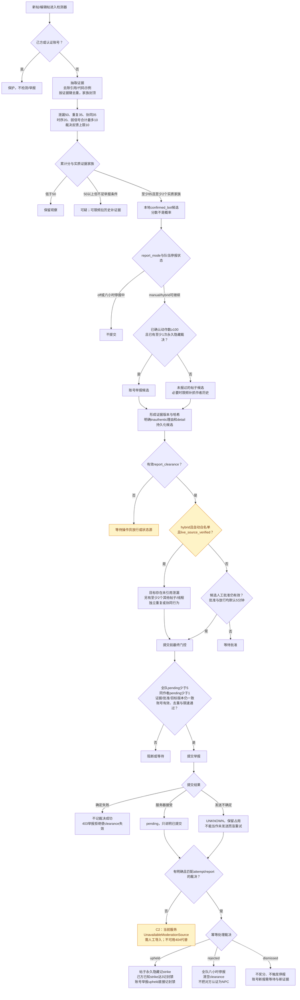

# 发帖、回帖、举报逻辑树

按 2026-10-18 当前代码绘制。这里描述**实际实现**，不是建议中的新策略。F/C 编号对应 [审计报告](review.md)。红色是已确认缺陷，黄色是条件性阻断或尚未接通能力。三棵树末端的共享执行校验见文末。

## 1. 发帖逻辑树

战略选题由 `.pi/skills/campaign-publisher/SKILL.md` 规定，触发依赖外部 Pi 调度；Python 不自行执行 A/B 选题。暖号由 Python 负责。

补充：战略原创配额默认 10/悉尼日，warmup 默认 15/日；两个进程共用发送速率与账号状态。CLI 丢参不应被误读为“战略原创设计上不需要快照”。

## 2. 回帖逻辑树

主路径不自动选择 repost/follow/report。下图的 same/opposing/neutral 针对**当前帖子表达**，不代表作者永久阵营。

注意：机会默认 30 分钟，草稿默认 5 分钟；编辑目标会取消旧版本。完整性标记还有 F7：Brain 会把目标和父帖 `text_complete` 强行设为 true，即使上游标记 false。

## 3. 举报逻辑树

`confirmed_bot` 是本地候选标签，**不是官方确认身份**。举报没有 NO 方过滤；其他队伍的 YES 账号也可能进入此树。

自动白名单不是任意“85分”就自动报。当前正式装配没有可验证裁决源，人工 clearance 又明确不授权自动模式，因此图中的自动提交分支目前不能通过正常生产入口直接启用。

## 共享最终执行校验

发帖/回复实际发送前再次确认：当前人设目录哈希与版本、绑定账号与激活状态、账号能力与租约、目标版本、草稿/机会期限、RAG 撤回、文本重复、配额和相应策略授权。HTTP 登录、查询和发送也计入共享请求预算。确认成功后，才更新发言计数、冷却与效果归因。

报告编号、精确位置与离线复现见 [审计报告](review.md) 和 [复现结果](reproductions.json)。
