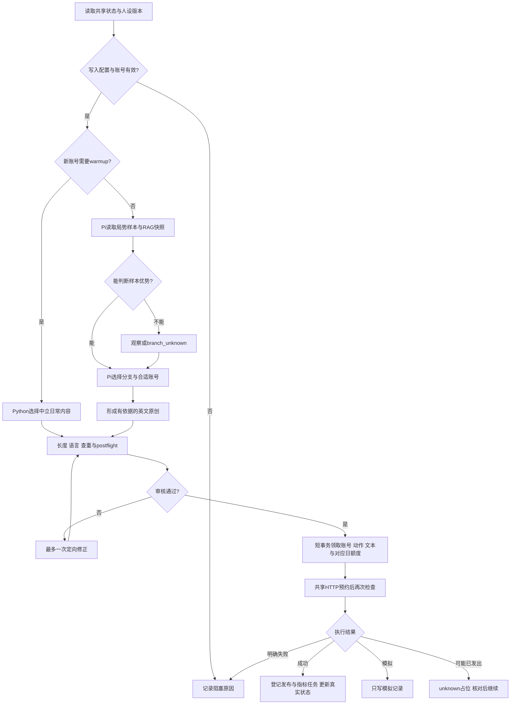
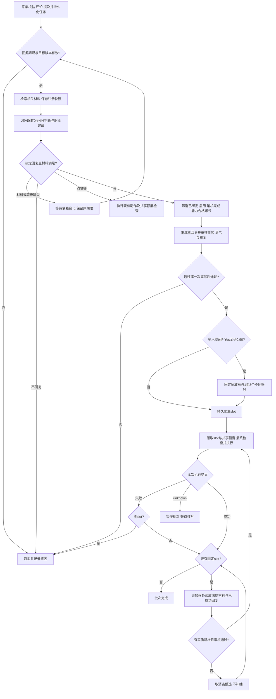
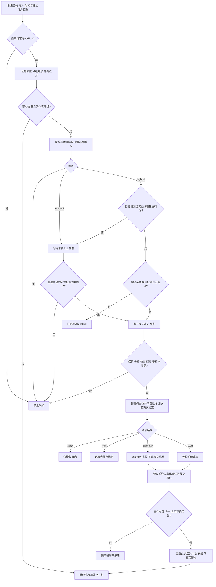

# v5发帖、回帖和举报逻辑树

## 原创：Pi战略决策／Python warmup

修正预算耗尽即取消，不循环重试。Pi只在确认published后更新harness。原创24小时锁与回复普通冷却分开。

## 自动回帖

主回复最多1条、总数最多4条。追加失败不补位；任一unknown暂停后续。机会30分钟，草稿5分钟，编辑或材料撤回取消未发送部分。

## 举报

账号举报还需确认100次动作及一条正式裁决隐藏帖。驳回不认证身份；临时隐藏不算正式成立。所有分数均不是概率。
