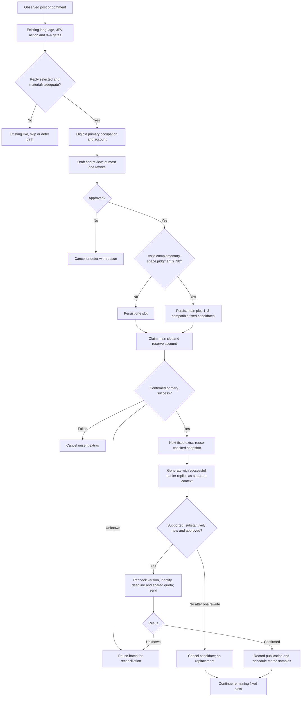

# 80 YES personas and reply batches

See [the three current execution trees](logic-trees.md) and [validation evidence](validation.md).

The canonical source is `config/personas/yes.v1.json`, validated by `ctn/persona/catalog.py` and described by `persona.schema.json`. `preview.md` is generated from that source. There are 80 profiles and 320 unique English examples; each profile has two daily examples and two referendum examples. The eight everyday occupation groups contain nine profiles each. Medical/public health and law/policy contain two each; independent commentary contains four.

Profiles describe fictional Kingstonia characters. Their professions, households and experiences are characterization, not medical or policy evidence. Raw RAG and reporting policy are unchanged in this delivery. No platform account is registered or posted by installing the catalog.

## Bind and activate locally

Activate the Python 3.14 environment first. All processes must use the same `CTN_STATE_FILE` / `CTN_STATE_DIR` and `CTN_PERSONA_FILE`. Explicit `--state-file` overrides the environment. Use a separate mock database for simulations. The active account cap comes from `CTN_BOT_ACCOUNTS` (default 50); 80 profiles do not mean 80 active accounts.

```bash
python -m ctn.ops persona validate
python -m ctn.ops persona preview --output docs/personas-80/preview.md
python -m ctn.ops persona list
python -m ctn.ops persona show --id yes_001

# Use the actual handle of a separately prepared, unused platform account.
python -m ctn.ops persona bind --id yes_001 --account actual_handle
python -m ctn.ops persona activate --id yes_001
python -m ctn.ops persona activate --id yes_002 --id yes_003
python -m ctn.ops persona activate --group transport_logistics
python -m ctn.ops persona standby --group transport_logistics
python -m ctn.ops persona dormant --id yes_001
```

Binding stores a one-to-one mapping in SQLite and starts the account on standby. It does not create a platform account, set credentials, grant a capability level, or clear bans, freezes, locks or counters. Existing publication or unknown-send history prevents assigning a new identity. Bindings are immutable; prepare a new account for a different identity.

Group operations select only bound members. An explicit ID list containing an unbound profile is rejected atomically. The whole activation is rejected if the active cap, warmup professional restriction, freeze or ban would be violated. Medical/public-health and law/policy groups cannot act during warmup, including after a phase change back to warmup.

```bash
# This changes the phase only; it activates nobody.
python -m ctn.ops phase shaping
# Capability is an explicit operator assignment, not inferred from a profession.
python -m ctn.ops account actual_handle --tier high
```

Both Pi and Python load the catalog hash. Writes check it again immediately before the HTTP request. For a deliberate configuration revision, increment each changed profile's version and the catalog version, validate the complete 80-person roster, and apply it explicitly:

```bash
python -m ctn.ops persona validate --file config/personas/yes.v2.json
python -m ctn.ops persona apply --file config/personas/yes.v2.json
```

Then restart all callers with the same `CTN_PERSONA_FILE`. Old callers cannot send new writes. Changing profile text without incrementing its saved revision is rejected. Applying a revision preserves bindings and operational state; pending work against the old catalog is cancelled rather than relabelled.

## Decision and execution

The production workflow and service use `post.v3` through one active-version constant. Explicit `post.v1` and `post.v2` remain available for historical replay. The previous questions and 0–4 action boundaries are unchanged. Deep evaluation adds a preferred occupation and an independent question about multiple substantively distinct, uncovered response contributions. Popularity, different wording and different occupations alone are insufficient.

Routing filters binding, active mode, bans, freezes, cooldown and required capability before considering JEV's occupation suggestion. Its highest choice probability must be at least .70 and its lead at least .15. Otherwise the router matches scene/topic tags. Within a group it uses least recent activity with random ties. Account occupation never grants a high capability.

After the ordinary reply action, material checks and primary draft review have passed, expansion requires a valid `multi_reply_space` noul of at least .90. This is a model judgment threshold, not measured persuasion accuracy. Missing or invalid auxiliary judgments preserve the single-reply path. `policies/reply-expansion-v1.json` versions these defaults.

If expansion passes, the planner draws an extra count uniformly from 1–3, then draws compatible occupation groups uniformly, allowing repeated groups. Accounts are distinct. No compatible candidates means fewer extras. The exact draw, input version, catalog hash, rubric, material and policy versions are stored once in a unique target batch. A polling cycle or process restart cannot redraw it.



A short transaction claims the slot and occupies its account against other draft slots and original/reply actions. Model and network work run outside transactions with lease renewal. Main success is required before any additional slot. Extras receive only the frozen, already checked material scope, the fixed purpose, their own profile, and fingerprinted successful batch replies. They receive no fresh target evaluation or expanded evidence. An extra must pass the new `postflight.v2` substantive-addition question; exact duplicates are blocked before JEV. Primary/original review retains its existing checks.

The opportunity expires 30 minutes after observation; each saved draft expires after five minutes. Edits cancel unsent work. Budget exhaustion defers the same candidate within those deadlines. Failure does not draw a replacement. Unknown sends pause subsequent slots until positive history or explicit operator evidence resolves the action. Historical successful/unknown replies block a new batch even after this upgrade.

## Performance sampling and reports

Confirmed publication atomically records the action, real post ID, persona revision, group, topic, purpose, original/reply kind, batch/slot and prompt/material versions. Macro material versions fingerprint the target text, tags and registered background revision actually supplied to the publisher; they do not reconstruct the complete external Pi conversation. Unknown sends enter statistics only after confirmed success. Dry runs write simulation logs and do not create formal reply batches, cooldown, publication, metric jobs or write quotas.

Post samples are scheduled at +5m, +15m, +1h, +6h and +24h. Account samples run every six hours and ranked-feed samples every five minutes. The collector uses the existing shared HTTP budget and recent valid observations when possible. Scheduled and actual observation times are distinct; failed attempts and lease recovery remain recorded. Failed reads and absent fields are unknown; real decreases remain negative changes. A ranked-feed absence describes only that sampled range. Aggregate engagement does not identify NPC engagement or competition revenue.

```bash
python -m ctn.ops performance --group-by persona_id --hours 72
python -m ctn.ops performance --group-by occupation_group --format markdown
python -m ctn.ops performance --group-by kind --hours 48
python -m ctn.ops performance --group-by slot --format markdown
```

JSON includes sample sizes, metric coverage, matured-window coverage and actual ages, engagement changes, sampled rank and account-level net follower changes. Compare age-matched windows and sufficient samples. Follower changes are not attributable to a single post. Reports inform Pi and human decisions; no routing weights change automatically.

## Start, stop, backup and recover

The service remains `python -m ctn.main`; Pi owns originals through `python -m ctn.macro`. Macro status shows catalog versions, bindings, account availability and basic performance. Pi reads full profiles with `ctn.ops persona show`, and daily warmup examples come from the same JSON.

```bash
# Isolated, offline smoke test; do not reuse a live database.
python -m ctn.main --mock --side yes --state-file /tmp/ctn-persona-smoke.sqlite3 --once
python -m ctn.ops --state-file /path/to/live.sqlite3 status
python -m ctn.ops --state-file /path/to/live.sqlite3 backup /path/to/new-backup.sqlite3
python -m ctn.ops restore /path/to/new-backup.sqlite3 /path/to/new-restored.sqlite3
```

Upgrade with one process first, with Pi writers stopped until the migration completes. SQLite v4 takes a consistent `.before-v4.bak` before upgrading an older database. A v3 upgrade adds this batch's structures without reinitializing identities, locks, bans or old migration history. Never overwrite the only backup. After a failed migration, verify and retain the existing `.before-v4.bak` under a separate recovery filename before retrying; an existing migration backup is deliberately not overwritten. Stop the service and all Pi writers before switching a restored path; restart all callers on that same restored database. SIGTERM gives in-flight workers time to stop; interrupted sends remain unknown rather than being replayed.

For unknown actions, use the existing history reconciler or `ctn.ops resolve-action ACTION_ID evidence.json`. Positive success evidence must contain a real platform post ID. Failure requires explicit confirmation that the action was not sent; absence from a limited feed is insufficient. After resolution, an unexpired paused batch resumes its remaining fixed slots. Expired/edited batches remain cancelled. Inspect `reply_batches`, `reply_slots` and `action_intents` or `ctn.ops status` for reasons. Do not delete those rows to retry an uncertain publication.
