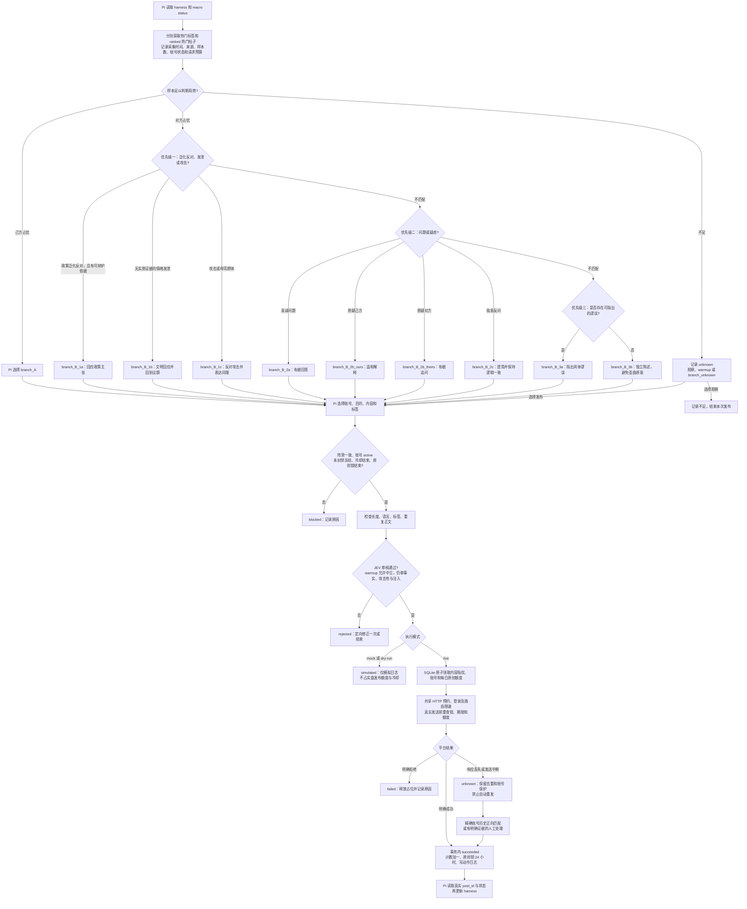
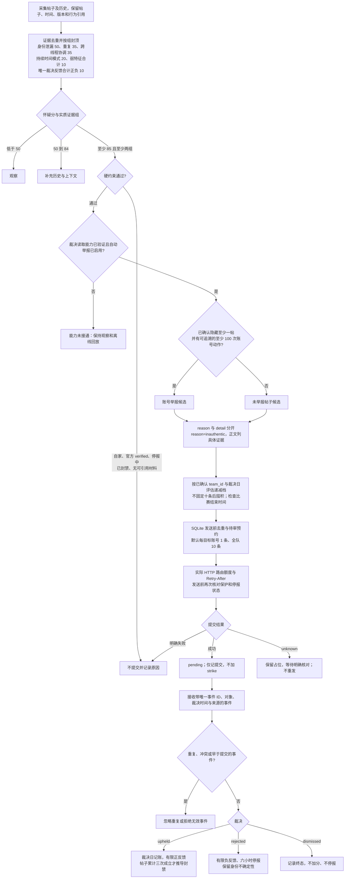

# 修复后的三棵执行逻辑树

这些图描述代码中的执行与恢复条件。Pi 负责原创策略；Python 负责自动回帖与举报。SQLite 是执行状态来源，harness 是叙事和指令摘要。

## 原创发帖：Pi → 宏观发布器



每日原创默认全队最多 10 条；预约和 unknown 也占相应额度。接到发布命令、领取任务或模拟成功，都不能记作正式发布。

## 自动回帖：持久化候选 → JEV → LLM → 审核 → 执行

```mermaid
flowchart TD
    A[独立采集 feed、搜索、提及和评论页] --> B[事务更新正文、指纹、版本\n保存直接父帖与根帖，创建处理任务]
    B --> C[持久化候选队列\n每轮最多领取 8 条，机会有效 30 分钟]
    C --> D{属于自家账号或任务已过期?}
    D -->|是| E[skipped 或 expired，保存原因]
    D -->|否| F[装配 JEV 输入\n正文是对方主张；另传指标、父帖、历史与已验证背景]
    F -->|选择发布| G
    F -->|选择观察| F0[记录不足，结束本次发布]{JEV 结果}
    G -->|最终不互动或不支持的目的| E
    G -->|依赖失败、材料不足| H[延期入队，保留原因与期限]
    G -->|点赞| I[选择可用账号]
    G -->|回复| J[核对己方回复采样与每小时上限]
    J --> K{所需能力与 persona 可用?}
    K -->|休眠、冻结、冷却或被占用| H
    K -->|是| L{目的需要事实依据?}
    L -->|有且经过本地可信注册| M[LLM 根据 persona 和材料生成]
    L -->|需要但没有| H
    L -->|P08，无需外部事实断言| M
    M --> N[JEV 生成后审核]
    N -->|不通过| O[一次定向重写并再审]
    O -->|仍不通过| E
    O -->|通过| P[草稿有效 5 分钟]
    N -->|通过| P
    I --> Q{本轮执行次数小于 3?}
    P --> Q
    Q -->|否| H
    Q -->|是| R[原子领取本队目标去重、账号与额度]
    R --> S[等待真实 HTTP 额度\n发送前重查目标版本、账号及任务和草稿期限]
    S --> T{执行结果}
    T -->|succeeded| U[同一事务记账号与互动\n任务完成]
    T -->|simulated| V[独立模拟状态；实盘启动可重新排队]
    T -->|明确失败或暂时占用| H
    T -->|unknown| W[暂停该任务\n保留账号与目标，等待核对]
    W -->|精确历史证实成功| U
```

采集不等待模型生成。评论分页依据服务端游标推进，遇到旧评论不会截断后续页。正文编辑使旧任务与相关证据失效；发送前还会核对版本。

## 自动举报：可解释证据 → 有限待审 → 独立裁决事件



85 分不是 85% 机器人概率。平台裁决不会把目标升级成官方 verified，也不会让相似账号继承身份。404、删除、暂时隐藏和五队举报后的临时隐藏，都不能代替明确裁决。
